# Manual de usuario

La **Base de Empresas** es el registro maestro de empresas de Equipos, con el RUT como clave. De ahí salen las muestras de los estudios a empresas, se genera la lista para uContact y vuelven los resultados del campo (las llamadas del CDR y el .sav de Alchemer) para que la base aprenda en cada estudio: qué números no corresponden, cuáles son de estudios contables, quién atendió y cuándo se contactó a cada empresa.

Este manual sigue el circuito de un estudio y está organizado por rol. Las capturas usan datos ficticios de demostración.

## Roles

Cada persona entra con su email de Equipos y ve el menú de su rol. El sistema valida los permisos en el servidor: si una acción no está permitida para tu rol, el botón no aparece o el sistema avisa.

| Rol | Qué hace | Pantallas principales |
| --- | --- | --- |
| **Data steward** | Carga bases, resuelve intermediarios y coincidencias, corrige datos y fusiona empresas | Cargas, Intermediarios, Revisión de fusiones, Empresas |
| **Jefe/a de proyecto** | Crea estudios y partes, sortea muestras, libera reemplazos | Estudios y muestras, Actividad |
| **Coordinador/a de campo** | Exporta el CSV para uContact, ingiere el .sav, concilia y controla el campo | Estudios y muestras, Ingesta .sav, Conciliación, Actividad |
| **Administrador/a** | Configuración, naturalezas jurídicas, no llamar, usuarios y auditoría. Puede hacer todo lo de los demás roles | Administración |
| **Lectura** | Consulta, sin acciones. No ve los datos personales de los contactos | Inicio, Empresas, Estudios, Actividad |

## El circuito de un estudio

1. **Data steward:** mantiene la base al día (cargas, intermediarios, revisión).
2. **Jefe de proyecto:** crea el estudio con sus partes y sortea la muestra.
3. **Coordinador:** descarga el CSV de cada parte y lo carga en uContact.
4. **Campo:** los encuestadores llaman (campaña o marcador manual) y completan la encuesta de Alchemer, incluidas las preguntas del bloque estándar.
5. **Cada noche (automático):** el CDR de uContact llega al sistema y registra los intentos de llamada.
6. **Coordinador:** al cerrar una parte u ola, sube el .sav y confirma el mapeo. La base se actualiza sola: calidad de cada número, teléfonos alternativos, contactos y fecha del último contacto efectivo.
7. **Jefe de proyecto:** mira el avance por estrato y libera reemplazos si hace falta.

## Ingreso y pantalla de inicio

### Tu primer ingreso

Cuando un administrador te da de alta, te llega un correo de **notificaciones@equipos.com.uy** con el asunto "Tu acceso a la Base de Empresas de Equipos". Tocá el enlace del correo, elegí tu contraseña y después entrá a la dirección de la aplicación con tu email y esa contraseña. Nadie más conoce tu contraseña: ni siquiera el administrador que te dio de alta.

- **El enlace vence en una hora.** Si venció, escribí tu email en la pantalla de ingreso y tocá **¿Olvidaste tu contraseña?**, o pedile a un administrador que te **reenvíe el acceso**.
- Si no ves el correo, buscalo en la carpeta de spam.

### Ingresar

Entrá con tu email y tu contraseña. Si la olvidaste, escribí tu email y tocá **¿Olvidaste tu contraseña?**: te llega un correo para elegir una nueva.

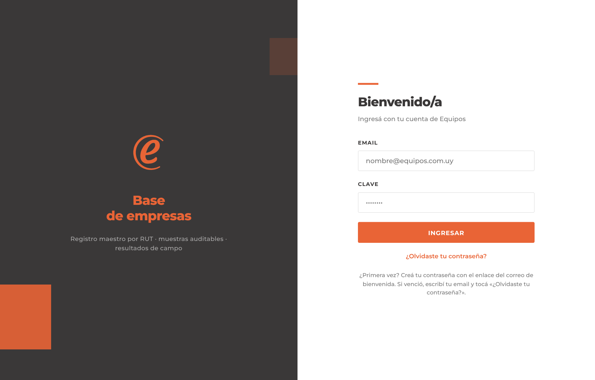

Si no podés entrar, la pantalla te dice por qué:

| Mensaje | Qué hacer |
| --- | --- |
| "Email o clave incorrectos" | Revisá lo que escribiste. Si es tu primer ingreso, primero creá tu contraseña con el enlace del correo de bienvenida |
| "… no tiene acceso a la Base de Empresas" | Todavía no te dieron de alta: pedíselo a un administrador |
| "Tu acceso está desactivado" | Un administrador te desactivó: pedile que te reactive |
| "Tu email no está verificado" | Pedile a un administrador que te reenvíe el acceso |
| "Demasiados intentos fallidos" | Esperá unos minutos o restablecé tu contraseña |
| "No se pudo conectar…" | Revisá tu conexión a internet y probá de nuevo |

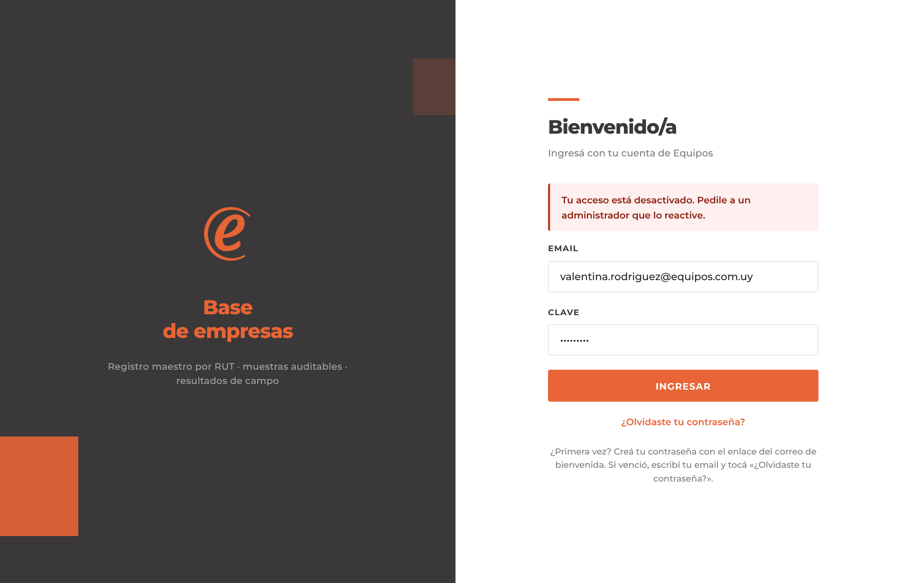

La pantalla de **Inicio** resume el estado de la base (empresas activas, disponibles para muestra, con teléfono discable, muestras activas, intermediarios confirmados y llamadas de los últimos 7 días) y las **bandejas pendientes** de tu rol. Los números naranjas del menú indican cuántos pendientes hay en cada bandeja.

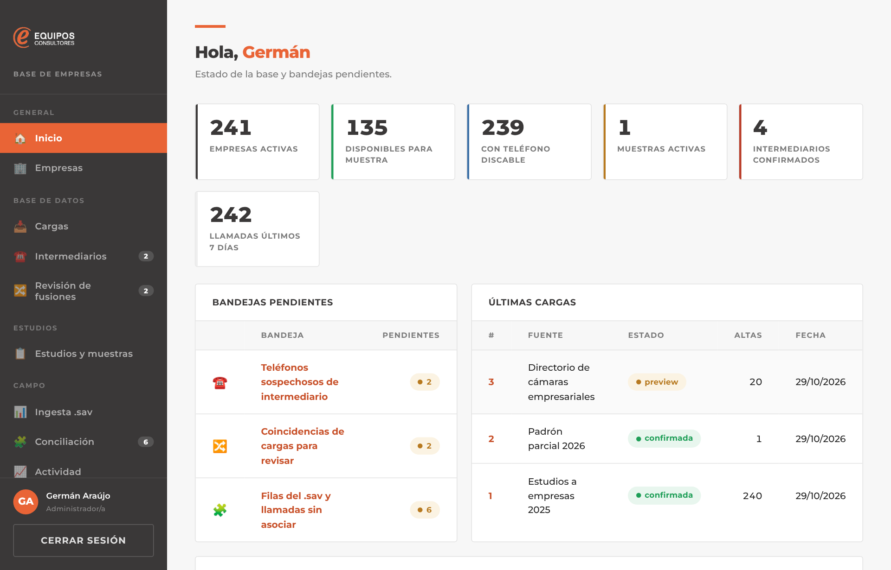

Abajo, la pantalla muestra la **última corrida del job del CDR** y su estado. Si la última corrida programada falló, o si pasaron 26 horas sin ninguna corrida, administradores y coordinadores ven un aviso arriba de todo con el motivo; el administrador tiene un enlace directo a Configuración para resolverlo.

## Empresas

### Buscar

En **Empresas** buscás por RUT (con o sin puntos) o por razón social o nombre de fantasía, y filtrás por departamento, tamaño, naturaleza jurídica y disponibilidad. La columna **Disponibilidad** dice si la empresa puede salir en una muestra y, si no, qué regla la bloquea.

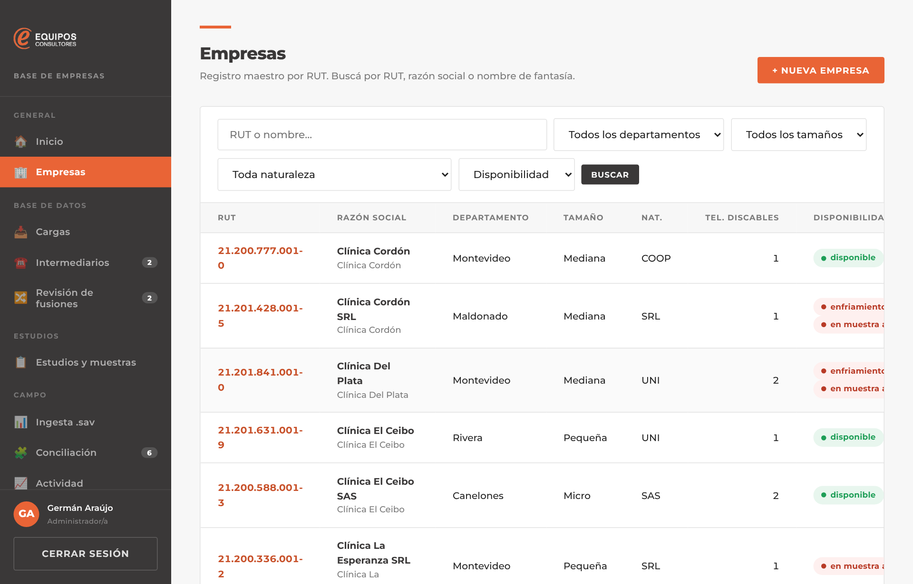

Las reglas que bloquean a una empresa son:

| Regla | Significa | Hasta cuándo |
| --- | --- | --- |
| Naturaleza excluida | Su naturaleza jurídica está marcada como excluida de contacto | Mientras siga excluida |
| No llamar | Hay un pedido de no llamar para la empresa | Hasta que un administrador lo levante |
| Enfriamiento | Tuvo un contacto efectivo hace menos de los meses configurados | La fecha se muestra en la ficha |
| En muestra activa | Está en una muestra activa (titular o reemplazo) | Hasta que se cierre la muestra |
| Sin teléfono discable | No tiene ningún número que se pueda llamar | Hasta que se agregue o libere un teléfono |
| Empresa cerrada | La sala o una fuente informó que cerró | Hasta que un dato más confiable diga otra cosa |

### La ficha de la empresa

Tocá el RUT para abrir la ficha. Arriba ves la razón social, el RUT, el estado y si está disponible; debajo, cuántos teléfonos discables y contactos tiene, en cuántas muestras estuvo y su último contacto efectivo.

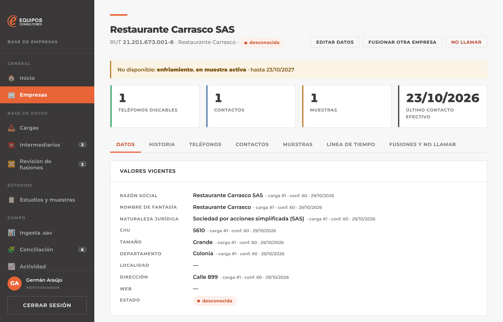

La pestaña **Datos** muestra el valor vigente de cada campo y de dónde salió: fuente (carga, sala, manual…), número de lote, confianza y fecha.

La pestaña **Historia** muestra todos los valores que llegó a tener cada campo. El vigente está resaltado en naranja; los tachados son de cargas o fusiones que se deshicieron. Así se resuelve "de dónde salió este dato".

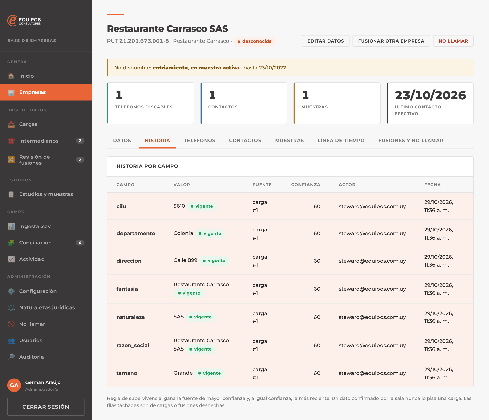

> **Cómo se elige el valor vigente.** Gana la fuente de mayor confianza y, a igual confianza, la más reciente. Un dato confirmado por la sala (por ejemplo, "la empresa cerró") nunca lo pisa una carga. Una corrección manual del data steward sí puede corregirlo.

La pestaña **Teléfonos** lista cada número con el estado de su vínculo con esta empresa (sin verificar, verificado, no corresponde, intermediario, inexistente), si es discable, alertas (intermediario, no llamar), cuántos RUTs comparten el número, cuántas veces se llamó y cuándo fue el último intento. El data steward puede cambiar el estado del vínculo o agregar un teléfono.

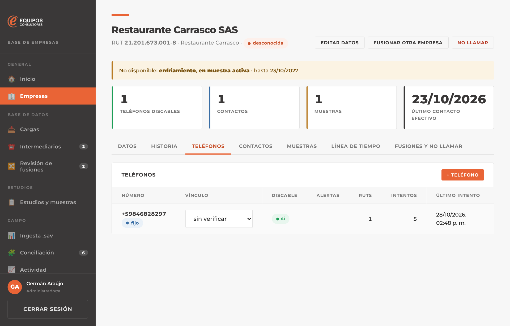

La pestaña **Línea de tiempo** junta todo lo que pasó con la empresa, del más reciente al más viejo: llamadas del CDR (con disposición, duración y encuestador), resultados de cada parte, cambios de datos, cambios de estado de teléfonos, muestras en las que salió y pedidos de no llamar.

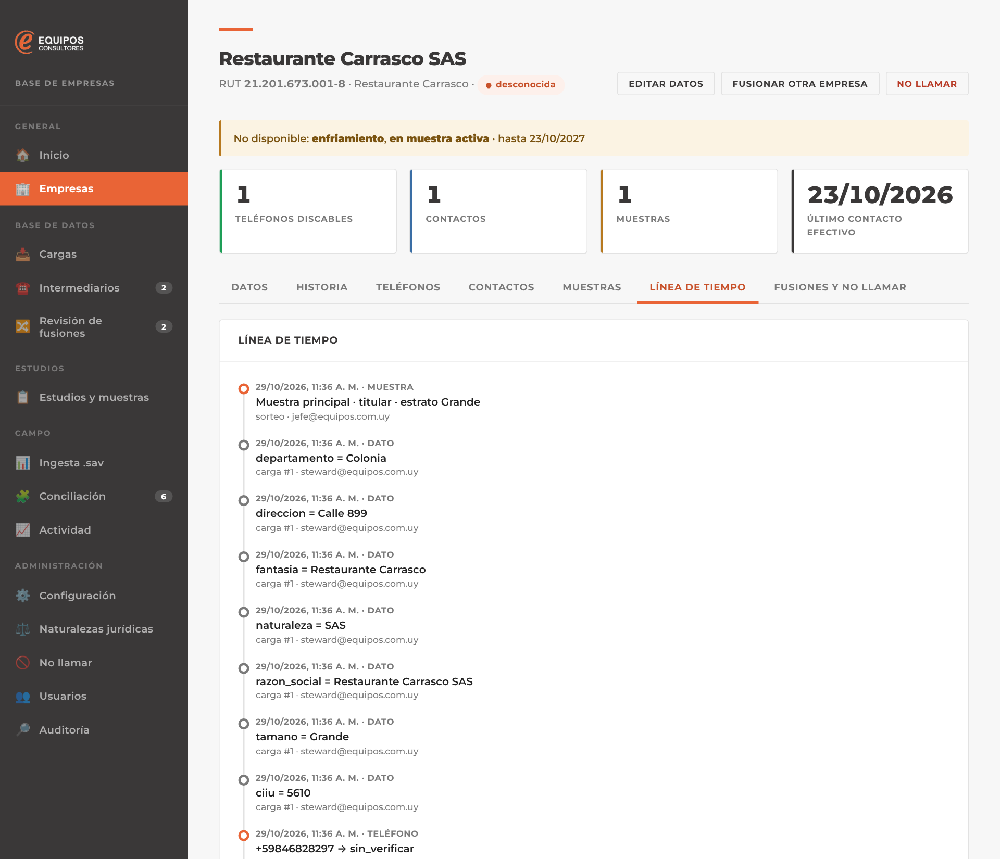

Lo que trajo cada ingesta del .sav aparece agrupado en una línea desplegable: «Ingesta .sav #12 (Estudio, Parte): 1 contacto nuevo, 1 teléfono verificado, ítem completo». Al abrirla se ven sus eventos. La línea de tiempo también muestra las altas y ediciones de contactos y «se habló con … al …».

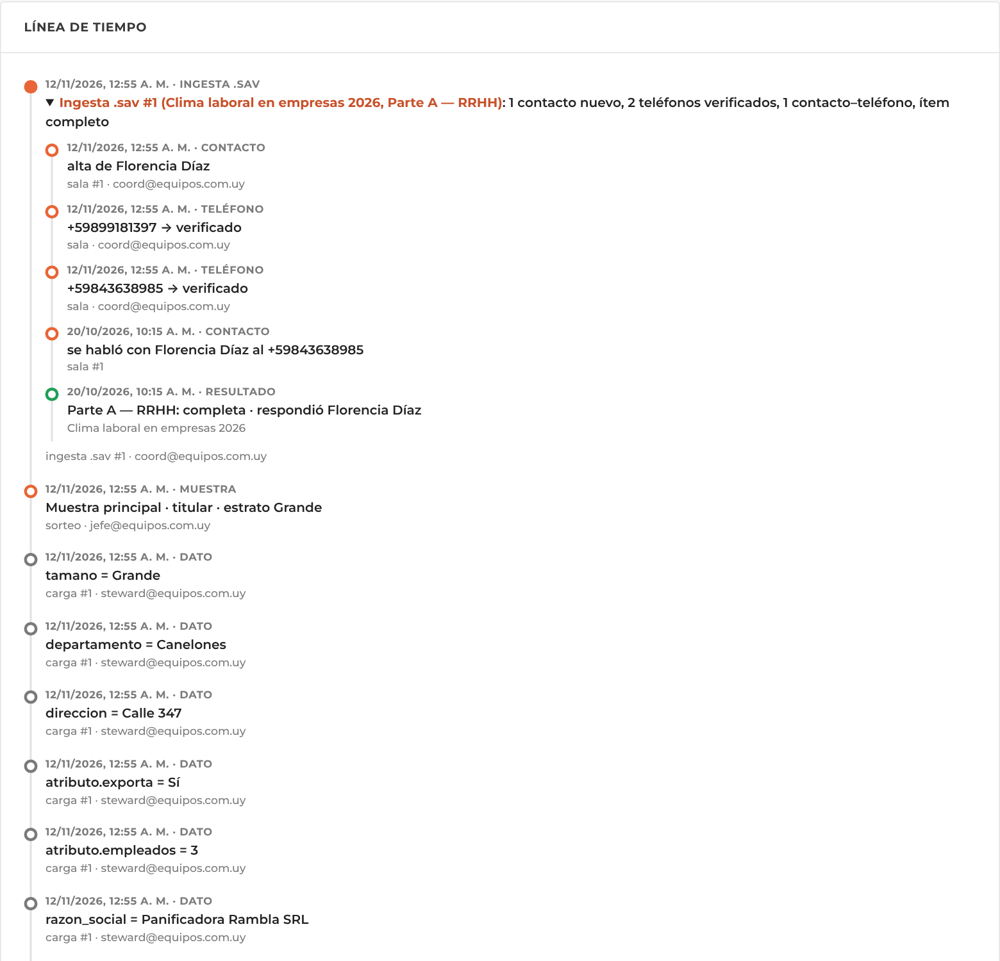

Las pestañas **Contactos**, **Muestras** y **Fusiones y no llamar** completan la ficha. La pestaña **Contactos** muestra, por contacto, sus **teléfonos** («se habló el 22/10/2026 (Estudio, Parte)» o «número del contacto») y sus **atributos**. Los contactos son datos personales (Ley 18.331): el rol Lectura los ve ocultos. La pestaña **Muestras** incluye los ítems de las empresas que esta absorbió en una fusión.

### Buscar por EC_ID_ITEM y por código provisorio

En el buscador de **Empresas**, `#1234` o `item:1234` busca el ítem de muestra 1234 (el `EC_ID_ITEM` que figura en Alchemer) y abre la ficha de su empresa en la pestaña **Muestras**, con esa fila resaltada. Un número sin `#` sigue buscando por RUT. Un código `P-000123` abre una empresa de la base provisoria. El filtro **Base** elige entre la base definitiva (por defecto), la provisoria o ambas.

### Acciones del data steward en la ficha

- **Contactos:** **+ Agregar contacto**, **Editar** y **Borrar** (ver «Contactos» más abajo).
- **Editar datos:** corrige campos con fuente "manual". Se registran solo los campos que cambiás; indicá el motivo.
- **Fusionar otra empresa:** cuando dos RUTs son la misma empresa, escribí el RUT de la que se absorbe. Sus teléfonos, contactos y sucursales pasan a esta; la absorbida queda guardada como "fusionada" y la fusión se puede **deshacer** desde la pestaña Fusiones.
- **No llamar** (también administrador): registra un pedido de no llamar con motivo y quién lo pidió. Se respeta en todas las muestras y CSV desde ese momento.

## Data steward

### Cargar una base

Las bases (estudios anteriores, padrones, directorios) entran por **Cargas → Nueva carga**. Se aceptan .xlsx, .csv y .sav de hasta 30 MB. Nada se escribe en la base hasta que confirmes.

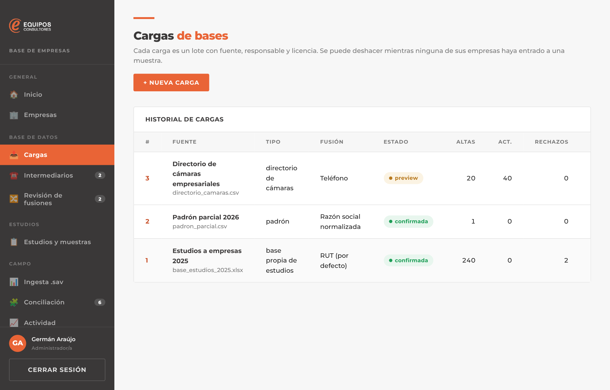

**Paso 1 — Archivo.** Arrastrá el archivo e indicá el **tipo de fuente** (por ejemplo, "padrón DGI" o "directorio de cámaras"). El mapeo de columnas se guarda como plantilla de ese tipo y se reusa la próxima vez.

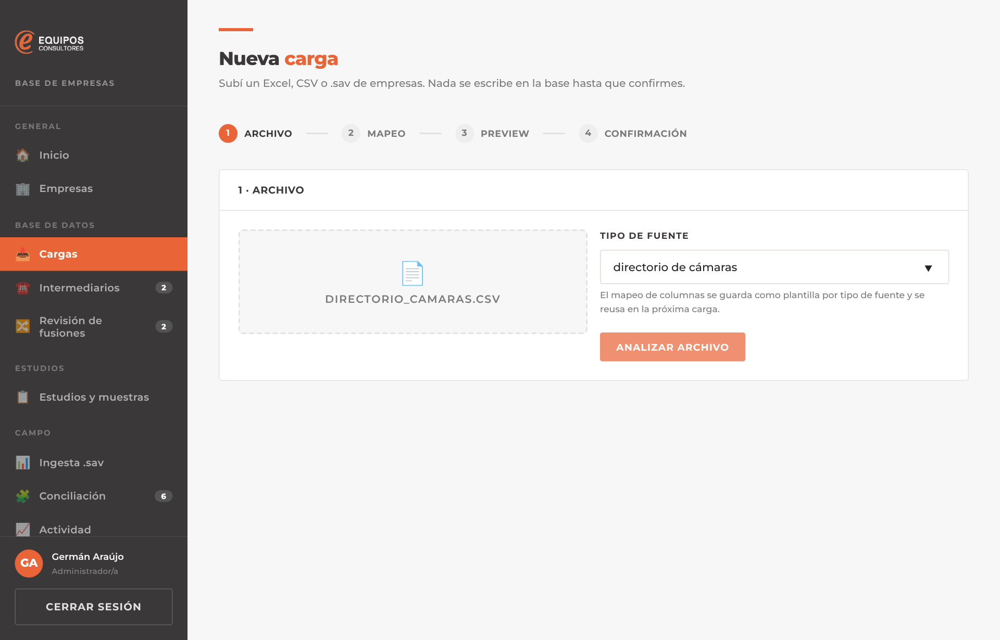

**Paso 2 — Mapeo.** El sistema muestra solo los campos que reconoció en el archivo (por el nombre de la columna, por los sinónimos de los atributos o por la plantilla del tipo de fuente), en cuatro bloques. **Todo es opcional salvo el RUT.**

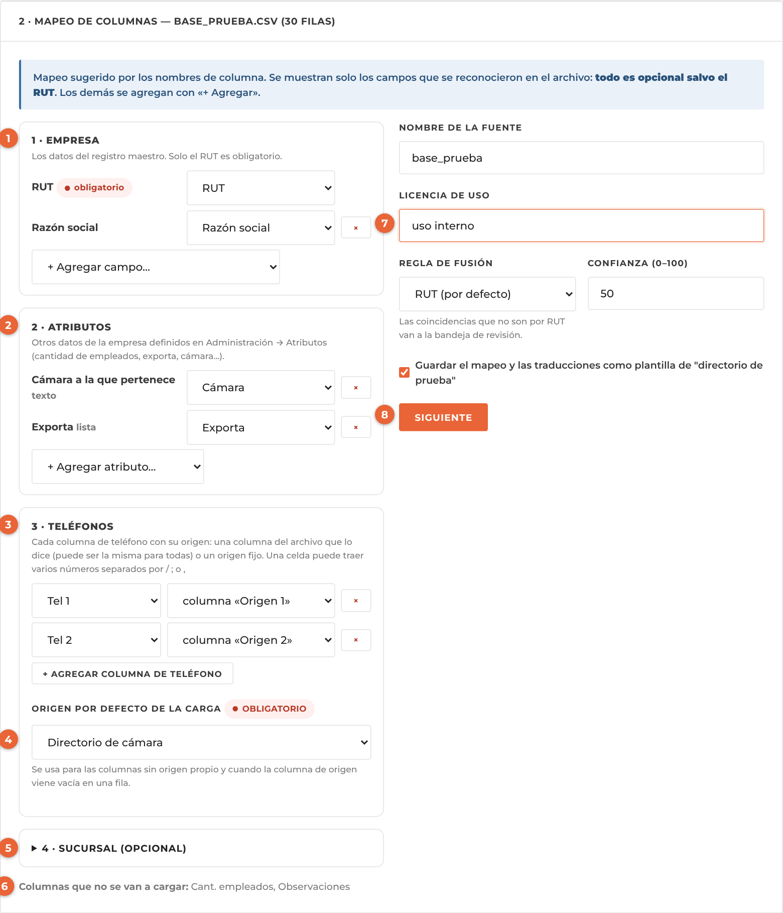

1. **Empresa:** los campos del sistema. «+ Agregar campo» suma otro y la × lo quita; un campo sin columna no se guarda.
2. **Atributos:** otros datos de la empresa definidos en **Administración → Atributos** (cantidad de empleados, exporta, cámara…).
3. **Teléfonos:** cada columna de teléfono con su **origen**: una columna del archivo que lo dice («Origen 1» para «Tel 1», o una sola para todas) o un origen fijo. El sistema sugiere el emparejamiento por nombre.
4. **Origen por defecto** (obligatorio): para las columnas sin origen propio y cuando la columna de origen viene vacía.
5. **Sucursal** (plegado): un local con dirección distinta de la fiscal.
6. **Columnas que no se van a cargar:** revisá que no quede afuera nada que importe.
7. **Contacto** (plegado): un contacto por fila, con nombre, cargo, área, email, teléfono del contacto y atributos de contacto. Si el contacto ya existe en la empresa (mismo nombre o email), se completan sus campos vacíos. Su teléfono se vincula a la empresa con el origen por defecto. Una fila con datos de contacto pero sin nombre se ignora y se avisa.
8. Licencia de uso (obligatoria), **destino**, **reglas de fusión** y confianza (ver «Base provisoria» y «Reglas de fusión»). 9. **Siguiente.**

> **Atributos parecidos.** Si una columna no se reconoce pero se parece a un atributo que ya existe («Cant. Empleados» y **Cantidad de empleados**), arriba del mapeo aparece «se parece a … (82 %)». **Usar ese atributo** la mapea a ese atributo y suma el nombre de la columna como sinónimo: la próxima base se reconoce sola. **No** la deja como está.

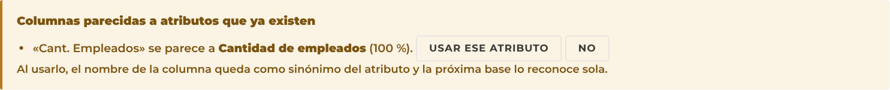

**Paso 2b — Traducción de valores.** Los valores de lista se comparan sin mayúsculas, tildes ni espacios: «SI», «si» y «Sí » se cargan como «Sí» sin pedir nada. Si la columna de origen o un atributo de lista trae valores que no coinciden con el catálogo («guia», «GUIA TEL.», «Exportadora» frente a «Exportador»), cada valor distinto aparece con cuántas filas tiene. Elegí un valor del catálogo, «Sin dato» o (administrador) «+ Crear uno nuevo». Las sugerencias no se aplican solas: «Usar sugerencias» las confirma. La traducción queda en la plantilla del tipo de fuente.

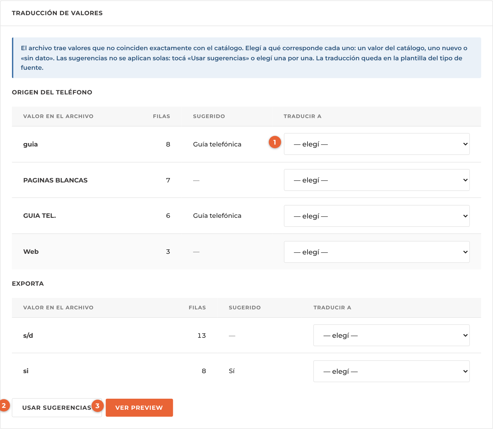

**Paso 3 — Preview.** El sistema procesa el archivo completo sin guardar nada y muestra los conteos reales: altas, actualizaciones, sin cambios, conflictos, rechazos, filas a revisión, nuevos sospechosos y teléfonos nuevos; además, **filas sin teléfono, con 1, 2 y 3 o más**, **teléfonos por origen** (nuevos y ya existentes) y **atributos** cargados, inválidos y sin dato. Las filas sin teléfono no se rechazan: la empresa queda no disponible por «sin teléfono discable». Un número o una fecha que no se puede interpretar queda como vino y se cuenta como inválido.

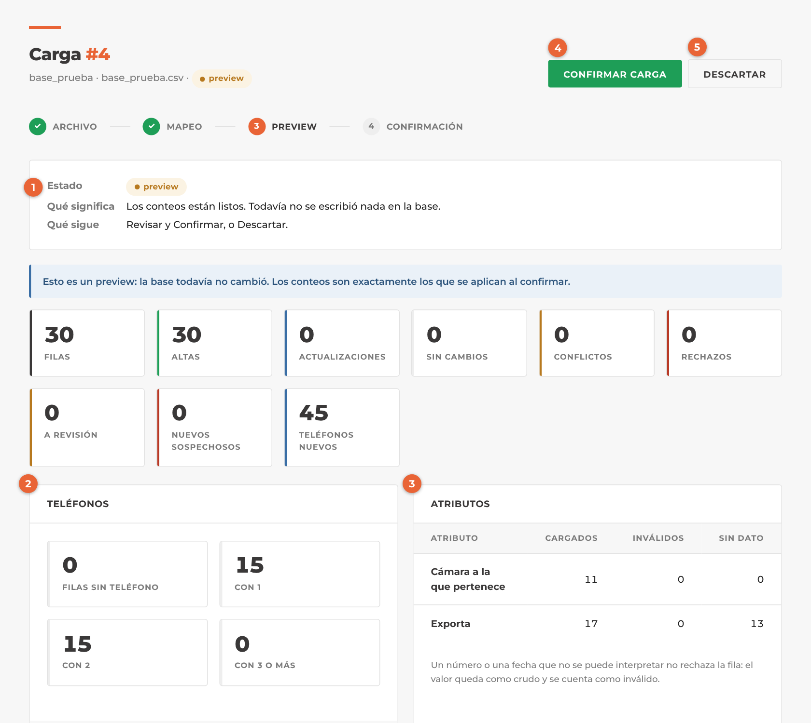

**Paso 4 — Confirmar o descartar.** **Confirmar carga** aplica exactamente lo que mostró el preview. **Descartar** la deja «descartada»: no se aplica y queda como registro. Cada estado explica qué significa y qué sigue:

| Estado | Qué significa | Qué sigue |
| --- | --- | --- |
| Analizando | Se lee el archivo y se calcula el preview | Esperar |
| Preview | Conteos listos; todavía no se escribió nada | Confirmar o Descartar |
| En proceso | Se está aplicando a la base | Esperar |
| Confirmada | Aplicada a la base | Se puede Deshacer mientras ninguna empresa haya entrado a una muestra |
| Descartada | Se revisó y no se aplicó | Nada |
| Deshecha | Se aplicó y después se anuló; la historia queda tachada | Nada |
| Error | Falló el análisis o la aplicación | Corregir y hacer una carga nueva |
| Interrumpida | Se cortó a mitad de camino; lo de los lotes terminados quedó | Reanudar, Deshacer o Borrar |
| Deshaciendo | Se está deshaciendo, por pasos | Esperar |
| Borrando | Se está borrando, por pasos | Esperar; si se cortó, volver a tocar Borrar carga |

> **Deshacer una carga.** Desde el detalle de una carga confirmada (o interrumpida), **Deshacer carga** anula todo lo que trajo (valores, atributos, vínculos y el origen que sumó a teléfonos que ya existían), mientras ninguna de sus empresas haya entrado a una muestra. La historia no se borra: queda tachada. Deshacer corre por pasos, con una barra de avance; en una carga grande puede tardar varios minutos.
>
> **Borrar una carga (administrador).** Si la carga no se puede deshacer (porque sus empresas ya están en una muestra) o se quiere eliminar del todo, **Borrar carga** la elimina con su archivo: las empresas que solo venían de esa carga se borran por completo, incluido su lugar en las muestras y su actividad de campo, y las demás se recalculan sin lo que aportó. Se confirma escribiendo BORRAR y no se puede deshacer. De la misma forma, **Borrar empresa** en la ficha elimina una empresa (se confirma escribiendo su RUT). Ambos quedan en Auditoría.
>
> **Borrar una carga en cualquier estado.** **Borrar carga** funciona en cualquier estado, también con la carga corriendo: el modal dice qué tarea se cancela; el lote en curso se revierte y lo que aplicaron los lotes anteriores se borra igual. El borrado también corre por pasos (la carga queda «borrando»); si se corta, volver a tocar **Borrar carga** lo retoma desde donde quedó.

En una carga a la **base definitiva**, las filas con RUT inválido o sin RUT se rechazan (el motivo queda en el detalle de la carga), salvo que marques **Enviar las filas sin RUT válido a la base provisoria**. Deshacer o borrar una carga quita también los contactos que trajo.

### Cargas grandes

Una carga se procesa **por lotes** de 5.000 filas (se cambia en Configuración → Cargas grandes). Cada lote es independiente: si algo se corta, lo que hicieron los lotes terminados queda y no hay que empezar de nuevo. Así se pueden cargar bases de cientos de miles de empresas.

- **El ritmo.** Cada lote se procesa por tandas de 500 filas, y la barra avanza de a 500. La meta es al menos 100 filas por segundo: una base de 190.000 filas, unos 30 a 40 minutos por operación.
- **El avance.** Mientras se calcula el preview o se aplica la carga, la barra dice en qué lote va: «Lote 12 de 38 · 60.000 de 190.000 filas». El detalle muestra también «N de M lotes aplicados (X filas)» y cuánto tardó el lote más lento. En una carga de más de 20.000 filas, la pantalla se actualiza cada 5 segundos.
- **El mismo RUT, en el mismo lote.** Las filas con el mismo RUT van siempre juntas, aunque estén lejos en el archivo: cuentan una sola alta. Las filas sin RUT van al final; si son muchas, el preview avisa que sus conteos son **aproximados** (dos filas sin RUT del mismo archivo podrían coincidir entre sí).
- **Cuánto va a tardar.** Después del preview, el detalle dice cuánto tardó: la confirmación suele tardar algo parecido.
- **Se puede seguir trabajando.** Mientras corre una carga grande, el resto de la aplicación se sigue usando: entre lote y lote la base tiene un respiro.
- **Un archivo grande se lee en segundo plano.** Si el archivo tiene más de 20.000 filas (o pesa más de 10 MB), al tocar **Analizar archivo** aparece «Leyendo el archivo… N filas»; cuando termina, sigue el mapeo como siempre. El archivo se lee una sola vez: revisar los valores y crear la carga ya no lo vuelven a leer.
- **«Siguiente» siempre muestra qué hace.** Mientras revisa los valores a traducir dice «Revisando los valores…», y al crear la carga la barra muestra enseguida «Creando la carga…», después «Preparando los lotes…» y después «Calculando el preview… Lote N de M».
- **Sin cargas repetidas.** Tocar «Siguiente» dos veces crea una sola carga. Si ya se está creando una carga de ese archivo, la pantalla ofrece **Ir a la carga #N** en lugar de crear otra.
- **Si algo se corta, sigue sola.** Si el servidor se reinicia o se despliega una versión nueva mientras corre una carga, el lote en curso se vuelve a hacer y la carga sigue sola, sin repetir lo ya aplicado: no hace falta tocar nada. Mientras corre un lote, la barra dice en qué fila va y cuánto lleva («Lote 1 de 40 · fila 2.300 de 4.812 · 1 min 40 s»). Si un lote pasa de 10 minutos aparece un aviso: si no avanza en 3 minutos, el sistema lo retoma solo.
- **Una carga grande a la vez.** Si confirmás, deshacés o borrás una carga mientras otra está corriendo, la segunda queda **en cola** con el aviso «Esperando a que termine la carga #N» y arranca sola cuando termina la primera.

**Si una carga queda «interrumpida».** Pasa si un lote falla, si se cancela, o si la tarea no avanza durante 10 minutos, se retoma sola y se vuelve a cortar. El detalle dice cuántos lotes se aplicaron y el error del lote que falló. Tres opciones:

| Acción | Qué hace |
| --- | --- |
| **Reanudar** | Sigue desde el primer lote que no se aplicó. No repite lo ya aplicado: el resultado es el mismo que si no se hubiera cortado |
| **Deshacer carga** | Quita lo que aplicaron los lotes terminados; la base queda como antes de la carga |
| **Borrar carga** | Elimina la carga, su archivo y lo que aplicó (administrador) |

Si se interrumpió mientras se calculaba el preview, todavía no se aplicó nada: **Reanudar** sigue calculándolo y **Descartar** la descarta.

### Base provisoria

La **base provisoria** guarda las empresas que **no traen RUT** (un directorio, un relevamiento web). Se carga, se consulta y se depura por separado, y sus empresas se pueden sortear y llamar. Cada una tiene un código **`P-000123`** que sirve en la ficha, el buscador, la exportación y el .sav.

- **Cargar:** en el paso 2 de la carga, **Destino → Base provisoria** (la columna RUT pasa a ser opcional). Una fila con RUT válido va igual a la base definitiva (se puede desmarcar). Si la fila traía otro identificador (una cédula, un «RUT» de 7 dígitos), queda en el atributo **Identificador informado**.
- **Pantalla Base provisoria** (menú Base de datos): código, razón social, teléfonos, carga, muestras y **candidatas en la definitiva** (mismo teléfono, razón social o dirección parecidas, mismo dominio, o el RUT que trajo el .sav). Por empresa: **Agregar RUT** (si es nuevo, pasa a la definitiva; si ya existe, ofrece fusionar), **Fusionar con…** (una candidata o una empresa que busques) y **Es otra empresa** (descarta las candidatas).
- **Completar RUT con un archivo** `codigo_provisorio;rut`: primero muestra qué pasaría con cada fila y después aplica.
- **Inicio** cuenta la base provisoria aparte; **Empresas activas** sigue contando solo la definitiva.
- Al fusionar una provisoria con una empresa de la definitiva, sus teléfonos, contactos, atributos e historia pasan a esa empresa, y sus ítems de muestra y llamadas se ven desde ella. La fusión se puede deshacer.

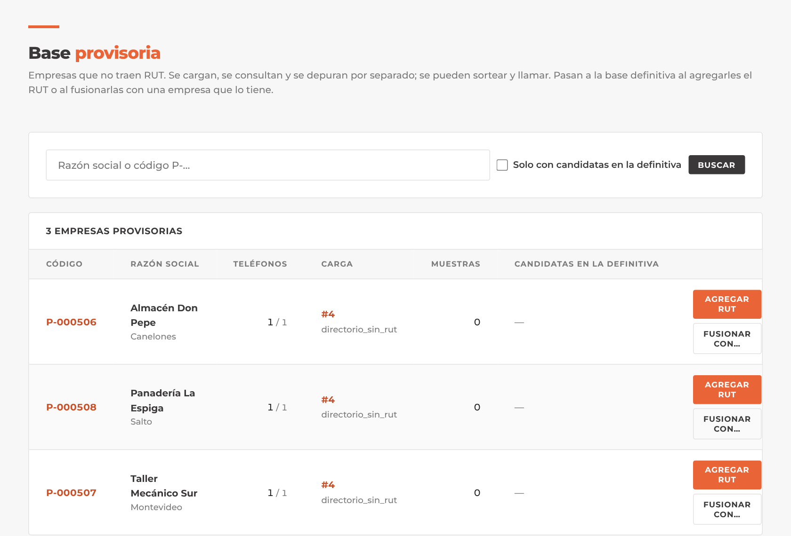

### Reglas de fusión

Cada carga tiene una **lista ordenada de reglas** para reconocer una empresa que ya está en la base (en las dos bases). El RUT va siempre primero. Cada regla tiene un criterio (razón social, teléfono, dominio web, dirección con departamento, email de contacto) y un tipo:

- **Exacta:** coincide después de normalizar (sin tildes, mayúsculas, puntuación ni «S.A.», «SRL»). Con una sola candidata se fusiona sola.
- **Flexible:** la similitud es igual o mayor que el umbral (0,85 por defecto). **Siempre se consulta.**

Una coincidencia que uniría dos RUT válidos distintos, o una exacta con varias candidatas, también se consulta. Las reglas y el destino quedan en la plantilla del tipo de fuente.

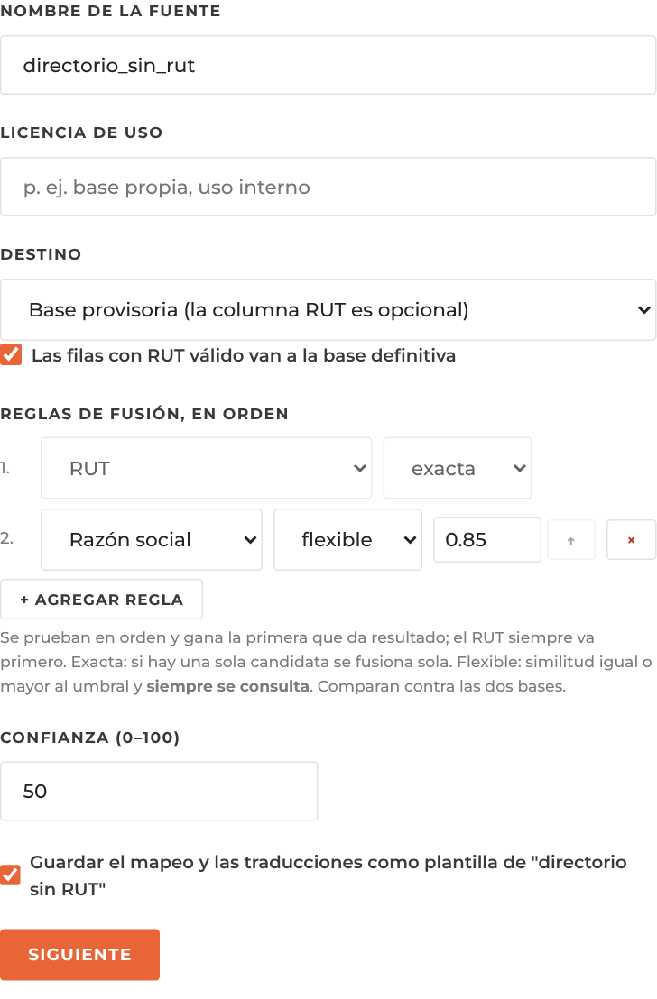

**Coincidencias a decidir.** En el preview, cada fila consultada aparece al lado de su candidata, con la regla y la similitud. Elegí **Fusionar**, **Es otra empresa** o **Decidir después** (o usá «Fusionar todas las de similitud ≥ 95 %»). Al confirmar se usan esas decisiones; lo que queda en «Decidir después» va a **Revisión de fusiones**. Deshacer la carga revierte también lo que se fusionó en ella.

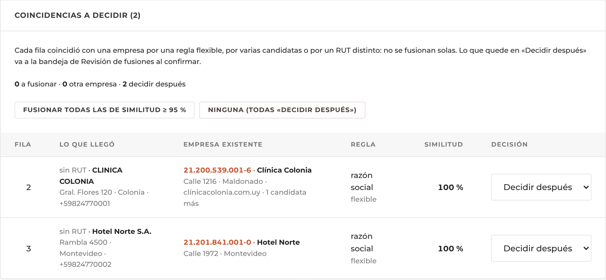

### Contactos

En la pestaña **Contactos** de la ficha, el data steward y el administrador pueden **+ Agregar contacto**, **Editar** y **Borrar**:

- Nombre (obligatorio), cargo, área, email (se valida el formato), sucursal, teléfonos (de la empresa o uno nuevo, que se vincula como manual) y atributos de contacto.
- Si ya hay un contacto con ese nombre en la empresa, el sistema avisa y ofrece **editar el existente** o agregar otro igual.
- Cada cambio queda en la línea de tiempo con el usuario.
- **Borrar** es definitivo (dato personal): se van el contacto, su historia, sus teléfonos de contacto, sus atributos y su «no llamar». En Auditoría queda el borrado con el RUT, sin el nombre.

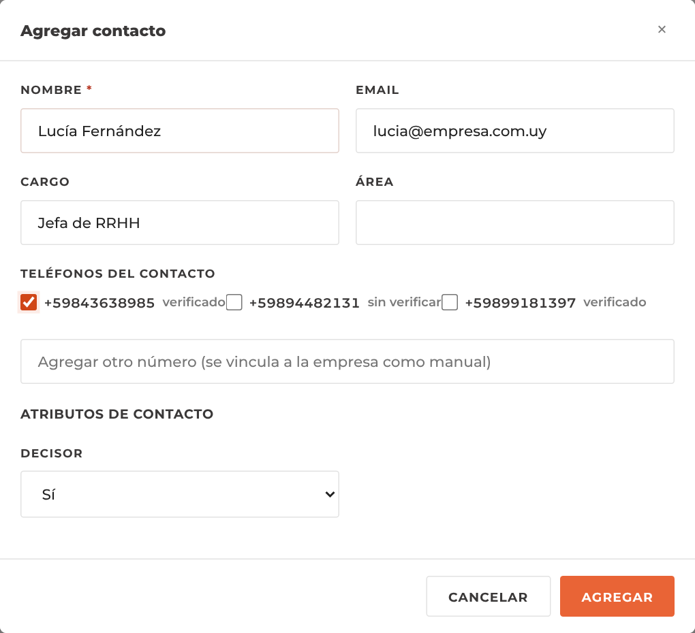

### Intermediarios

Un teléfono vinculado a 5 RUTs o más (el umbral se configura) queda **sospechoso de intermediario**: normalmente es el número de un estudio contable o jurídico que figura en muchas empresas. Mientras esté sospechoso no sale en ningún CSV.

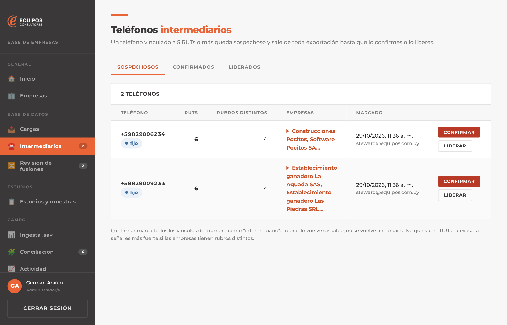

Para cada sospechoso ves cuántos RUTs lo comparten, de cuántos rubros distintos son (muchos rubros es una señal fuerte) y la lista de empresas. Entonces:

- **Confirmar:** marca todos sus vínculos como intermediario. No se vuelve a llamar.
- **Liberar:** si es un número legítimo (por ejemplo, la central de un grupo económico). Vuelve a ser discable y no se marca de nuevo salvo que aparezcan RUTs nuevos con ese número.

La sala también confirma intermediarios: cuando el encuestador responde "estudio contable o jurídico" en la pregunta de calidad del número.

### Revisión de fusiones

Las filas de una carga que coinciden con una empresa existente pero no se fusionan solas esperan acá: las de una regla flexible, las de una exacta con varias candidatas, las que unirían dos RUT distintos y las que quedaron en «Decidir después». Cada una muestra el criterio y la similitud.

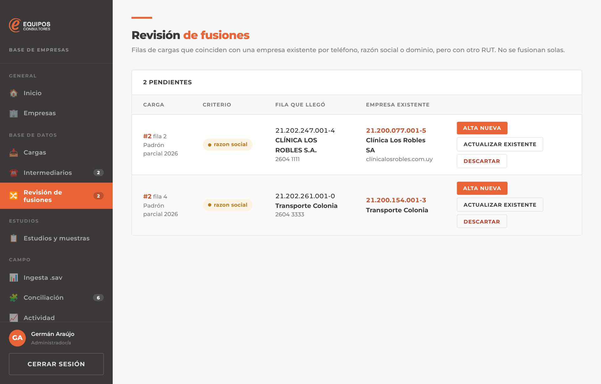

Comparás la fila que llegó con la empresa existente y elegís: **Alta nueva** (es otra empresa: se crea con su RUT, o en la base provisoria si no trae RUT), **Actualizar existente** (los datos se aplican a la empresa que ya estaba) o **Descartar**.

### Calidad de la base

**Administración → Calidad de la base** (data steward, jefes y administrador) tiene una tarjeta por dimensión, con su meta, su estado (**cumple**, **cerca** o **no cumple**) y la evolución de los últimos meses. Cada indicador tiene **Ver la lista**: las empresas, teléfonos o pares que lo incumplen, con enlace a cada ficha. Es la lista de trabajo de la semana.

| Dimensión | Qué mide | Meta |
| --- | --- | --- |
| Validez | RUT con dígito verificador correcto; teléfonos en formato uruguayo válido | 100 % |
| Unicidad | Una empresa por RUT, un teléfono por número y los posibles duplicados sin resolver | 100 % y 0 pendientes |
| Completitud | Empresas disponibles con al menos 1 teléfono discable, CIIU y departamento | ≥ 90 % |
| Exactitud | Teléfonos verificados por la sala sobre el total de discables | Que suba cada trimestre |
| Actualidad | Teléfonos discables verificados en los últimos 24 meses | ≥ 70 % |
| Consistencia | Naturaleza jurídica que no coincide con la razón social (por ejemplo, «SRL» con «… S.A.») | Alertas revisadas |
| Base provisoria | Empresas sin RUT y cuántas tienen candidata en la definitiva | Informativo |

En **Consistencia**, cada alerta tiene **Revisada**: corregí la naturaleza o la razón social en la ficha, o marcala si está bien así. Vuelve a aparecer si después cambia alguno de los dos datos. Todos los días, temprano, el sistema guarda una foto de los indicadores: la evolución se arma con esas fotos (el administrador puede guardar la de hoy con **Guardar la foto de hoy**).

La tarjeta **Enriquecimiento** muestra el gasto del mes contra el tope mensual, el gasto por proveedor y el **costo por teléfono verificado** (lo gastado en enriquecimiento sobre los teléfonos de Google Places o del sitio web que la sala después verificó). La meta es US$0,10 o menos.

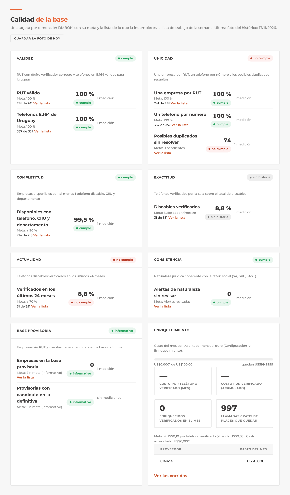

### Enriquecer empresas

El enriquecimiento busca, para empresas sin teléfono, un **teléfono**, el **sitio web**, la **dirección** y un **email institucional** (info@, contacto@…), en este orden y de lo más barato a lo más caro: lo que ya hay en la base (gratis), **Google Places**, una **búsqueda web** (solo si falta el sitio) y la **lectura del sitio con Claude** (solo si todavía falta el teléfono). Por defecto se corta apenas consigue un teléfono.

Se lanza desde:

- **Empresas**, con los filtros de la pantalla (hay filtros nuevos **Teléfono** y **Sitio web**, por ejemplo «pymes de Canelones sin teléfono»): **Enriquecer estas N empresas**, al pie de la lista;
- la **ficha** de una empresa: **✨ Enriquecer**;
- una **muestra**: **✨ Enriquecer** (también el jefe de proyecto), con las empresas sin teléfono discable o todas.

**Antes de gastar** se muestra la estimación: cuántas empresas se enriquecen y cuántas se saltean y por qué (ya tienen un teléfono verificado o discable, se enriquecieron en los últimos 90 días, están en no llamar, o son provisorias con candidata: conviene fusionarlas), el **costo máximo** y el **esperado**, cuántas llamadas entran en las gratuitas del mes y cuánto queda del tope mensual. Si el máximo supera lo permitido, elegís cuántas enriquecer (las primeras o al azar). Nada se gasta hasta tocar **Aprobar y enriquecer**.

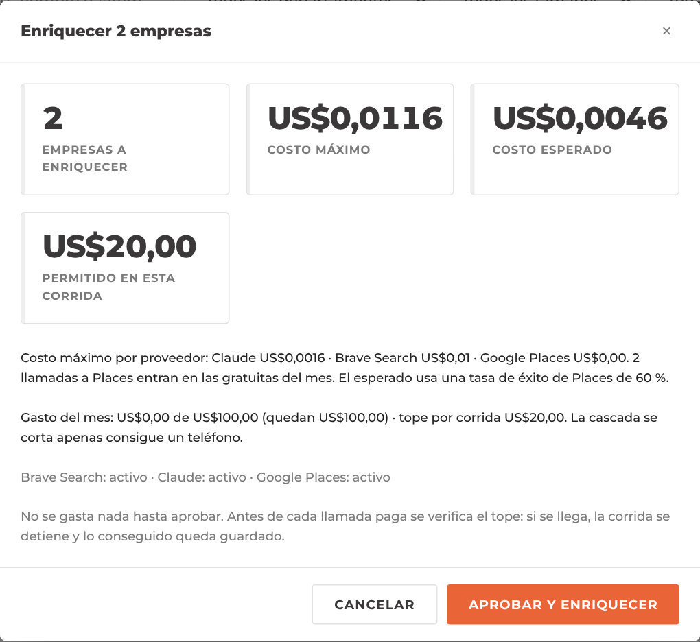

La corrida avanza empresa por empresa y se puede **Cancelar**. Antes de cada llamada paga se verifica el tope: si se llega, la corrida se detiene («detenida por tope»). En los dos casos lo conseguido queda guardado. Al terminar muestra cuántas empresas tienen teléfono nuevo, el gasto real por proveedor y la lista de empresas con su resultado. **Base de datos → Enriquecimiento** lista todas las corridas.

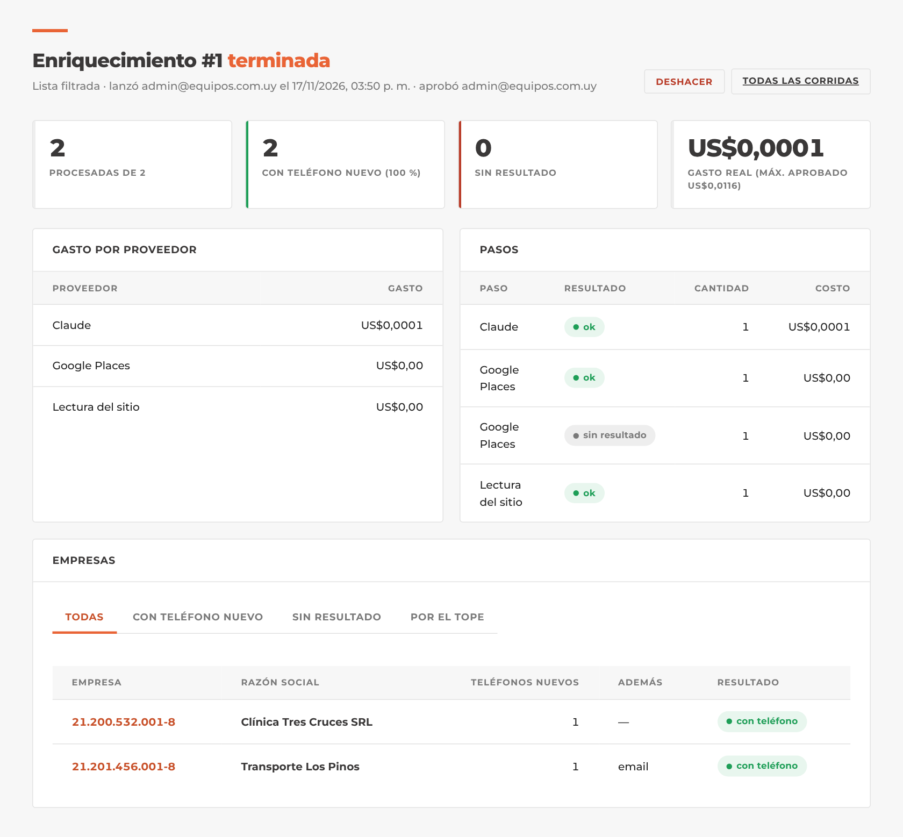

**Qué pasa con lo encontrado:**

- Los teléfonos entran **sin verificar**, con origen **Google Places** o **Sitio web**. Salen en el CSV como cualquier teléfono discable (en el orden de prioridad de su origen) y los verifica la sala con el .sav. En la ficha, la pestaña Teléfonos dice de qué corrida salió cada uno.
- El sitio, la dirección y el email entran con **confianza 30**: nunca reemplazan un dato de una carga (50) ni de la sala (80).
- Si el sitio es de un **estudio contable o jurídico**, sus teléfonos quedan como **intermediario sospechoso** y van a la bandeja de Intermediarios, con el motivo.
- Nunca se guardan datos personales: ni nombres ni celulares ni emails de personas que aparezcan en el sitio.
- **Deshacer** (en la corrida) quita lo que trajo, salvo los teléfonos que la sala ya verificó.
- En **Actividad → Rendimiento por origen**, Google Places y Sitio web se miden como cualquier origen.

### Posibles duplicados y grupos económicos

**Base de datos → Posibles duplicados** muestra pares de empresas con **RUT distinto** que comparten un teléfono, el sitio web, la dirección (con el departamento) o una razón social casi igual. Se detectan todos los días; **Detectar ahora** lo hace en el momento. Cada par aparece lado a lado, con lo que coincide. Para cada uno:

| Para… | Hacé esto |
| --- | --- |
| Son la misma empresa | **Fusionar: queda …** (elegí cuál queda). Es la fusión de siempre: se puede deshacer desde la ficha |
| Son empresas distintas del mismo grupo | **Son grupo económico** (con un nombre opcional). Quedan relacionadas, sin fusionarse. Si una ya estaba en un grupo, la otra se suma |
| No tienen nada que ver | **Sin relación**: el par no se vuelve a proponer |

Los pares con más de 14 días sin resolver se marcan. La ficha de una empresa de un grupo muestra el grupo y las otras empresas que lo forman, y permite cambiarle el nombre o sacarla del grupo.

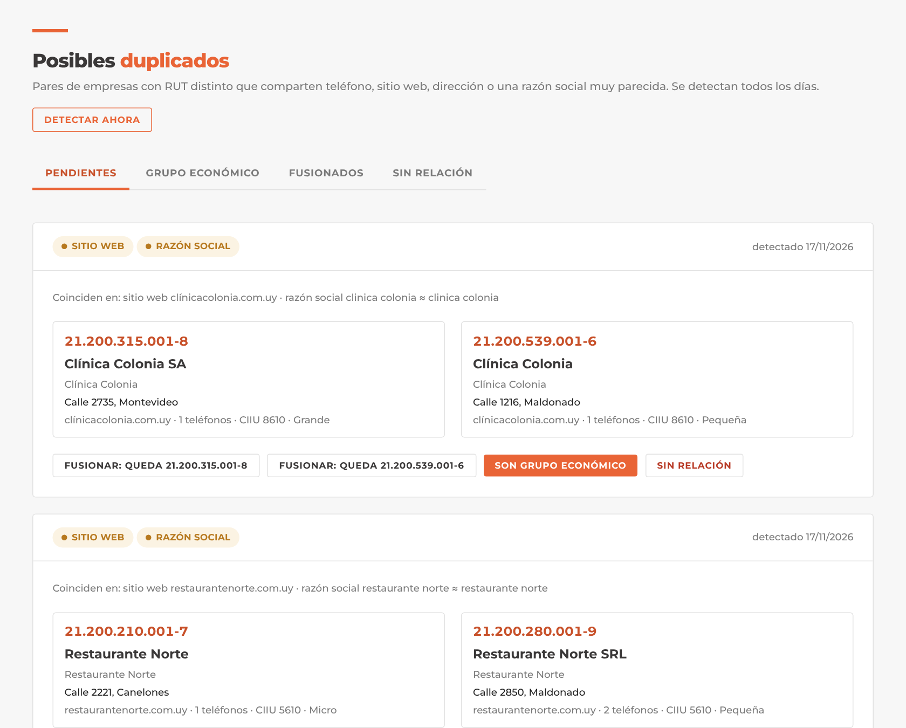

### Buscar empresas nuevas

**Base de datos → Buscar empresas nuevas** busca en Google Places por rubro y zona: escribí la búsqueda («imprentas en Salto») o armala con rubro, departamento y localidad, y elegí cuántas páginas pedir (20 resultados cada una; cada página es una llamada paga). **Ver el costo** muestra cuánto cuesta con los mismos topes del enriquecimiento; **Buscar** hace las llamadas.

Cada resultado se compara con la base y queda en uno de tres casos: **nueva** (se ofrece el alta en la base provisoria), **coincide** con una empresa por teléfono, sitio o nombre y dirección (se ofrece completarla; si la coincidencia es por similitud, revisala) o **ya guardada** (el mismo lugar ya está en la base). Elegí qué hacer con cada uno y tocá **Confirmar**: nada se guarda antes. El lote **Descubrimiento #N** queda con su linaje y se puede **Deshacer**. Las empresas nuevas entran a la base provisoria con código P-, teléfono sin verificar (origen Google Places) y el rubro buscado; después siguen el circuito de siempre (agregar el RUT o fusionar).

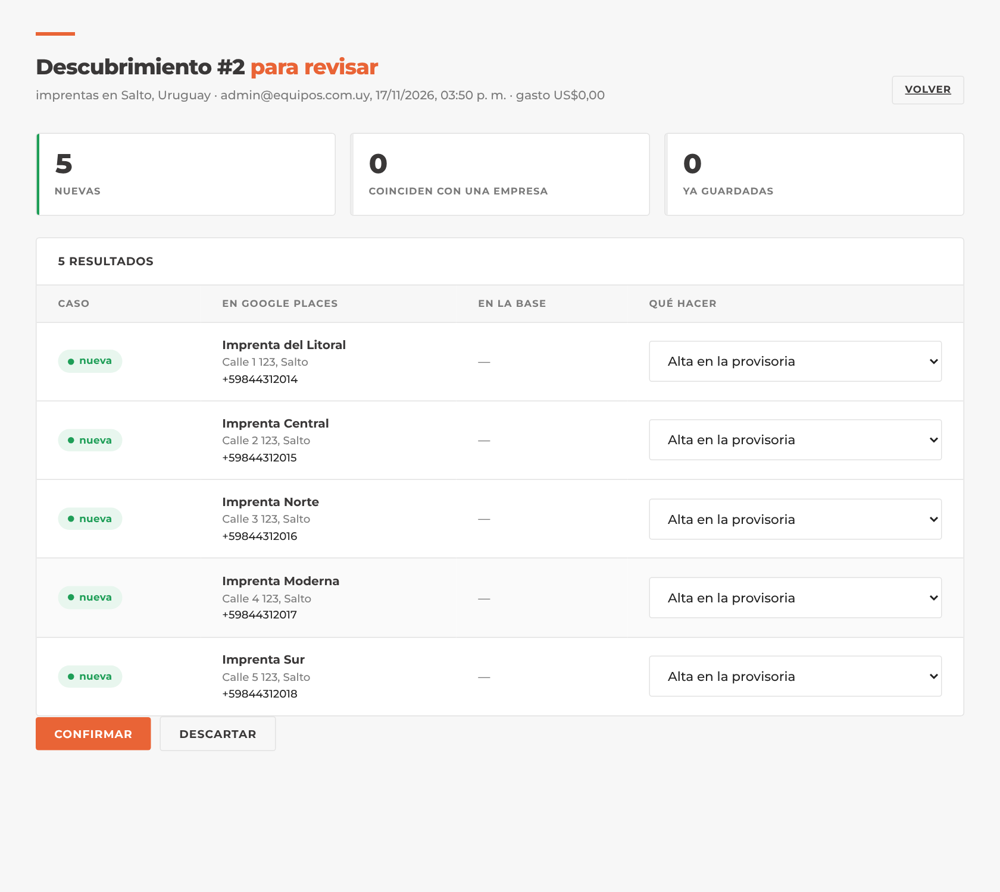

## Jefe de proyecto

### Estudios y partes

En **Estudios y muestras → Nuevo estudio** cargás nombre, cliente y fechas de campo, y la primera parte. Las fechas de campo importan: solo las llamadas dentro de ese período se asocian a los ítems de la muestra.

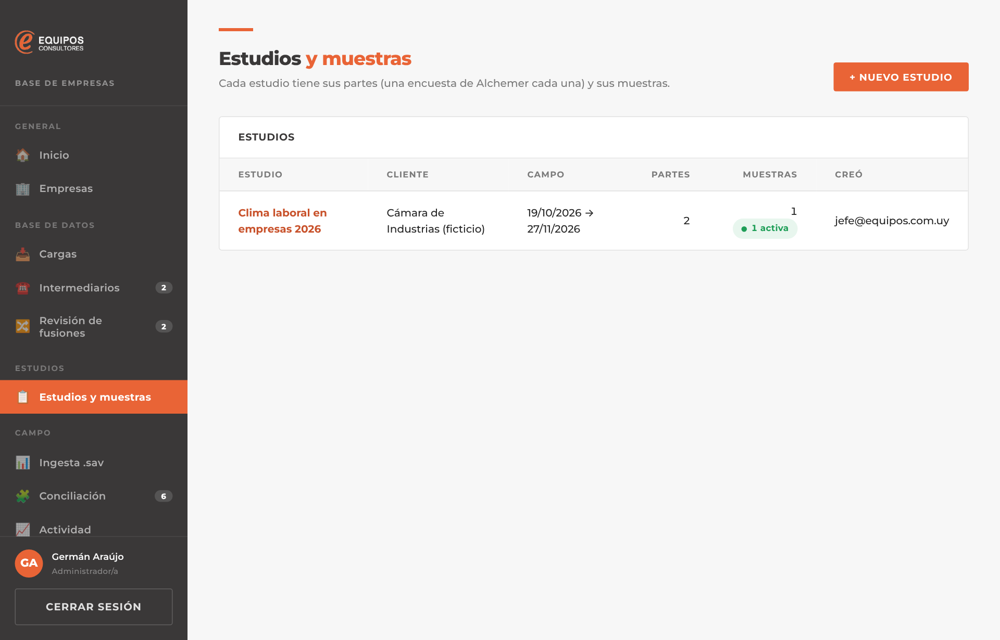

Cada **parte** es una encuesta de Alchemer con su survey ID, su link base y su respondente objetivo (área o cargo, por ejemplo "RRHH"). El respondente objetivo se usa para sugerir el contacto en el CSV. En el estudio ves sus partes (con cuántos ítems hay en cada estado) y sus muestras.

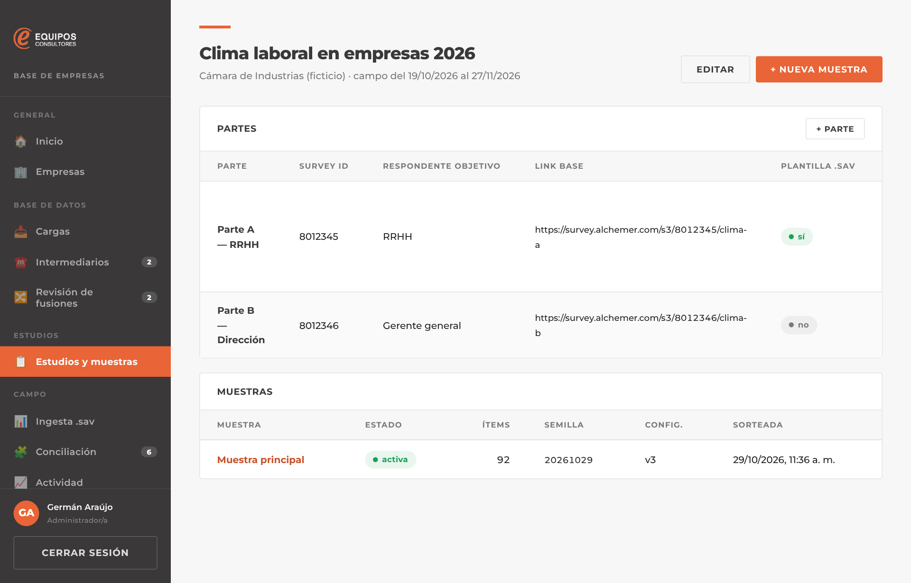

> **Borrar un estudio (administrador).** **Borrar estudio** elimina el estudio con sus partes, sus muestras (ítems, intentos del CDR y filas del .sav) y sus ingestas .sav con sus archivos. El modal muestra cuántos de cada uno se van a borrar y hay que escribir el nombre del estudio para confirmar. Lo que la base aprendió de las empresas **se conserva**: contactos y teléfonos nuevos, calidad de los números, historia y último contacto efectivo (las empresas con un contacto efectivo siguen en enfriamiento). Si una ingesta del estudio se estaba procesando, se cancela. No se puede deshacer; queda en Auditoría.

### Sortear una muestra

Desde el estudio, **Nueva muestra**:

0. **Partir de un template** (opcional): elegí uno y los pasos 1 a 3 se completan con sus valores. Todo se puede ajustar antes de sortear (ver «Templates de sorteo»).
1. **Filtros:** «+ Agregar filtro» ofrece cualquier dato de la empresa (ver «Filtros y estratos»), los orígenes de los teléfonos, «Incluir la base provisoria», «Incluir empresas sin teléfono discable» y «Como máximo una empresa por grupo económico» (marcada: si sale una empresa de un grupo que ya tiene otra en la muestra, se saltea y sigue la siguiente del orden). Sin filtros entra toda la base disponible.
2. **Estratos:** «+ Agregar estrato» con cualquier dato, y **Ver marco disponible**. El sistema muestra cuántas empresas cumplen los filtros, cuántas están disponibles, cuántas excluye cada regla y cuántas hay en cada estrato.
3. **Tamaño por estrato:** titulares y reemplazos de cada estrato (con "Aplicar a todos" para cargarlos de una vez). Opcionalmente, una semilla. **Guardar como template…** guarda los pasos 1 a 3 para la próxima vez.

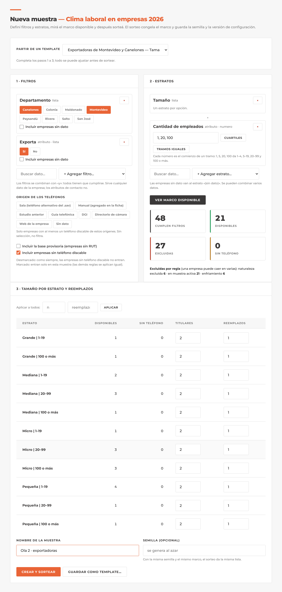

Al tocar **Crear y sortear** el sistema congela el marco (snapshot), aplica las reglas de la configuración vigente, sortea dentro de cada estrato y guarda la semilla y la versión de configuración. Los titulares quedan liberados; los reemplazos, en reserva y en orden.

**Incluir la base provisoria.** Desmarcado por defecto: el marco es solo la base definitiva. Si lo marcás, las empresas sin RUT entran con su estrato y las mismas reglas de disponibilidad.

### Filtros y estratos

Al crear una muestra (y en los templates) sirve **cualquier dato de la empresa**, sin que un administrador lo habilite antes: los campos fijos (razón social, nombre de fantasía, naturaleza jurídica, CIIU completo, a 2 y a 1 dígito, tamaño, departamento, localidad, dirección, web y estado) y **todos los atributos de empresa activos**. Los atributos de contacto no se usan. El selector los agrupa en «Campos de la empresa» y «Atributos», con un buscador.

| Tipo de dato | Filtro | Estratos |
| --- | --- | --- |
| Lista (y naturaleza, tamaño, departamento, estado) | Una o varias opciones | Uno por opción |
| Texto (y razón social, localidad, dirección, web, CIIU) | «Contiene…», «Es uno de…» (con los valores que existen y cuántas empresas tienen cada uno), «Tiene dato» o «No tiene dato» | Uno por valor, sin distinguir mayúsculas, tildes ni espacios. Con muchos valores, «Agrupar en Otros los de menos de N empresas» o «Los N más frecuentes y el resto en Otros» |
| Número | Desde / hasta | **Tramos**: por ejemplo, 1, 5, 20, 100 da 1–4, 5–19, 20–99 y 100 o más. «Cuartiles» y «Tramos iguales» los sugieren a partir del marco |
| Fecha | Desde / hasta | Por año, por semestre o por tramos |

- Cada filtro tiene **«Incluir empresas sin dato»**. Los filtros se combinan con «y».
- Las empresas sin dato van al estrato «(sin dato)». Se pueden combinar varios datos (tamaño × departamento × tramo de empleados); si hay demasiados estratos o un texto con muchos valores, la vista previa avisa.
- El estrato de cada empresa se calcula al sortear y queda congelado: cambiar después un dato de una empresa sorteada no altera «Verificar reproducibilidad».

**Origen de los teléfonos** deja solo las empresas con al menos un teléfono discable de los orígenes elegidos; el cuadro de exclusiones dice cuántas dejó afuera.

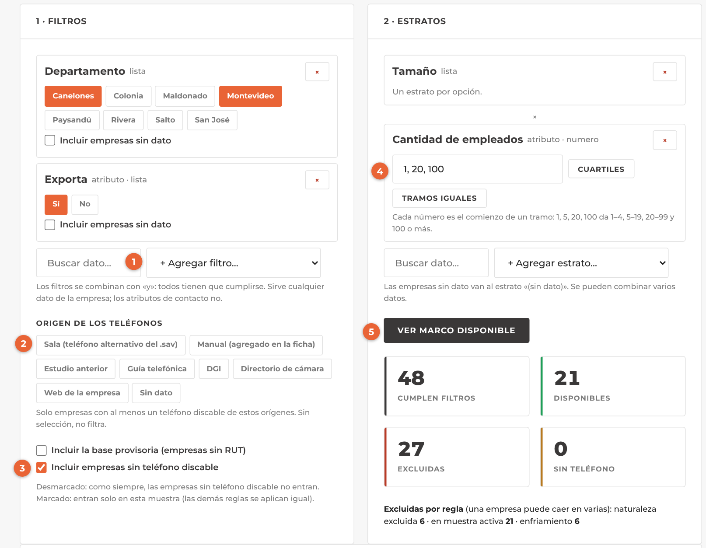

### Empresas sin teléfono

**Incluir empresas sin teléfono discable** (paso 1) viene desmarcado: como siempre, las empresas sin un número que se pueda llamar no entran. Marcado, entran **solo en esa muestra** (para estudios donde el teléfono se consigue después); las demás reglas se aplican igual. Si la regla está apagada en la Configuración general, la opción aparece marcada y deshabilitada.

- La vista previa y el resultado del sorteo dicen cuántas empresas sin teléfono entraron, por estrato.
- Con un filtro por origen, una empresa sin teléfonos no tiene ningún número de ese origen: no entra.
- En la muestra, **Empresas de la muestra → Sin teléfono** las lista, para completarlas desde la ficha. En cuanto tienen un número, la próxima exportación lo incluye.
- El CSV «Una fila por empresa» las trae con las columnas de teléfono vacías; «Una fila por número» no (no tienen números).

### Templates de sorteo

Un **template** guarda los pasos 1 a 3 de una muestra (filtros, estratos con sus tramos y agrupamientos, y tamaños por estrato) para reusarlos en la próxima ola o en otro estudio. No guarda la semilla, el estudio, el nombre ni las opciones de exportación. Los usan el jefe de proyecto y el administrador.

- **Crear:** en el paso 3, **Guardar como template…** (si partiste de uno, también **Actualizar template X**), o desde el detalle de una muestra ya creada, **Guardar configuración como template**.
- **Usar:** en «Nueva muestra», **Partir de un template**. Si el template usa algo que ya no existe (un atributo desactivado, un origen borrado), se avisa («se quitó el filtro por X: el atributo ya no está activo») y se sigue. En el paso 3, un estrato del template que hoy no tiene empresas aparece marcado, y los estratos nuevos del marco aparecen con tamaño 0 y la marca «nuevo».
- **Administrar:** menú **Templates de sorteo**: resumen de filtros y estratos, tamaño, cuántas veces se usó y la última muestra; **Editar** (los pasos 1 a 3, sin sortear), **Duplicar**, **Desactivar** y **Borrar** (solo si nunca se usó).
- **Las muestras guardan su propia copia:** editar un template después no cambia las muestras que ya lo usaron ni su reproducibilidad.

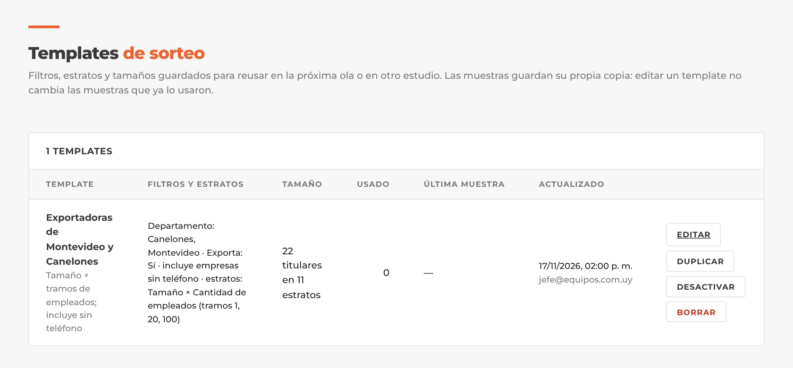

> **Muestras auditables.** Con la misma semilla, el mismo snapshot y la misma configuración, el sorteo da exactamente la misma lista en el mismo orden. El botón **Verificar reproducibilidad** lo comprueba en cualquier momento.

**Qué responde «Verificar reproducibilidad».** El marco congelado no cambia nunca, aunque después se borren empresas o cargas. Por eso hay cuatro respuestas posibles:

| Respuesta | Qué significa |
| --- | --- |
| Reproducible ✓ | El re-sorteo da la misma lista en el mismo orden |
| Reproducible ✓ — N empresas se borraron después del sorteo | Coincide contando las empresas que se borraron (por «Borrar empresa» o «Borrar carga»). La lista dice el estrato, el orden, el rol, el RUT si se conoce, y cuándo y quién las borró. La pantalla de la muestra también avisa «N empresas borradas después del sorteo» |
| ¡El re-sorteo no coincide! | La muestra se alteró de verdad: revisar la Auditoría |
| No verificable | Se borraron empresas de esta muestra con una versión anterior del sistema, que no guardaba los borrados. Ver Auditoría |

### Seguir la muestra

La pantalla de la muestra muestra los totales, las exclusiones del sorteo, los avisos (por ejemplo, "el estrato Grande no alcanza: pidió 10 y hay 8 disponibles"), el **avance por estrato** (llamados, contactabilidad, completas, tasa de respuesta, rechazos, fuera de marco) y la lista **Empresas de la muestra**, 50 por página, con el total arriba, filtros por estrato, rol, liberado y estado en cada parte, y búsqueda por RUT, razón social o EC_ID_ITEM. Los filtros se mantienen al cambiar de página.

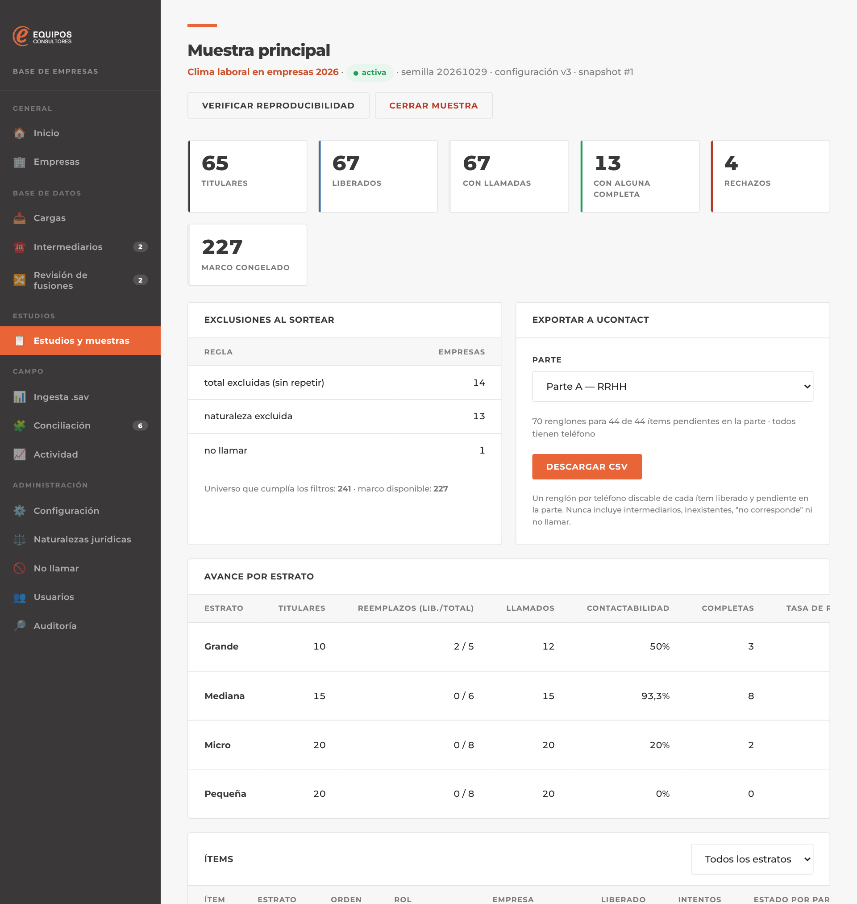

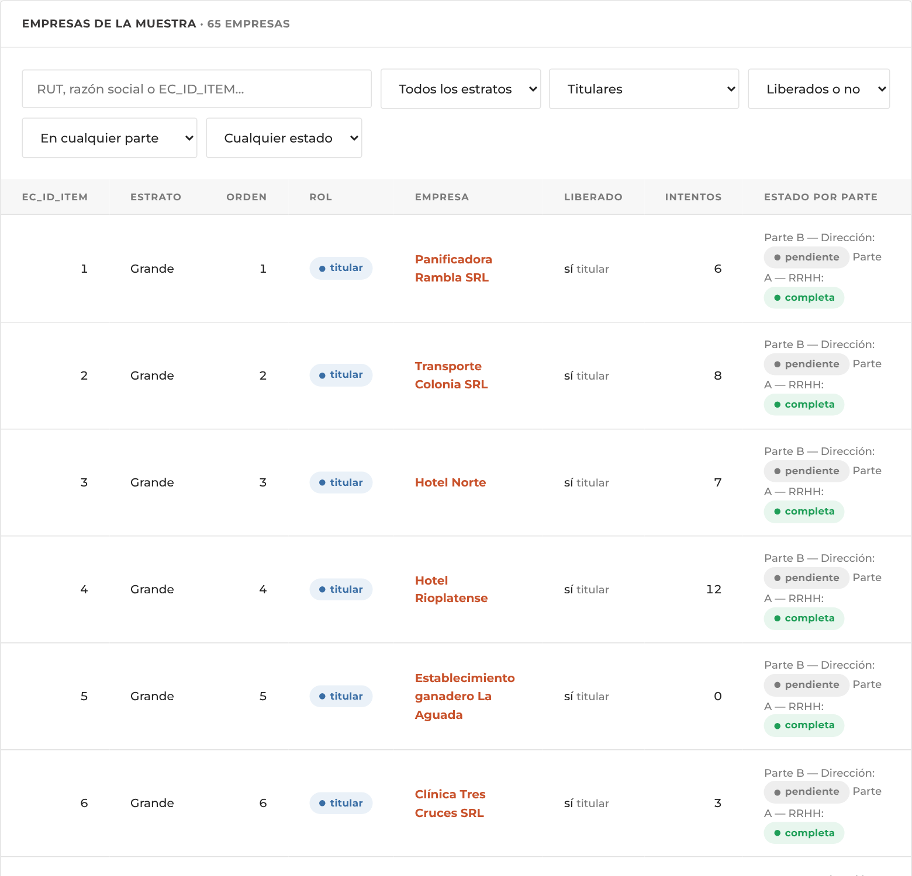

> **Muestras activas.** El indicador **Muestras activas** de Inicio lleva a la lista (estudio, nombre, ítems, fecha de sorteo). Una muestra activa que quedó **sin empresas** (se borraron todas) se muestra «activa, sin empresas» y se puede cerrar o borrar desde ahí. Si un «Borrar muestra» quedó con error o cancelado, el detalle de la muestra lo avisa.

**✨ Enriquecer** busca teléfono para las empresas de la muestra que no tienen uno discable (o para todas), con la estimación de costo antes de gastar (ver «Enriquecer empresas»). Las corridas de la muestra aparecen arriba, con cuántas consiguieron teléfono.

Mientras la muestra está activa, sus empresas no pueden salir en otra muestra. **Cerrar muestra** las libera y deja de permitir exportaciones.

> **Borrar una muestra (administrador).** **Borrar muestra** (en cualquier estado) elimina la muestra con sus ítems, sus intentos del CDR, sus filas del .sav y su marco congelado; el modal muestra cuántos y se confirma escribiendo BORRAR. Sus empresas vuelven a estar disponibles, salvo las que quedaron en enfriamiento por un contacto efectivo: lo que la base aprendió en el campo se conserva. No se puede deshacer; queda en Auditoría.

### Liberar reemplazos

Cuando un estrato tiene bajas (rechazos, fuera de marco), tocá **Liberar reemplazos** en ese estrato, indicá cuántos y el motivo. Se liberan en el orden sorteado y queda registrado quién y por qué.

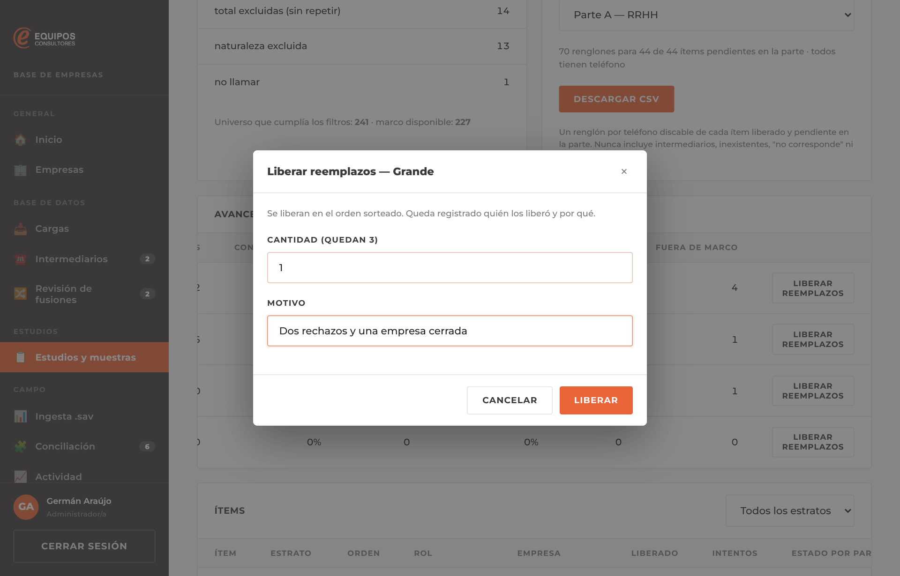

## Coordinador de campo

### Exportar el CSV para uContact

En la muestra, en **Exportar a uContact**, elegí la parte y tocá **Descargar CSV**. El resumen dice cuántos renglones salen, para cuántos ítems, y si algún ítem pendiente no tiene teléfono discable.

- Sale un renglón por cada teléfono discable de cada ítem liberado que esté pendiente o en curso en esa parte.
- Nunca salen intermediarios, números inexistentes o que no corresponden, ni nada en no llamar, aunque el pedido haya llegado después del sorteo.
- El link de Alchemer ya trae `EC_ID_ITEM`, `EC_RUT` y `EC_TEL_USADO`.
- La columna de contacto sugerido solo se completa si tu usuario tiene permiso para exportar contactos personales. Toda exportación queda auditada, con las columnas incluidas.
- **Qué incluir** (plegado): los **atributos de empresa** (uno por uno, «todos» y «ninguno»), los **números** (todos los discables o solo los verificados) y, si tu usuario tiene el permiso, los **contactos** (nombre, cargo, área, email, teléfonos y atributos de contacto). Por defecto, todo. La elección queda guardada en la muestra. Van al final del archivo: `EC_ID_EMPRESA` (el RUT o el código provisorio), `atr_<clave>` y `contacto_1_*`, `contacto_2_*`… (hasta 3 por empresa; se configura).
- **Formato:** **Una fila por empresa** (la opción por defecto: cada empresa una vez, con sus números en `tel_1`, `tel_2`… y sus orígenes; las sin teléfono salen con esas columnas vacías) o **Una fila por número** (una fila por cada número discable: una empresa con 3 números sale 3 veces). La ayuda debajo del botón cambia según la opción, y el archivo se llama `…_por_empresa.csv` o `…_por_numero.csv`.

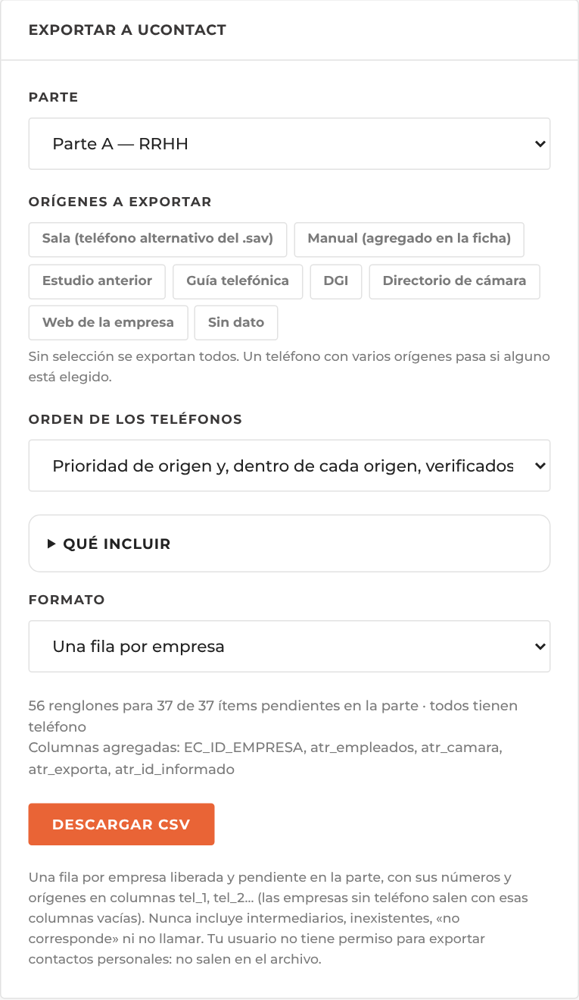

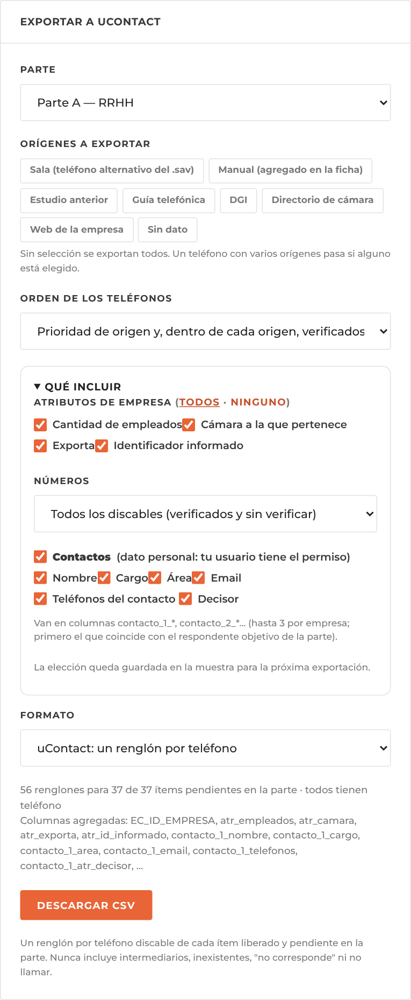
- **Orígenes a exportar:** todos (por defecto) o solo los elegidos; un teléfono con varios orígenes pasa si alguno está elegido. **Orden de los teléfonos:** por prioridad de origen y, dentro de cada origen, primero los verificados (por defecto). Las dos opciones quedan guardadas en la muestra y el resumen dice cuántos ítems quedan sin teléfono exportable por el filtro de origen.

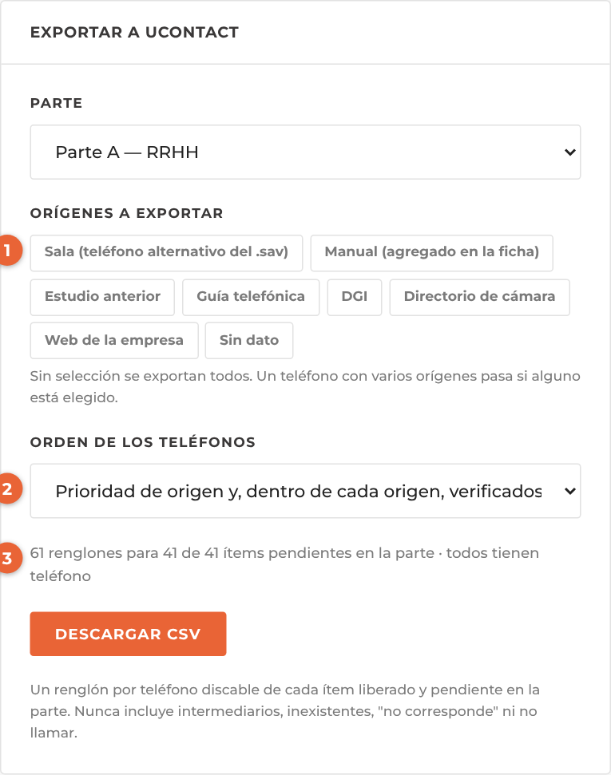

### Bloque estándar en Alchemer

Para que el .sav se asocie solo y actualice la base, cada cuestionario tiene que tener estas variables (el detalle de cómo armarlas está en `fase0/alchemer_bloque_estandar.md`):

| Variable | Qué es |
| --- | --- |
| `EC_ID_ITEM`, `EC_RUT` | URL variables ocultas que vienen en el link del CSV |
| `EC_TEL_USADO` | El teléfono con el que se hizo la encuesta (URL variable o pregunta) |
| `EC_CALIDAD_TEL` | 1 corresponde · 2 no es de la empresa · 3 estudio contable o jurídico · 4 la empresa cerró · 5 inexistente |
| `EC_TEL_ALT` | Número alternativo que dieron |
| `EC_RESP_NOMBRE`, `EC_RESP_CARGO`, `EC_RESP_AREA` | Quién contestó |
| `EC_RESULTADO` | Ya no hace falta: toda fila del .sav es una encuesta completa (si el cuestionario la tiene, se ignora) |

### Ingerir el .sav

Cuando cerrás una parte u ola, exportá el .sav de Alchemer y entrá a **Ingesta .sav**:

1. Elegí el estudio y la parte. Si es la segunda ola de un cuestionario que ya se usó en otro estudio, podés reusar el mapeo de esa otra parte.
2. Subí el .sav y tocá **Analizar**. El sistema lee el archivo y **propone** el mapeo: cuál es el `response_id`, cuál es el identificador (`EC_ID_ITEM` o RUT), qué variable corresponde a cada dato del sistema y, para la calidad del número, qué valor corresponde a cada código. **Toda fila del .sav es una encuesta completa** (Alchemer exporta solo las completas): no hay que mapear un resultado ni el estado de Alchemer. Además, cualquier variable se puede guardar como **atributo del contacto** que respondió (con traducción de valores para las listas).

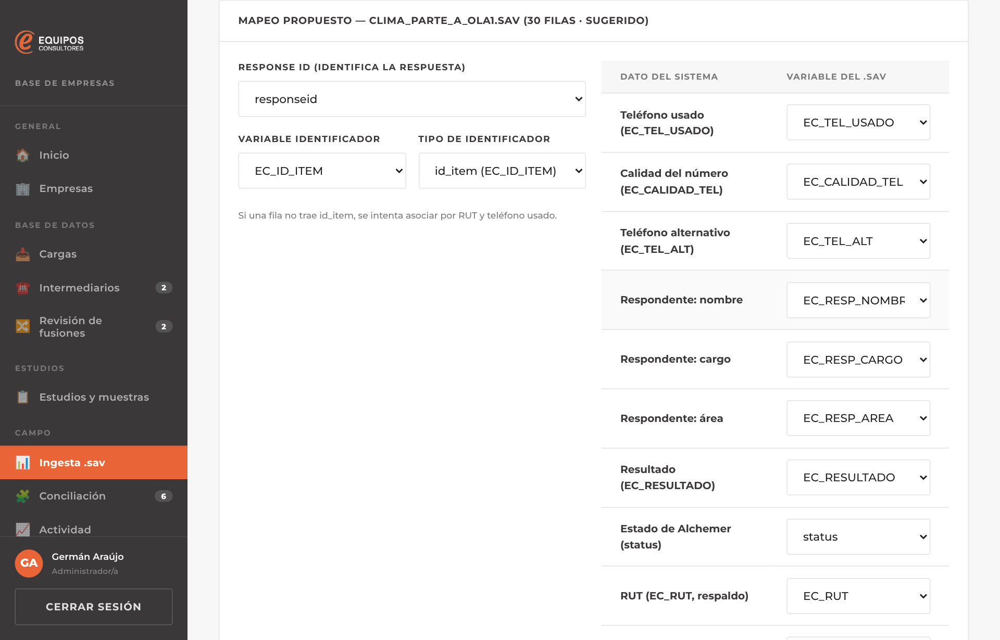

3. Revisá los **conteos**: filas asociadas a un ítem de la muestra, sin asociar (con motivo) y los valores sin mapear ("el 9 quedó sin mapear: 3 filas"). Si un código no tiene que hacer nada (por ejemplo, 9 = no sabe), mapealo a **ignorar**. Tocá **Recontar** después de cada cambio.

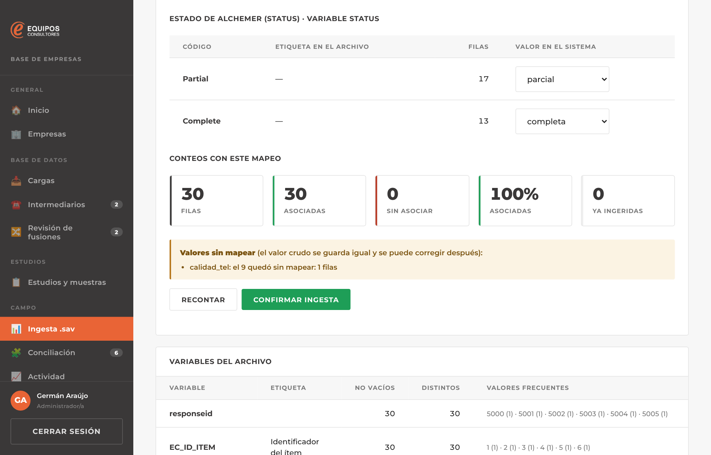

4. **Confirmar ingesta.** Recién ahí se aplica, en diferido. El mapeo queda como plantilla de la parte y se precarga en el próximo .sav.

Qué cambia en la base al confirmar:

| En el .sav | Cambio en la base |
| --- | --- |
| `EC_CALIDAD_TEL` = corresponde | El vínculo del teléfono usado pasa a **verificado** |
| = no es de la empresa / inexistente | El vínculo pasa a **no corresponde** / **inexistente**; deja de exportarse |
| = estudio contable o jurídico | El teléfono queda como **intermediario confirmado** |
| = la empresa cerró | La empresa pasa a **cerrada** (dato de la sala: una carga no lo pisa) |
| `EC_TEL_USADO` | El número con el que se habló queda **verificado** con origen Sala, exista o no en la base (si `EC_CALIDAD_TEL` dice «no corresponde», «inexistente» o «intermediario», gana eso) |
| `EC_TEL_ALT` | Número adicional: se crea si no existe y queda **verificado** con origen Sala |
| `EC_RESP_*` | Contacto nuevo o actualizado con su cargo y área, relacionado con el número por el que se habló |
| Cada fila | El ítem queda **completa** en la parte y la empresa actualiza su **último contacto efectivo** (de ahí se cuenta el enfriamiento) |

Cada cambio queda con su linaje: estudio, parte, ingesta, encuestador y fecha.

**Lo que no se aplicó, fila por fila.** El detalle de la ingesta dice cuántas encuestas completas trajo (asociadas a un ítem y sin asociar) y lista los motivos con conteos y ejemplos: «fila sin ítem asociado: en Conciliación», «EC_TEL_USADO no normalizable», «EC_TEL_ALT vacío».

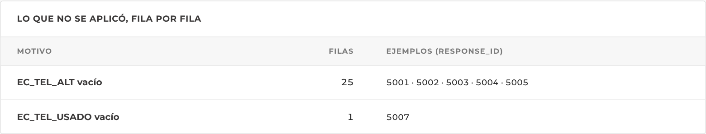

> **Subir el mismo .sav dos veces no duplica nada**: las respuestas se identifican por `response_id`. Podés subir el archivo acumulado de la parte cada vez que quieras.

### Corregir un mapeo

Si después de confirmar te das cuenta de que un código estaba mal mapeado, abrí la ingesta y tocá **Corregir mapeo**. Se reaplica sobre los valores crudos guardados, sin volver a subir el archivo. Reaplicar una ingesta anterior a noviembre de 2026 le aplica la regla nueva: marca completos sus ítems, actualiza el último contacto efectivo y verifica los números usados.

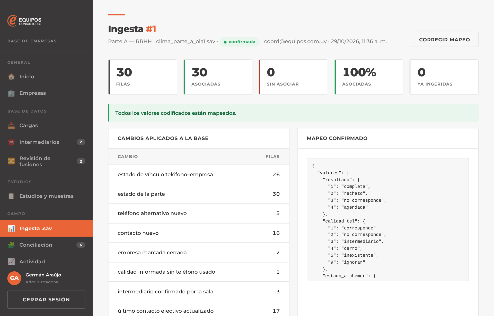

### Conciliación

Lo que no se pudo asociar solo espera en **Conciliación**:

- **Filas del .sav** sin ítem (por ejemplo, un `EC_ID_ITEM` mal escrito o un RUT que no está en la muestra). Ya cuentan como encuestas completas («sin asociar»). Podés ver los valores crudos y asociarla a un ítem; al hacerlo, se aplica completa: teléfonos, contacto y estado del ítem.
- **Llamadas del CDR** cuyo número corresponde a más de un ítem de muestras activas (un número compartido). Elegís a qué ítem corresponde.

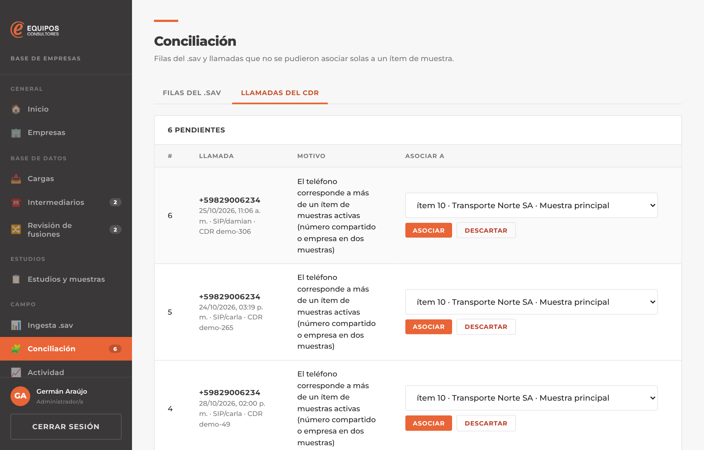

### Actividad

**Actividad** muestra, filtrando por estudio, muestra, encuestador y período: intentos, teléfonos marcados, empresas llamadas, contactos efectivos, **encuestas completas** (todas las filas del .sav: asociadas a un ítem más las sin asociar, con un enlace a Conciliación) y qué porcentaje de las llamadas quedó asociado a un ítem; intentos por franja horaria y por día; una tabla por encuestador (intentos, teléfonos, contactos efectivos, completas, intentos por completa); las disposiciones de llamada y las **corridas del job del CDR** (cuándo corrió, si fue programada o manual, el período leído, el estado y cuántos intentos nuevos cargó).

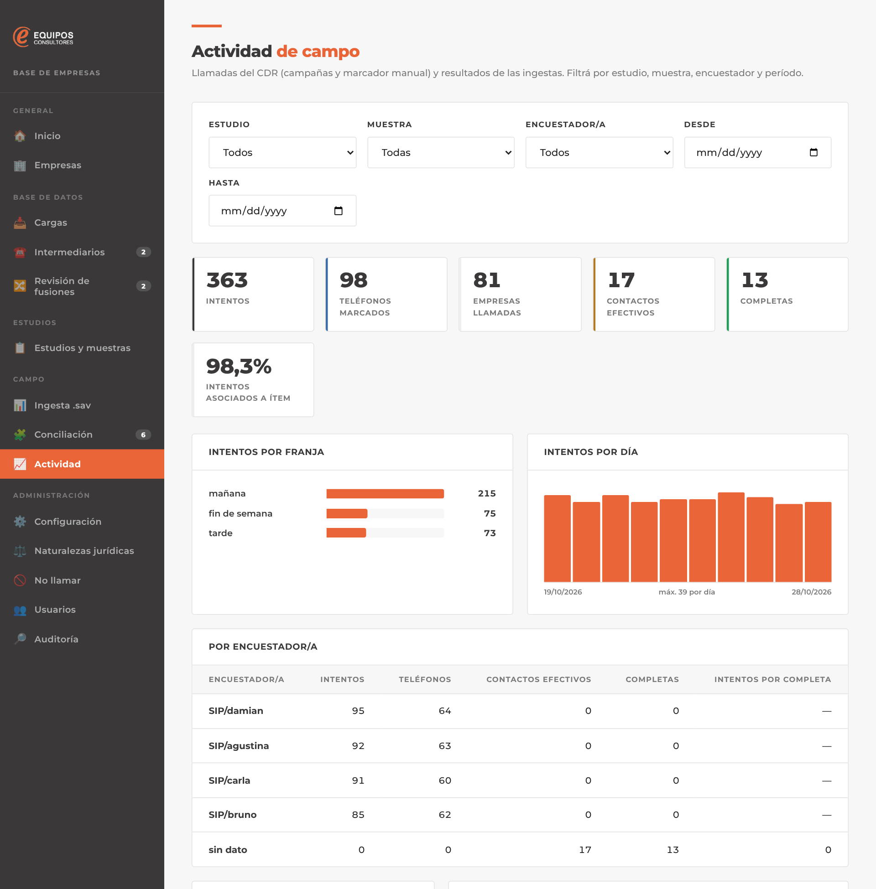

**Corridas del job del CDR.** Cada corrida muestra:

| Columna | Qué cuenta |
| --- | --- |
| Llamadas | Una por llamada del CDR, como el dashboard de productividad: los tramos de una misma llamada cuentan una vez, sin las llamadas a anexos internos y sin filtro de campaña |
| A empresas | Las llamadas a un teléfono de la base, nuevas o ya registradas (un reproceso repite el número) |
| Teléfonos | Teléfonos distintos de esas llamadas |
| Empresas | Empresas distintas de esas llamadas |

**Ver detalle** muestra el embudo: filas leídas → llamadas (sin tramos repetidos ni internas) → llamadas a empresas (sin números no normalizables ni que no están en la base, nuevas y ya registradas) → asociadas a una muestra, en Conciliación o sin muestra. **Exportar empresas** abre la lista de empresas de esa corrida. Las corridas anteriores a este conteo muestran «—»; un reproceso con «Correr ahora» y fechas las recalcula.

**Rendimiento por origen.** Por cada origen de teléfono: teléfonos discables, **teléfonos llamados**, **llamadas**, **empresas llamadas**, contactabilidad (teléfonos con al menos una llamada atendida sobre teléfonos llamados; atendida = disposición ANSWERED o, si la disposición no lo dice, duración facturada mayor a 0), contactos efectivos, % que la sala marcó como no corresponde, inexistente o intermediario, e intentos por contacto efectivo. Cuenta **todas las llamadas a empresas de la base**, estén o no en una muestra. Con un estudio o una muestra elegidos, cuenta las llamadas a las empresas de sus muestras aunque no hayan quedado asociadas al ítem (por ejemplo, antes del campo o en Conciliación). Un teléfono con varios orígenes cuenta en cada uno; la fila Total cuenta cada teléfono una sola vez y coincide con el total del tablero. Se descarga como CSV.

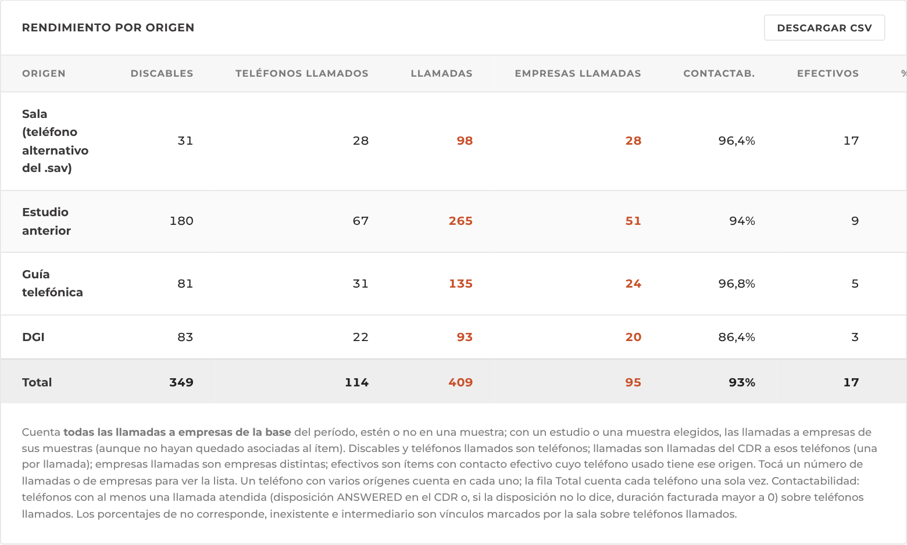

**Empresas llamadas.** El botón **Empresas llamadas** (con los filtros de la pantalla), cada número de llamadas o de empresas de la tarjeta de rendimiento (ese origen) y **Exportar empresas** de una corrida abren la lista: una fila por empresa con sus teléfonos llamados y su origen, llamadas, atendidas, primera y última llamada, encuestadores, y estudio, muestra y estado del ítem («sin muestra» si no está en ninguna). «Solo empresas que no están en ninguna muestra» filtra rápido las que no están en ningún estudio. **Descargar CSV** baja la misma lista (separador `;`, abre en Excel con tildes) y queda en Auditoría. No incluye contactos. Una llamada a un número compartido por varias empresas aparece en la fila de cada una; el total de llamadas arriba la cuenta una vez.

El CDR se procesa cada noche a las 4:00 (hora de Montevideo) e incluye las llamadas de campaña **y** las del marcador manual: se reconocen por el número marcado, no por la campaña. Las llamadas a internos y a números que no están en la base se cuentan pero no se guardan.

## Administrador

### Configuración

Todos los parámetros de negocio están en **Configuración** y se cambian sin pedir nada a un desarrollador. Cada vez que guardás se crea una versión nueva con tu nombre, la fecha y un comentario; las muestras guardan la versión con la que se sortearon.

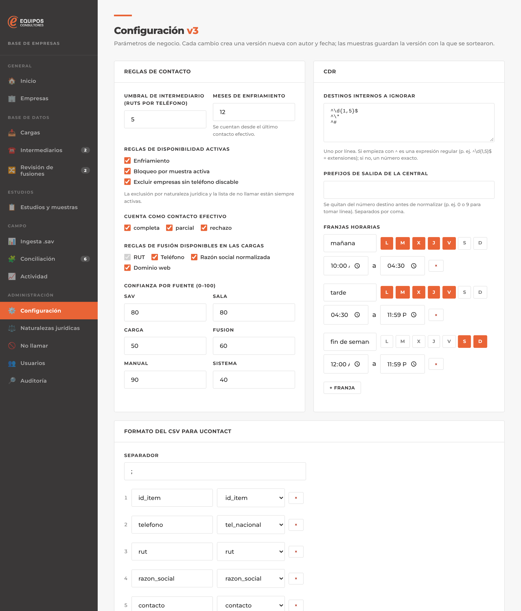

| Parámetro | Para qué sirve |
| --- | --- |
| Umbral de intermediario | Cuántos RUTs con el mismo teléfono lo vuelven sospechoso (5 por defecto) |
| Meses de enfriamiento | Cuánto tiempo después de un contacto efectivo una empresa no puede volver a sortearse |
| Reglas de disponibilidad | Activar o desactivar enfriamiento, bloqueo por muestra activa y exclusión de empresas sin teléfono discable. La naturaleza excluida y no llamar están siempre activas |
| Contacto efectivo | Qué resultados cuentan para el enfriamiento (completa, parcial, rechazo) |
| Reglas de fusión | Qué criterios se ofrecen en las cargas |
| Confianza por fuente | El peso de cada fuente en la regla de supervivencia |
| Destinos internos | Extensiones y números del CDR que se ignoran (uno por línea; los que empiezan con ^ son patrones) |
| Prefijos de salida | Dígitos que la central agrega para tomar línea y que hay que quitar |
| Franjas horarias | Nombre, días y horario de cada franja del tablero |
| Formato del CSV | Separador y columnas, para que coincida con la importación de uContact |
| Cargas grandes | Filas por lote (5.000; entre 500 y 20.000), pausa entre lotes (1 s) y minutos sin avanzar para retomarla sola (10; si se vuelve a cortar, queda interrumpida). Ver «Cargas grandes» |

En el historial, tocá una versión para ver todos sus parámetros.

#### Conexión al CDR

La tarjeta **CDR — conexión a la base de uContact** tiene los datos que usa el job nocturno para leer las llamadas.

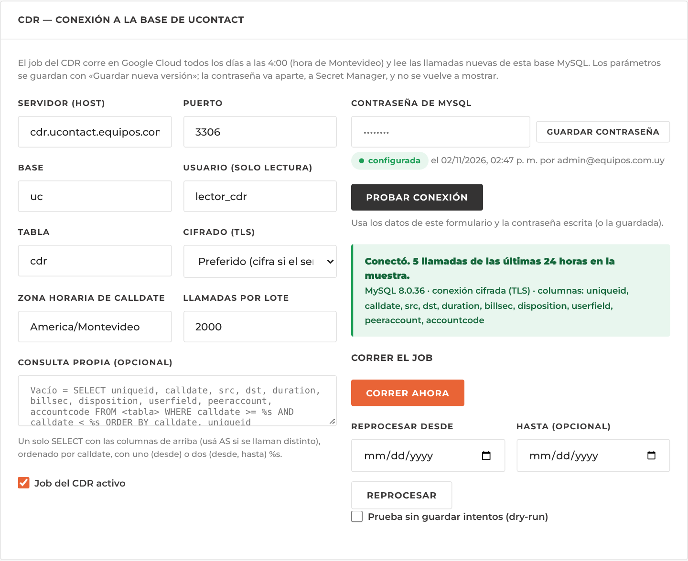

- **Servidor, puerto, base, usuario y tabla** de la base MySQL de uContact. El usuario conviene que sea de solo lectura.
- **Cifrado (TLS):** «Preferido» cifra si el servidor lo acepta; «Requerido» no deja conectar sin cifrado; «Desactivado» solo si el servidor no lo soporta.
- **Zona horaria de calldate** y **llamadas por lote** normalmente no se tocan.
- **Consulta propia (opcional):** solo si la tabla tiene otros nombres de columna. La ayuda debajo del campo dice qué tiene que devolver.
- **Job del CDR activo:** mientras no esté marcado, el job no lee nada (las corridas quedan como «omitida»).

Estos datos se guardan con **Guardar nueva versión**, como el resto de la configuración.

**La contraseña va aparte.** Escribila y tocá **Guardar contraseña**: se guarda en un lugar seguro (Secret Manager), fuera de la base y de la auditoría, y **nunca se vuelve a mostrar**. La tarjeta solo dice si está configurada, cuándo y quién la cargó. Para cambiarla, escribí la nueva y guardala.

**Probar conexión** usa los datos del formulario, aunque todavía no los hayas guardado, y la contraseña escrita (o la guardada). En pocos segundos dice si conectó, con qué versión de MySQL, si la conexión va cifrada y cuántas llamadas de las últimas 24 horas encontró. Si falla, dice por qué:

| Mensaje | Qué revisar |
| --- | --- |
| No se resuelve el host | El nombre del servidor |
| No responde el puerto | El puerto. Si está bien, el servidor probablemente acepta solo IPs autorizadas: avisale a quien hizo el despliegue (hace falta la IP fija) |
| Usuario o contraseña incorrectos | El usuario y la contraseña |
| La base no existe / La tabla del CDR no existe | Los nombres de base y tabla, o la consulta propia |
| El usuario no tiene permiso | Que al usuario de MySQL le den permiso de lectura |
| Error de cifrado (TLS) | Cambiar **Cifrado (TLS)** según lo que diga el mensaje |
| Faltan columnas en la consulta | La consulta propia: usá `AS` para renombrar columnas |

**Correr el job a mano.** **Correr ahora** lee las llamadas nuevas sin esperar a las 4:00. **Reprocesar desde** (con **Hasta** opcional) vuelve a leer un período, por ejemplo para cargar el histórico la primera vez o recuperar días en que el job falló. Reprocesar no duplica llamadas ni hace que el job nocturno retroceda. Con **Prueba sin guardar intentos (dry-run)** el job cuenta lo que haría sin escribir nada. La tarjeta sigue la corrida y muestra el resultado al terminar; no se puede lanzar otra mientras una está en curso.

### Enriquecimiento (configuración)

La tarjeta **Enriquecimiento** de Configuración tiene:

- **Proveedores:** Google Places, Brave Search y Claude, cada uno con su estado (activo, desactivado o **no configurado**), la casilla **usar** y su **clave**. La clave se pega y se guarda con **Guardar clave**: va a Secret Manager y no se vuelve a mostrar. Sin clave, la cascada saltea ese proveedor.
- **Precios** de cada paso (los usa la estimación; se actualizan a mano si el proveedor cambia precios): Places por llamada y llamadas gratis por mes, Brave por búsqueda, y el modelo de Claude con sus precios por millón de tokens.
- **Topes:** mensual duro (US$100 al empezar), por corrida (US$20) y máximo de empresas por corrida (2.000).
- **Confianza** de los datos enriquecidos (30), días antes de volver a enriquecer una empresa (90) y **dónde se corta la cascada**: apenas consigue un teléfono (lo más barato) o cuando tiene teléfono y sitio web.
- **Dominios genéricos** que no cuentan como «mismo sitio» en los posibles duplicados (gmail.com, facebook.com…).

Todo, salvo las claves, se guarda con **Guardar nueva versión** y queda en el historial y en Auditoría.

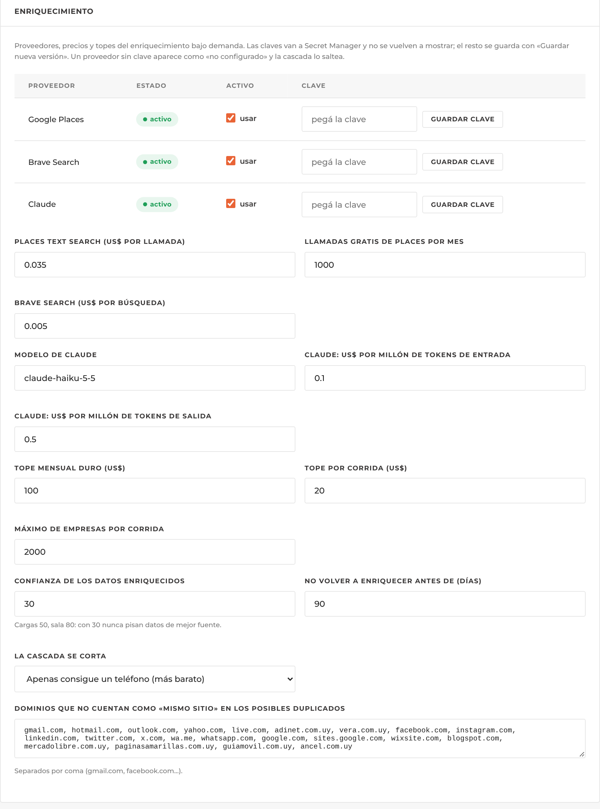

### Atributos de empresa y de contacto

En **Administración → Atributos** hay dos pestañas: **De empresa** (cantidad de empleados, exporta, cámara…) y **De contacto** (decisor sí/no, antigüedad en el cargo…). **Solo el nombre y el tipo** (texto, número, fecha o lista) son obligatorios; la **clave se genera sola** a partir del nombre (`cantidad_de_empleados`; si ya existe, `_2`) y no cambia aunque después cambies el nombre. Una lista puede quedar sin opciones: se completan en la carga. Opcionales: sinónimos para el mapeo automático y, para los de texto, normalizar a mayúscula inicial o MAYÚSCULAS. Todo atributo de empresa activo sirve como filtro y como estrato del sorteo, sin marcar nada. Si al crear uno el nombre se parece a otro que ya existe, el sistema avisa y ofrece usar el existente.

**Fusionar con…** junta un atributo duplicado dentro de otro del mismo ámbito y tipo compatible: sus valores pasan al que queda (se recalcula el vigente), su nombre y sus sinónimos pasan a los sinónimos, las opciones se unifican y el duplicado queda inactivo con la nota «fusionado en …». No se puede si se usa como filtro o estrato de una muestra activa. Desactivar un atributo lo saca del mapeo y de los filtros pero conserva sus valores; solo se borra uno sin valores y que no se use en una muestra activa. Los campos del sistema (RUT, razón social, naturaleza, CIIU, tamaño…) no se pueden borrar ni renombrar.

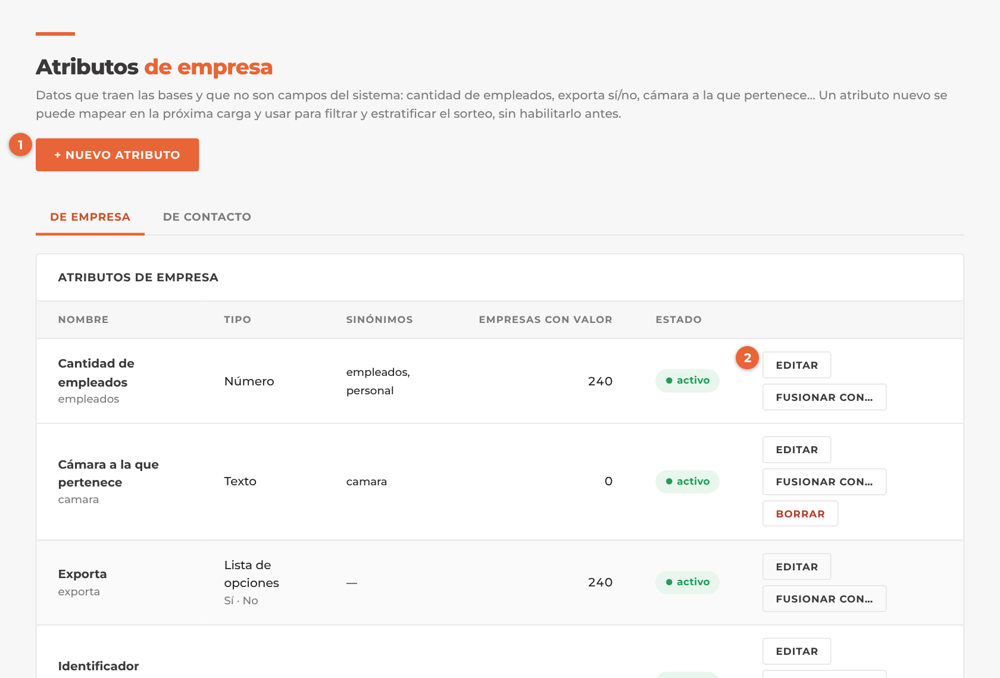

### Orígenes de teléfono

En **Administración → Orígenes de teléfono** está el catálogo de dónde sale cada número. El orden es la prioridad que usa el CSV. **Sala**, **Manual** y **Sin dato** son de sistema y no se borran; un origen con teléfonos se desactiva en lugar de borrarse.

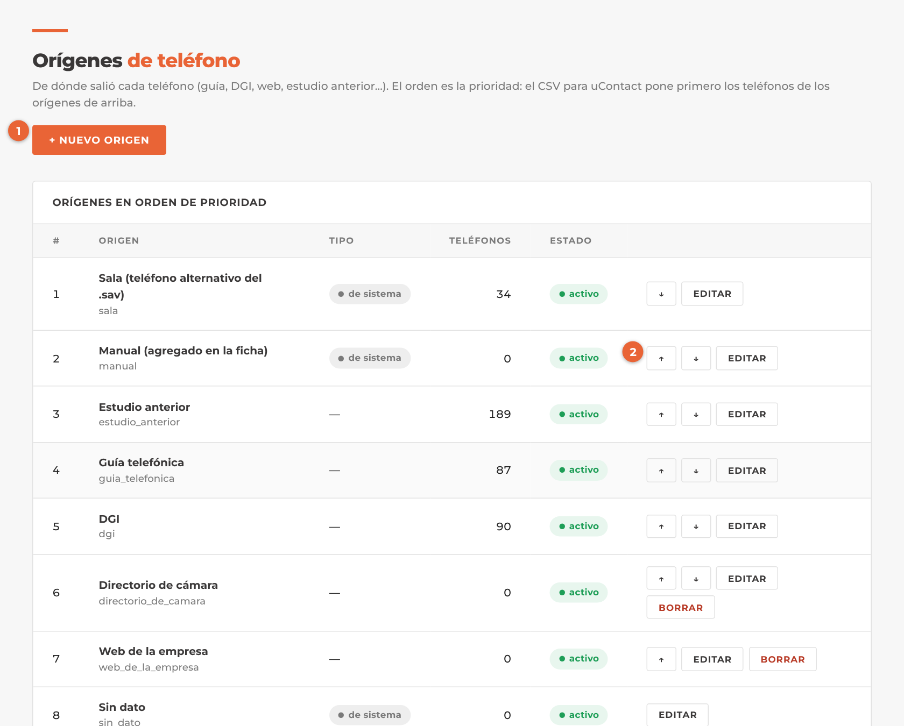

### Naturalezas jurídicas

El catálogo de naturalezas tiene la marca **excluida de contacto**. Las empresas de una naturaleza excluida se guardan y se siguen actualizando, pero nunca entran a un marco muestral ni a un CSV. Cambiar la marca crea una versión nueva de la configuración.

El administrador tiene, en cada fila:

- **Editar:** cambia el **nombre** y la marca de exclusión. El **código** de una naturaleza en uso no se cambia: lo guardan la historia de las empresas, la configuración y los criterios de las muestras. Si ninguna empresa la usa ni la usó, también se puede corregir el código (sirve para arreglar una naturaleza que quedó **sin código**, que la lista marca en rojo).
- **Borrar:** aparece solo en las naturalezas que **ninguna empresa tiene ni tuvo** (las demás dicen «en uso»). Si la naturaleza estaba excluida, al borrarla se crea una versión nueva de la configuración.

**+ Naturaleza** no deja crear un código que ya existe: para cambiarlo, usá Editar. Todo queda en Auditoría.

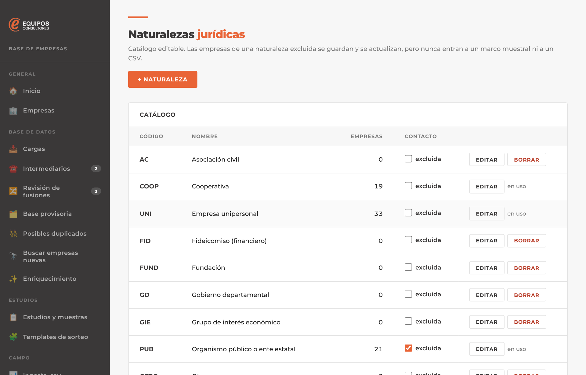

### No llamar

Registro de pedidos de no llamar por empresa (RUT), teléfono o contacto, con motivo, quién lo pidió y quién lo registró. Es el mecanismo para atender los derechos de supresión de la Ley 18.331. Un pedido se puede **levantar** (con motivo); el historial se conserva.

### Usuarios

En **Usuarios** se da de alta a las personas, se les cambia el rol y se las activa o desactiva. Todo se hace desde esta pantalla: no hace falta entrar a la consola de Firebase.

La tabla muestra, para cada persona:

- **Rol**, y si puede exportar contactos personales.
- **Estado** y **último ingreso**. "Nunca ingresó" es alguien que todavía no creó su contraseña; "sin cuenta", alguien registrado antes del alta con enlace, que necesita «Reenviar acceso».
- **Correo de acceso:** si el último correo salió (**enviado**) o no (**fallido**, con el motivo), qué correo fue y cuándo.

**Dar de alta.** Tocá **+ Usuario**, escribí email, nombre y rol, y marcá si puede exportar contactos personales. Tocá **Dar de alta**: la persona recibe un correo con el enlace para crear su contraseña (vence en una hora).

**Si el correo no salió**, la cuenta queda creada igual y aparece el enlace en una ventana que **se muestra una sola vez**. Tocá **Copiar enlace** y pasáselo a la persona por otro canal (WhatsApp, Teams). El enlace no se guarda en ningún lado: si se pierde, usá **Reenviar acceso**.

**Reenviar acceso.** Manda un enlace nuevo a quien lo perdió o lo dejó vencer: el de bienvenida si nunca entró, o uno para restablecer la contraseña si ya entró. Si la persona no tenía cuenta (por ejemplo, alguien registrado antes de este cambio), se la crea. Queda registrado quién lo pidió y cuándo.

**Editar.** Cambiar el nombre, el rol o el permiso de exportar contactos no manda ningún correo.

**Desactivar.** Desmarcá **Activo** al editar: la persona ya no puede entrar y ve "Tu acceso está desactivado". Para devolverle el acceso, volvé a marcarlo. No podés desactivarte ni quitarte el rol de administrador a vos mismo.

> **Si el email ya tenía cuenta** (por ejemplo, creada a mano antes), el alta no crea otra ni le cambia la contraseña: la registra con su rol y te avisa que uses **Reenviar acceso** si necesita entrar.

### Auditoría

Registro inalterable de cargas, fusiones, exclusiones, sorteos, exportaciones, ingestas, cambios de configuración y de usuarios. Se filtra por acción, objeto y actor; cada evento tiene su detalle. También se exporta todos los días a BigQuery para consultas largas.

## Preguntas frecuentes

**No me llegó el correo para crear mi contraseña.** Buscalo en spam. Si no está, pedile a un administrador que use **Reenviar acceso**; si el correo vuelve a fallar, la pantalla le muestra el enlace para pasártelo por otro canal.

**El enlace del correo dice que venció o que ya se usó.** Los enlaces duran una hora y sirven una vez. En la pantalla de ingreso escribí tu email y tocá **¿Olvidaste tu contraseña?**.

**¿Por qué una empresa no salió en la muestra?** Abrí su ficha: el aviso de disponibilidad dice qué regla la bloquea y hasta cuándo. En la muestra, el cuadro de exclusiones dice cuántas empresas sacó cada regla.

**El CSV tiene menos renglones de los que esperaba.** Solo salen teléfonos discables de ítems liberados y pendientes o en curso en esa parte. El resumen arriba del botón dice cuántos ítems no tienen teléfono discable.

**Una llamada manual, ¿cuenta?** Sí. El CDR se analiza por número marcado, venga de una campaña o del marcador manual.

**En Inicio aparece un aviso del CDR.** El job de la noche falló o no corrió. Un administrador ve el motivo en **Actividad** (corridas del job) o en Configuración → **Probar conexión**, lo corrige y toca **Correr ahora**. No se pierden llamadas: la corrida siguiente sigue desde donde quedó.

**Subí el .sav y quedaron filas sin asociar.** Revisá el motivo en los conteos. Lo más común es que la encuesta no tenga la URL variable `EC_ID_ITEM`; en ese caso el sistema intenta por RUT y teléfono usado. Lo que no se resuelve va a Conciliación.

**Una carga grande quedó «interrumpida».** Abrí su detalle: dice cuántos lotes se aplicaron y por qué se cortó. **Reanudar** sigue desde ahí sin repetir nada. Si preferís sacarla, **Deshacer carga** quita lo aplicado. Ver «Cargas grandes».

**Arriba de la aplicación hay una franja roja «Faltan migraciones».** Solo la ven los administradores: se publicó una versión sin actualizar la base. Corré `./infra/desplegar.sh migrar` (ver la guía de despliegue); la franja desaparece en un minuto.

**Toqué «Siguiente» y quedaron dos cargas del mismo archivo.** Pasaba antes de noviembre de 2026, cuando «Siguiente» no mostraba nada y se cortaba al minuto. Abrí **Cargas**, seguí con una y borrá la otra con **Borrar carga**. Ahora la pantalla avisa «Ir a la carga #N» en lugar de crear otra.

**Una carga dice «Esperando a que termine la carga #N».** Se procesa una carga grande a la vez: arranca sola cuando termina la otra.

**Me equivoqué al cargar una base.** Si ninguna de sus empresas entró a una muestra, deshacé la carga desde su detalle. Si ya entraron, corregí los datos en la ficha o hacé una carga nueva con más confianza.

**¿Puedo volver a sortear una muestra?** Una muestra sorteada no se vuelve a sortear: se verifica. Si necesitás otra lista, cerrá la muestra y creá una nueva.

**Un número que confirmé como intermediario era legítimo.** En Intermediarios → Confirmados, tocá **Liberar**.

## Glosario

| Término | Significado |
| --- | --- |
| Ítem de muestra | Una empresa sorteada en una muestra, con su estrato, rol (titular o reemplazo) y orden |
| Parte | Una encuesta de Alchemer dentro de un estudio, con su respondente objetivo |
| Marco | Las empresas disponibles que cumplen los filtros al momento de sortear |
| Snapshot | Copia congelada del marco con la que se sorteó; permite reproducir la muestra |
| Semilla | Número que fija el sorteo: misma semilla y mismo marco dan la misma lista |
| Teléfono discable | Número válido, no intermediario, con vínculo sin verificar o verificado, y fuera de no llamar |
| Intermediario | Teléfono que no es de la empresa sino de un tercero (estudio contable o jurídico) compartido por muchos RUTs |
| Contacto efectivo | Encuesta completa, parcial o rechazo explícito de la empresa |
| Enfriamiento | Período después de un contacto efectivo en el que la empresa no se vuelve a sortear |
| Linaje | Registro de de dónde salió cada dato: fuente, lote, fecha, actor y confianza |
| Conciliación | Asociación manual de una respuesta o una llamada que el sistema no pudo asociar solo |
| CDR | Registro de llamadas de uContact |
| Enriquecimiento | Búsqueda de teléfono, sitio, dirección y email de una empresa en Google Places, la web y su sitio, con costo estimado y tope |
| Grupo económico | Empresas con RUT distinto relacionadas entre sí (no fusionadas); el sorteo puede tomar como máximo una por grupo |
| Descubrimiento | Búsqueda de empresas nuevas por rubro y zona en Google Places; las nuevas entran a la base provisoria |
