# Manual de usuario

La **Base de Empresas** es el registro maestro de empresas de Equipos, con el RUT como clave. De ahí salen las muestras de los estudios a empresas, se genera la lista para uContact y vuelven los resultados del campo (las llamadas del CDR y el .sav de Alchemer) para que la base aprenda en cada estudio: qué números no corresponden, cuáles son de estudios contables, quién atendió y cuándo se contactó a cada empresa.

Este manual sigue el circuito de un estudio y está organizado por rol. Las capturas usan datos ficticios de demostración.

## Roles

Cada persona entra con su email de Equipos y ve el menú de su rol. El sistema valida los permisos en el servidor: si una acción no está permitida para tu rol, el botón no aparece o el sistema avisa.

| Rol | Qué hace | Pantallas principales |
| --- | --- | --- |
| **Data steward** | Carga bases, resuelve intermediarios y coincidencias, corrige datos y fusiona empresas | Cargas, Intermediarios, Revisión de fusiones, Empresas |
| **Jefe/a de proyecto** | Crea estudios y partes, sortea muestras, libera reemplazos | Estudios y muestras, Actividad |
| **Coordinador/a de campo** | Exporta el CSV para uContact, ingiere el .sav, concilia y controla el campo | Estudios y muestras, Ingesta .sav, Conciliación, Actividad |
| **Administrador/a** | Configuración, naturalezas jurídicas, no llamar, usuarios y auditoría. Puede hacer todo lo de los demás roles | Administración |
| **Lectura** | Consulta, sin acciones. No ve los datos personales de los contactos | Inicio, Empresas, Estudios, Actividad |

## El circuito de un estudio

1. **Data steward:** mantiene la base al día (cargas, intermediarios, revisión).
2. **Jefe de proyecto:** crea el estudio con sus partes y sortea la muestra.
3. **Coordinador:** descarga el CSV de cada parte y lo carga en uContact.
4. **Campo:** los encuestadores llaman (campaña o marcador manual) y completan la encuesta de Alchemer, incluidas las preguntas del bloque estándar.
5. **Cada noche (automático):** el CDR de uContact llega al sistema y registra los intentos de llamada.
6. **Coordinador:** al cerrar una parte u ola, sube el .sav y confirma el mapeo. La base se actualiza sola: calidad de cada número, teléfonos alternativos, contactos y fecha del último contacto efectivo.
7. **Jefe de proyecto:** mira el avance por estrato y libera reemplazos si hace falta.

## Ingreso y pantalla de inicio

### Tu primer ingreso

Cuando un administrador te da de alta, te llega un correo de **notificaciones@equipos.com.uy** con el asunto "Tu acceso a la Base de Empresas de Equipos". Tocá el enlace del correo, elegí tu contraseña y después entrá a la dirección de la aplicación con tu email y esa contraseña. Nadie más conoce tu contraseña: ni siquiera el administrador que te dio de alta.

- **El enlace vence en una hora.** Si venció, escribí tu email en la pantalla de ingreso y tocá **¿Olvidaste tu contraseña?**, o pedile a un administrador que te **reenvíe el acceso**.
- Si no ves el correo, buscalo en la carpeta de spam.

### Ingresar

Entrá con tu email y tu contraseña. Si la olvidaste, escribí tu email y tocá **¿Olvidaste tu contraseña?**: te llega un correo para elegir una nueva.

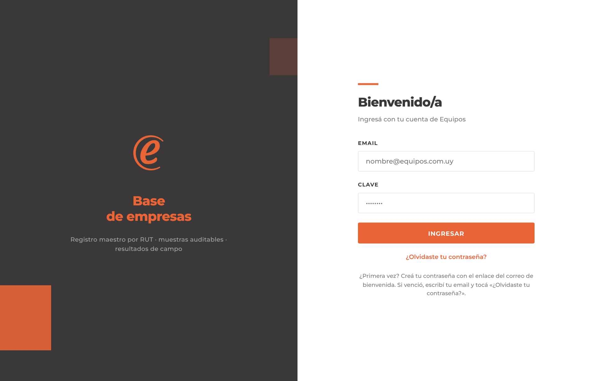

Si no podés entrar, la pantalla te dice por qué:

| Mensaje | Qué hacer |
| --- | --- |
| "Email o clave incorrectos" | Revisá lo que escribiste. Si es tu primer ingreso, primero creá tu contraseña con el enlace del correo de bienvenida |
| "… no tiene acceso a la Base de Empresas" | Todavía no te dieron de alta: pedíselo a un administrador |
| "Tu acceso está desactivado" | Un administrador te desactivó: pedile que te reactive |
| "Tu email no está verificado" | Pedile a un administrador que te reenvíe el acceso |
| "Demasiados intentos fallidos" | Esperá unos minutos o restablecé tu contraseña |
| "No se pudo conectar…" | Revisá tu conexión a internet y probá de nuevo |

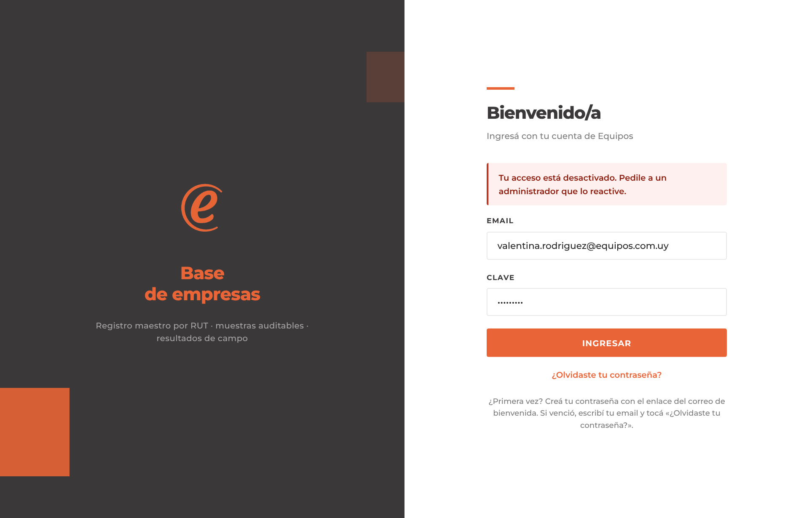

La pantalla de **Inicio** resume el estado de la base (empresas activas, disponibles para muestra, con teléfono discable, muestras activas, intermediarios confirmados y llamadas de los últimos 7 días) y las **bandejas pendientes** de tu rol. Los números naranjas del menú indican cuántos pendientes hay en cada bandeja.

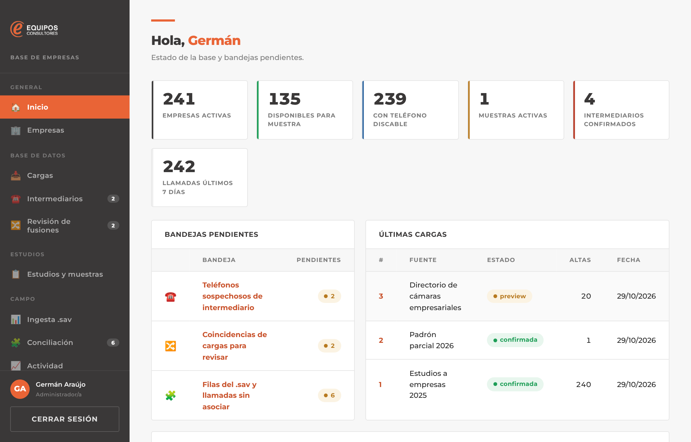

Abajo, la pantalla muestra la **última corrida del job del CDR** y su estado. Si la última corrida programada falló, o si pasaron 26 horas sin ninguna corrida, administradores y coordinadores ven un aviso arriba de todo con el motivo; el administrador tiene un enlace directo a Configuración para resolverlo.

## Empresas

### Buscar

En **Empresas** buscás por RUT (con o sin puntos) o por razón social o nombre de fantasía, y filtrás por departamento, tamaño, naturaleza jurídica y disponibilidad. La columna **Disponibilidad** dice si la empresa puede salir en una muestra y, si no, qué regla la bloquea.

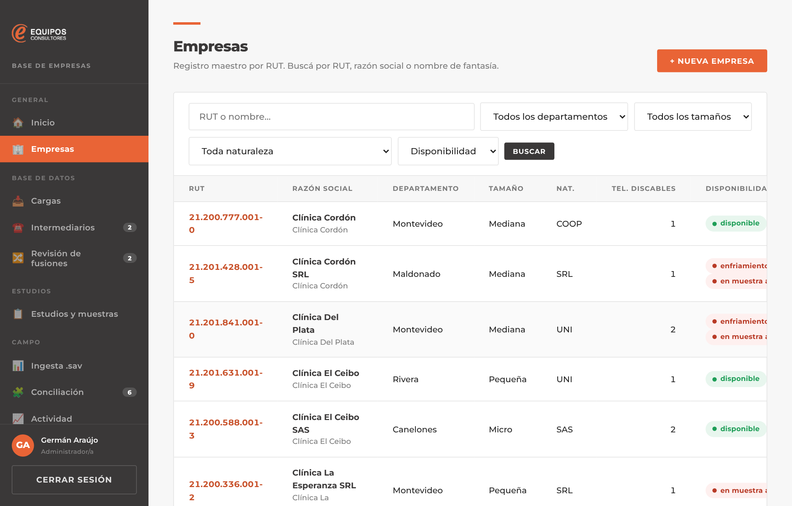

Las reglas que bloquean a una empresa son:

| Regla | Significa | Hasta cuándo |
| --- | --- | --- |
| Naturaleza excluida | Su naturaleza jurídica está marcada como excluida de contacto | Mientras siga excluida |
| No llamar | Hay un pedido de no llamar para la empresa | Hasta que un administrador lo levante |
| Enfriamiento | Tuvo un contacto efectivo hace menos de los meses configurados | La fecha se muestra en la ficha |
| En muestra activa | Está en una muestra activa (titular o reemplazo) | Hasta que se cierre la muestra |
| Sin teléfono discable | No tiene ningún número que se pueda llamar | Hasta que se agregue o libere un teléfono |
| Empresa cerrada | La sala o una fuente informó que cerró | Hasta que un dato más confiable diga otra cosa |

### La ficha de la empresa

Tocá el RUT para abrir la ficha. Arriba ves la razón social, el RUT, el estado y si está disponible; debajo, cuántos teléfonos discables y contactos tiene, en cuántas muestras estuvo y su último contacto efectivo.

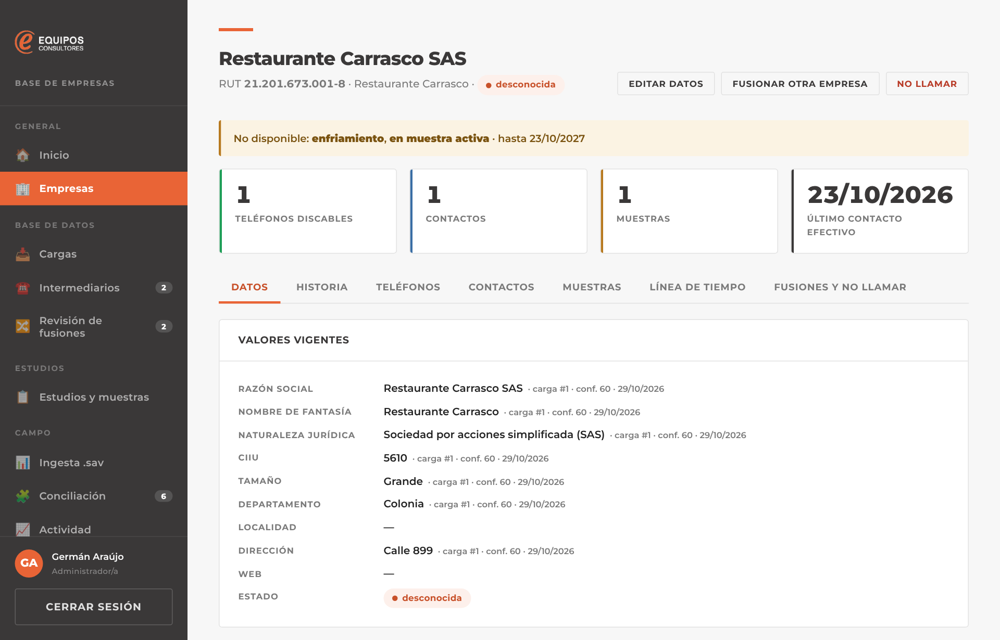

La pestaña **Datos** muestra el valor vigente de cada campo y de dónde salió: fuente (carga, sala, manual…), número de lote, confianza y fecha.

La pestaña **Historia** muestra todos los valores que llegó a tener cada campo. El vigente está resaltado en naranja; los tachados son de cargas o fusiones que se deshicieron. Así se resuelve "de dónde salió este dato".

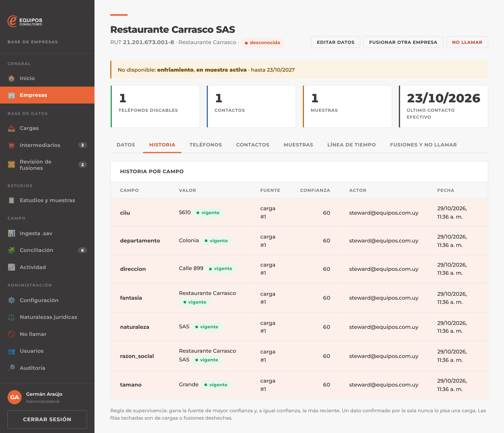

> **Cómo se elige el valor vigente.** Gana la fuente de mayor confianza y, a igual confianza, la más reciente. Un dato confirmado por la sala (por ejemplo, "la empresa cerró") nunca lo pisa una carga. Una corrección manual del data steward sí puede corregirlo.

La pestaña **Teléfonos** lista cada número con el estado de su vínculo con esta empresa (sin verificar, verificado, no corresponde, intermediario, inexistente), si es discable, alertas (intermediario, no llamar), cuántos RUTs comparten el número, cuántas veces se llamó y cuándo fue el último intento. El data steward puede cambiar el estado del vínculo o agregar un teléfono.

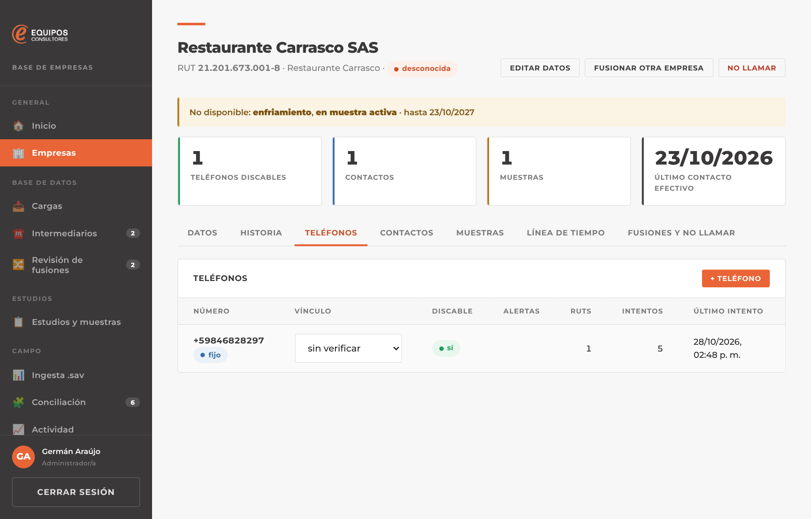

La pestaña **Línea de tiempo** junta todo lo que pasó con la empresa, del más reciente al más viejo: llamadas del CDR (con disposición, duración y encuestador), resultados de cada parte, cambios de datos, cambios de estado de teléfonos, muestras en las que salió y pedidos de no llamar.

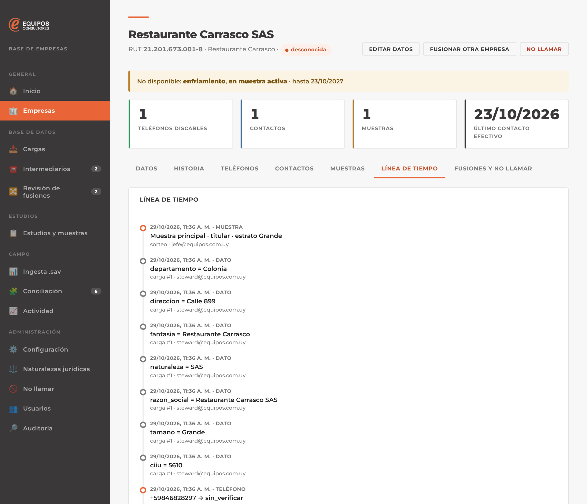

Las pestañas **Contactos**, **Muestras** y **Fusiones y no llamar** completan la ficha. Los contactos son datos personales (Ley 18.331): el rol Lectura los ve ocultos.

### Acciones del data steward en la ficha

- **Editar datos:** corrige campos con fuente "manual". Se registran solo los campos que cambiás; indicá el motivo.
- **Fusionar otra empresa:** cuando dos RUTs son la misma empresa, escribí el RUT de la que se absorbe. Sus teléfonos, contactos y sucursales pasan a esta; la absorbida queda guardada como "fusionada" y la fusión se puede **deshacer** desde la pestaña Fusiones.
- **No llamar** (también administrador): registra un pedido de no llamar con motivo y quién lo pidió. Se respeta en todas las muestras y CSV desde ese momento.

## Data steward

### Cargar una base

Las bases (estudios anteriores, padrones, directorios) entran por **Cargas → Nueva carga**. Se aceptan .xlsx, .csv y .sav de hasta 30 MB. Nada se escribe en la base hasta que confirmes.

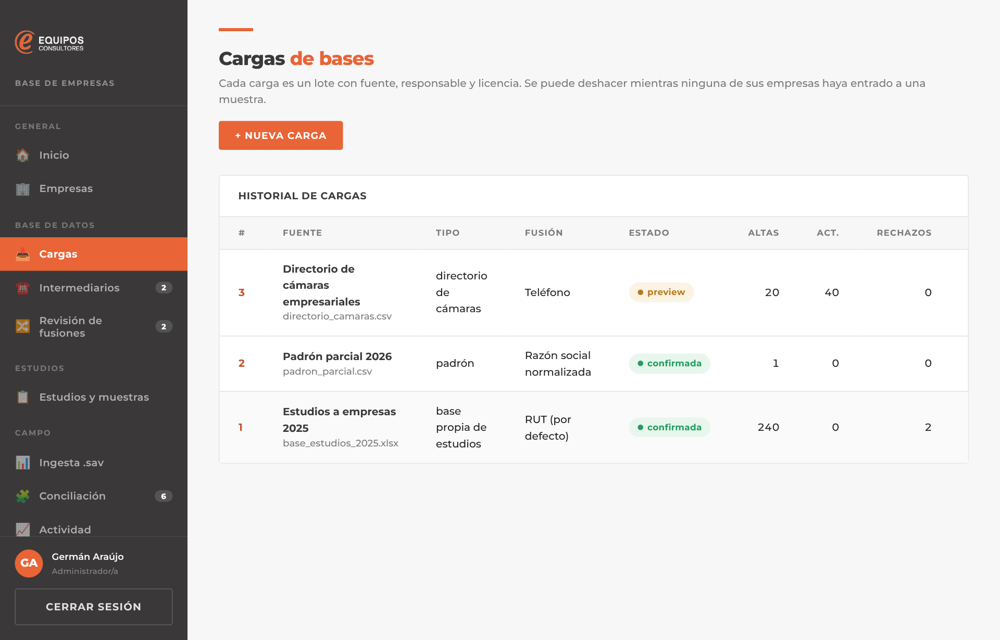

**Paso 1 — Archivo.** Arrastrá el archivo e indicá el **tipo de fuente** (por ejemplo, "padrón DGI" o "directorio de cámaras"). El mapeo de columnas se guarda como plantilla de ese tipo y se reusa la próxima vez.

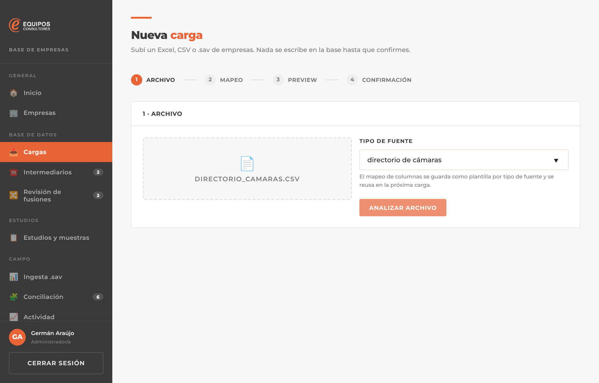

**Paso 2 — Mapeo.** El sistema muestra solo los campos que reconoció en el archivo (por el nombre de la columna, por los sinónimos de los atributos o por la plantilla del tipo de fuente), en cuatro bloques. **Todo es opcional salvo el RUT.**

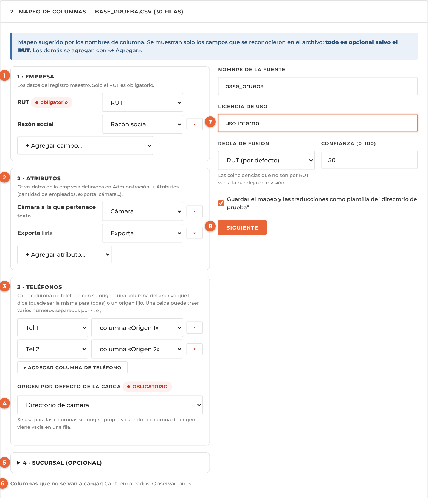

1. **Empresa:** los campos del sistema. «+ Agregar campo» suma otro y la × lo quita; un campo sin columna no se guarda.
2. **Atributos:** otros datos de la empresa definidos en **Administración → Atributos** (cantidad de empleados, exporta, cámara…).
3. **Teléfonos:** cada columna de teléfono con su **origen**: una columna del archivo que lo dice («Origen 1» para «Tel 1», o una sola para todas) o un origen fijo. El sistema sugiere el emparejamiento por nombre.
4. **Origen por defecto** (obligatorio): para las columnas sin origen propio y cuando la columna de origen viene vacía.
5. **Sucursal** (plegado): un local con dirección distinta de la fiscal.
6. **Columnas que no se van a cargar:** revisá que no quede afuera nada que importe.
7. Licencia de uso (obligatoria), regla de fusión y confianza, como siempre. 8. **Siguiente.**

Los contactos no se cargan desde una base: se generan en el campo, con el .sav.

**Paso 2b — Traducción de valores.** Si la columna de origen o un atributo de lista trae valores que no coinciden exactamente con el catálogo («guia», «GUIA TEL.»), cada valor distinto aparece con cuántas filas tiene. Elegí un valor del catálogo, «Sin dato» o (administrador) «+ Crear uno nuevo». Las sugerencias no se aplican solas: «Usar sugerencias» las confirma. La traducción queda en la plantilla del tipo de fuente.

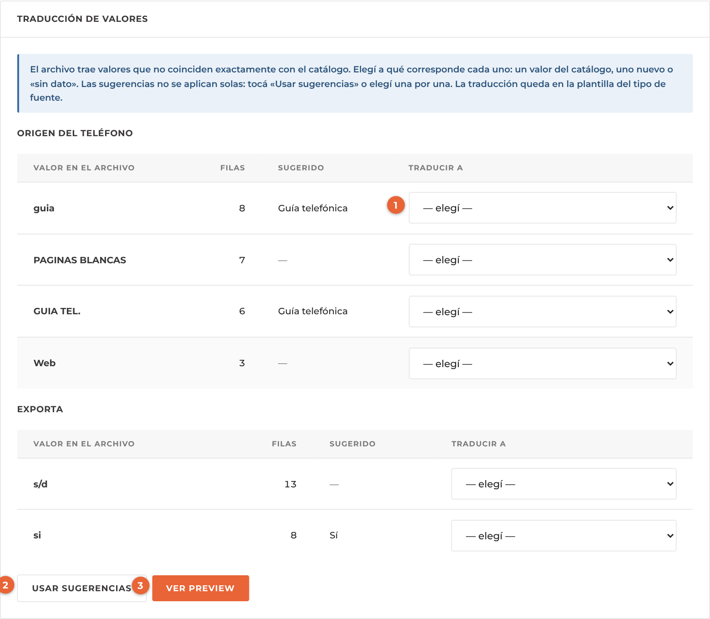

**Paso 3 — Preview.** El sistema procesa el archivo completo sin guardar nada y muestra los conteos reales: altas, actualizaciones, sin cambios, conflictos, rechazos, filas a revisión, nuevos sospechosos y teléfonos nuevos; además, **filas sin teléfono, con 1, 2 y 3 o más**, **teléfonos por origen** (nuevos y ya existentes) y **atributos** cargados, inválidos y sin dato. Las filas sin teléfono no se rechazan: la empresa queda no disponible por «sin teléfono discable». Un número o una fecha que no se puede interpretar queda como vino y se cuenta como inválido.

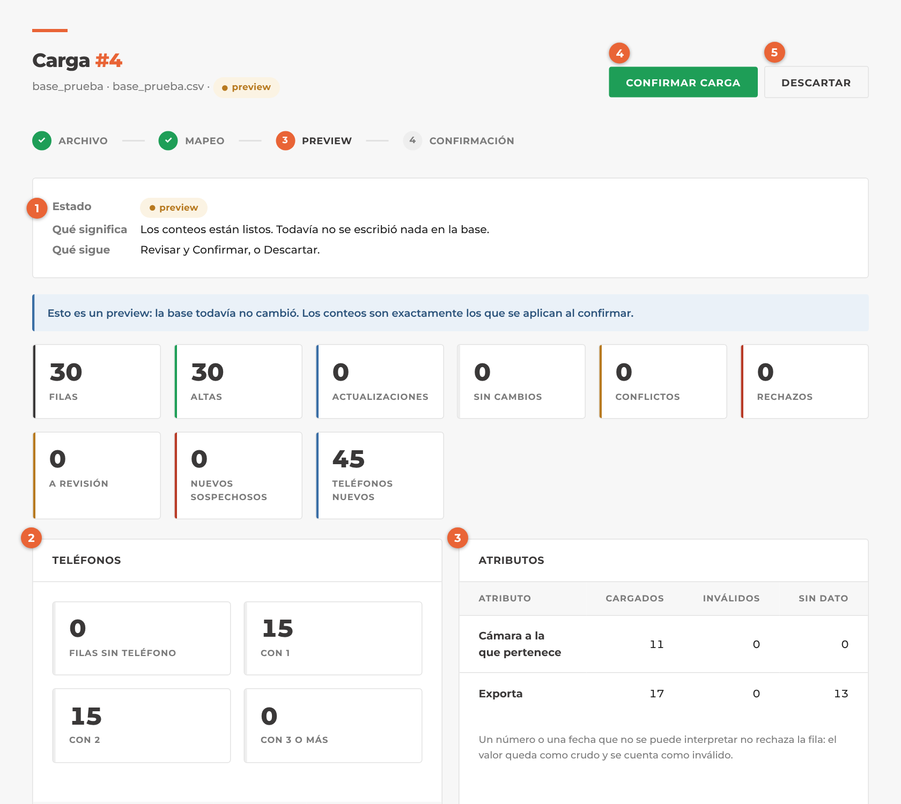

**Paso 4 — Confirmar o descartar.** **Confirmar carga** aplica exactamente lo que mostró el preview. **Descartar** la deja «descartada»: no se aplica y queda como registro. Cada estado explica qué significa y qué sigue:

| Estado | Qué significa | Qué sigue |
| --- | --- | --- |
| Analizando | Se lee el archivo y se calcula el preview | Esperar |
| Preview | Conteos listos; todavía no se escribió nada | Confirmar o Descartar |
| En proceso | Se está aplicando a la base | Esperar |
| Confirmada | Aplicada a la base | Se puede Deshacer mientras ninguna empresa haya entrado a una muestra |
| Descartada | Se revisó y no se aplicó | Nada |
| Deshecha | Se aplicó y después se anuló; la historia queda tachada | Nada |
| Error | Falló el análisis o la aplicación | Corregir y hacer una carga nueva |

> **Deshacer una carga.** Desde el detalle de una carga confirmada, **Deshacer carga** anula todo lo que trajo (valores, atributos, vínculos y el origen que sumó a teléfonos que ya existían), mientras ninguna de sus empresas haya entrado a una muestra. La historia no se borra: queda tachada.
>
> **Borrar una carga (administrador).** Si la carga no se puede deshacer (porque sus empresas ya están en una muestra) o se quiere eliminar del todo, **Borrar carga** la elimina con su archivo: las empresas que solo venían de esa carga se borran por completo, incluido su lugar en las muestras y su actividad de campo, y las demás se recalculan sin lo que aportó. Se confirma escribiendo BORRAR y no se puede deshacer. De la misma forma, **Borrar empresa** en la ficha elimina una empresa (se confirma escribiendo su RUT). Ambos quedan en Auditoría.
>
> **Borrar una carga trabada.** Una carga puede quedar «analizando» o «en proceso» para siempre si su tarea no arrancó o si se cortó a mitad de camino; el detalle avisa cuando la tarea está **trabada** (figura corriendo hace más de 30 minutos). **Borrar carga** funciona en cualquier estado: el modal dice qué tarea se cancela, la tarea se detiene **sin aplicar nada** y queda «cancelada», y después se borra la carga.

Las filas con RUT inválido o sin RUT se rechazan siempre (en la fase 1 toda empresa entra con RUT válido). El motivo queda en el detalle de la carga.

### Intermediarios

Un teléfono vinculado a 5 RUTs o más (el umbral se configura) queda **sospechoso de intermediario**: normalmente es el número de un estudio contable o jurídico que figura en muchas empresas. Mientras esté sospechoso no sale en ningún CSV.

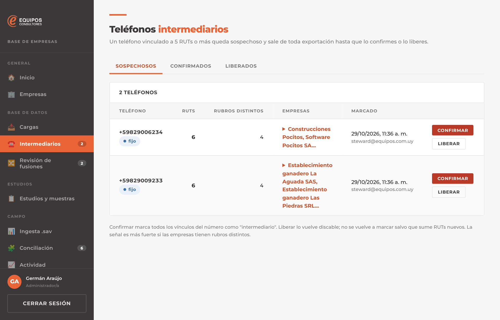

Para cada sospechoso ves cuántos RUTs lo comparten, de cuántos rubros distintos son (muchos rubros es una señal fuerte) y la lista de empresas. Entonces:

- **Confirmar:** marca todos sus vínculos como intermediario. No se vuelve a llamar.
- **Liberar:** si es un número legítimo (por ejemplo, la central de un grupo económico). Vuelve a ser discable y no se marca de nuevo salvo que aparezcan RUTs nuevos con ese número.

La sala también confirma intermediarios: cuando el encuestador responde "estudio contable o jurídico" en la pregunta de calidad del número.

### Revisión de fusiones

Cuando una carga usa una regla de fusión distinta del RUT, las filas que coinciden con una empresa existente (mismo teléfono, misma razón social o mismo dominio, pero otro RUT) esperan acá.

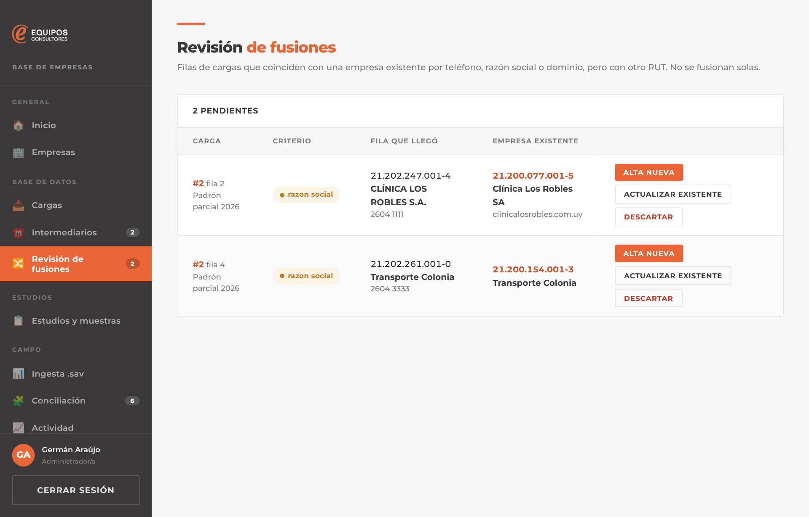

Comparás la fila que llegó con la empresa existente y elegís: **Alta nueva** (es otra empresa, se crea con su RUT), **Actualizar existente** (los datos se aplican a la empresa que ya estaba) o **Descartar**.

## Jefe de proyecto

### Estudios y partes

En **Estudios y muestras → Nuevo estudio** cargás nombre, cliente y fechas de campo, y la primera parte. Las fechas de campo importan: solo las llamadas dentro de ese período se asocian a los ítems de la muestra.

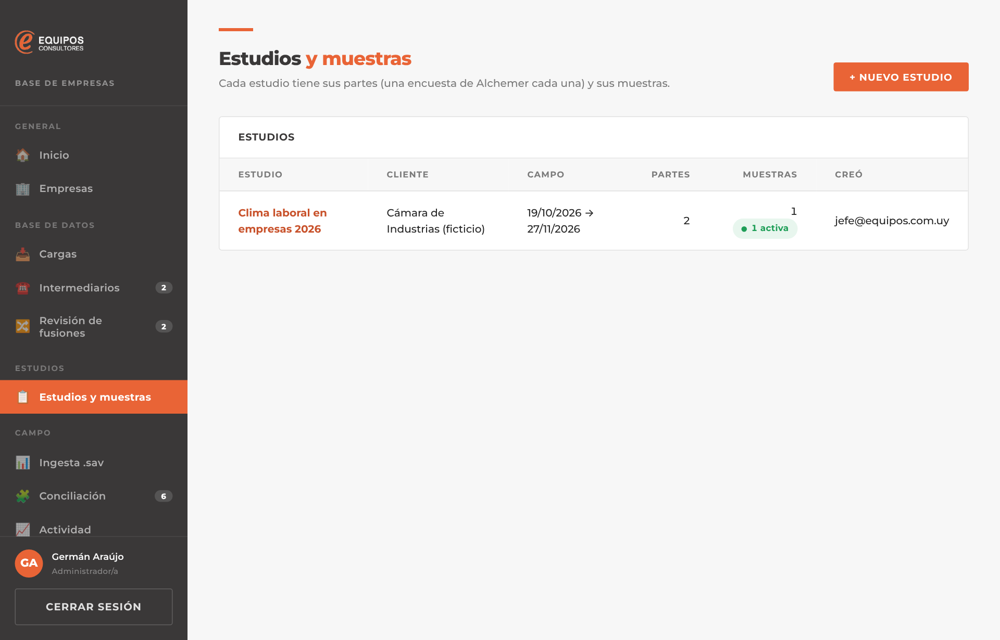

Cada **parte** es una encuesta de Alchemer con su survey ID, su link base y su respondente objetivo (área o cargo, por ejemplo "RRHH"). El respondente objetivo se usa para sugerir el contacto en el CSV. En el estudio ves sus partes (con cuántos ítems hay en cada estado) y sus muestras.

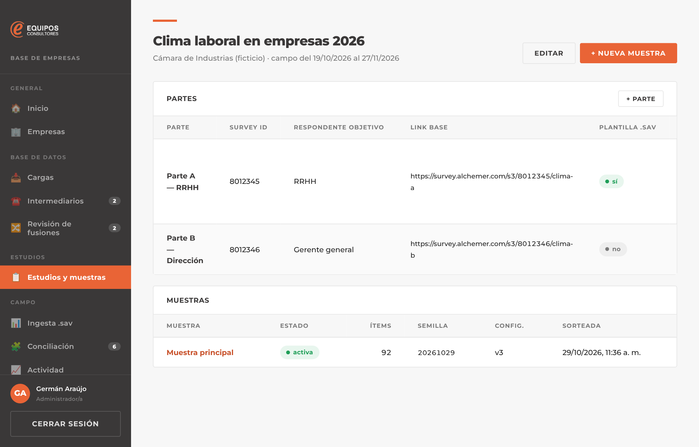

> **Borrar un estudio (administrador).** **Borrar estudio** elimina el estudio con sus partes, sus muestras (ítems, intentos del CDR y filas del .sav) y sus ingestas .sav con sus archivos. El modal muestra cuántos de cada uno se van a borrar y hay que escribir el nombre del estudio para confirmar. Lo que la base aprendió de las empresas **se conserva**: contactos y teléfonos nuevos, calidad de los números, historia y último contacto efectivo (las empresas con un contacto efectivo siguen en enfriamiento). Si una ingesta del estudio se estaba procesando, se cancela. No se puede deshacer; queda en Auditoría.

### Sortear una muestra

Desde el estudio, **Nueva muestra**:

1. **Filtros:** tamaño, departamento, naturaleza jurídica y prefijos de CIIU. Sin filtros entra toda la base disponible.
2. **Estratos:** elegí por qué estratificar (tamaño, departamento, naturaleza, CIIU a 1 o 2 dígitos) y tocá **Ver marco disponible**. El sistema muestra cuántas empresas cumplen los filtros, cuántas están disponibles y cuántas excluye cada regla.
3. **Tamaño por estrato:** titulares y reemplazos de cada estrato (con "Aplicar a todos" para cargarlos de una vez). Opcionalmente, una semilla.

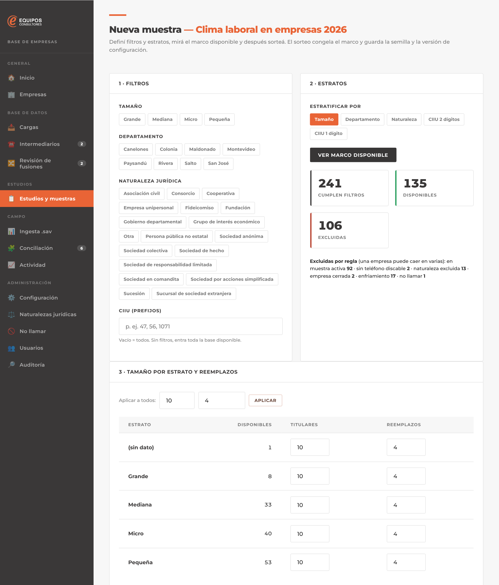

Al tocar **Crear y sortear** el sistema congela el marco (snapshot), aplica las reglas de la configuración vigente, sortea dentro de cada estrato y guarda la semilla y la versión de configuración. Los titulares quedan liberados; los reemplazos, en reserva y en orden.

**Filtros por atributo y por origen.** Los atributos marcados como filtro aparecen en el bloque Filtros (listas con botones, números y fechas con desde/hasta, textos con «contiene»), y los de lista marcados como estrato, en «Estratificar por». **Origen de los teléfonos** deja solo las empresas con al menos un teléfono discable de los orígenes elegidos; el cuadro de exclusiones dice cuántas dejó afuera.

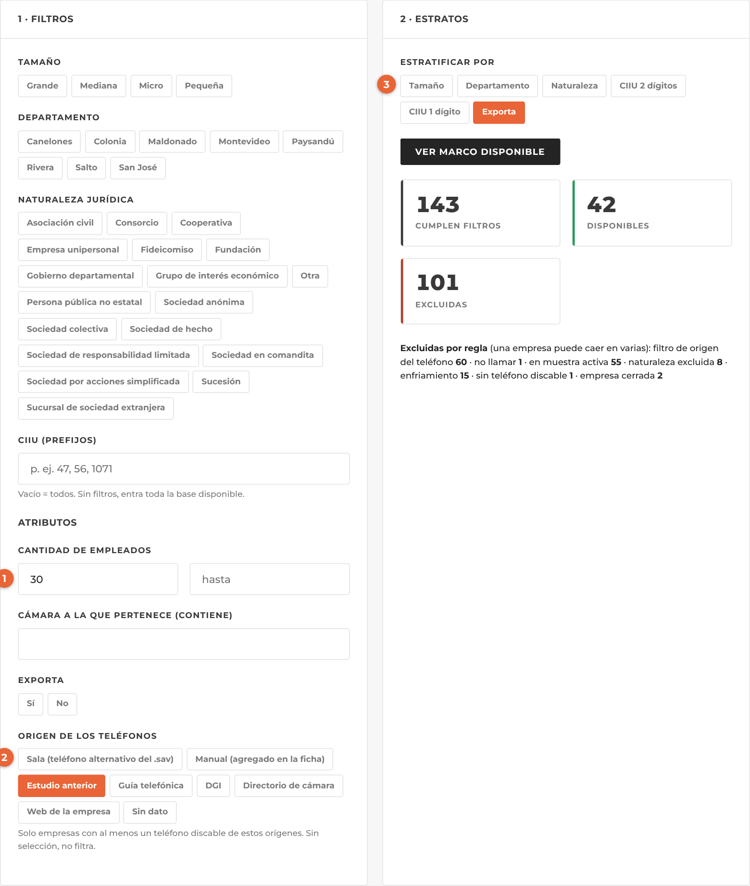

> **Muestras auditables.** Con la misma semilla, el mismo snapshot y la misma configuración, el sorteo da exactamente la misma lista en el mismo orden. El botón **Verificar reproducibilidad** lo comprueba en cualquier momento.

**Qué responde «Verificar reproducibilidad».** El marco congelado no cambia nunca, aunque después se borren empresas o cargas. Por eso hay cuatro respuestas posibles:

| Respuesta | Qué significa |
| --- | --- |
| Reproducible ✓ | El re-sorteo da la misma lista en el mismo orden |
| Reproducible ✓ — N empresas se borraron después del sorteo | Coincide contando las empresas que se borraron (por «Borrar empresa» o «Borrar carga»). La lista dice el estrato, el orden, el rol, el RUT si se conoce, y cuándo y quién las borró. La pantalla de la muestra también avisa «N empresas borradas después del sorteo» |
| ¡El re-sorteo no coincide! | La muestra se alteró de verdad: revisar la Auditoría |
| No verificable | Se borraron empresas de esta muestra con una versión anterior del sistema, que no guardaba los borrados. Ver Auditoría |

### Seguir la muestra

La pantalla de la muestra muestra los totales, las exclusiones del sorteo, los avisos (por ejemplo, "el estrato Grande no alcanza: pidió 10 y hay 8 disponibles"), el **avance por estrato** (llamados, contactabilidad, completas, tasa de respuesta, rechazos, fuera de marco) y la lista de ítems con su estado en cada parte.

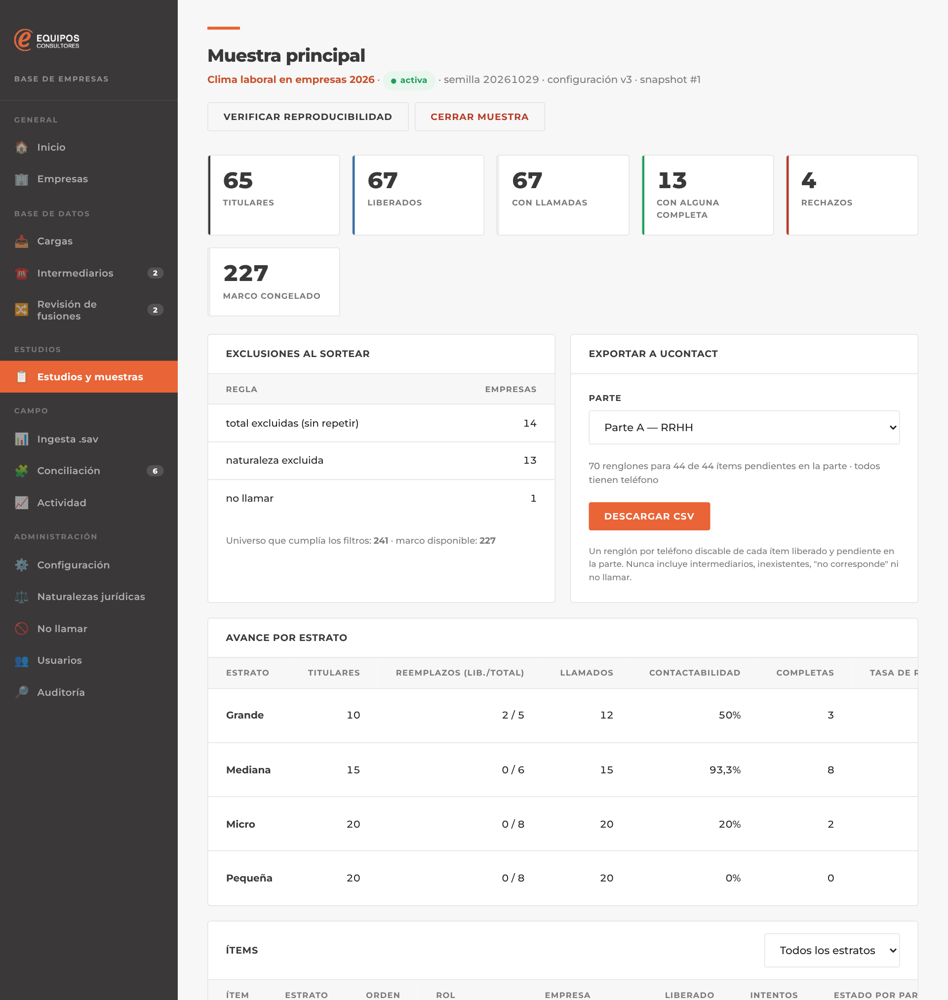

Mientras la muestra está activa, sus empresas no pueden salir en otra muestra. **Cerrar muestra** las libera y deja de permitir exportaciones.

> **Borrar una muestra (administrador).** **Borrar muestra** (en cualquier estado) elimina la muestra con sus ítems, sus intentos del CDR, sus filas del .sav y su marco congelado; el modal muestra cuántos y se confirma escribiendo BORRAR. Sus empresas vuelven a estar disponibles, salvo las que quedaron en enfriamiento por un contacto efectivo: lo que la base aprendió en el campo se conserva. No se puede deshacer; queda en Auditoría.

### Liberar reemplazos

Cuando un estrato tiene bajas (rechazos, fuera de marco), tocá **Liberar reemplazos** en ese estrato, indicá cuántos y el motivo. Se liberan en el orden sorteado y queda registrado quién y por qué.

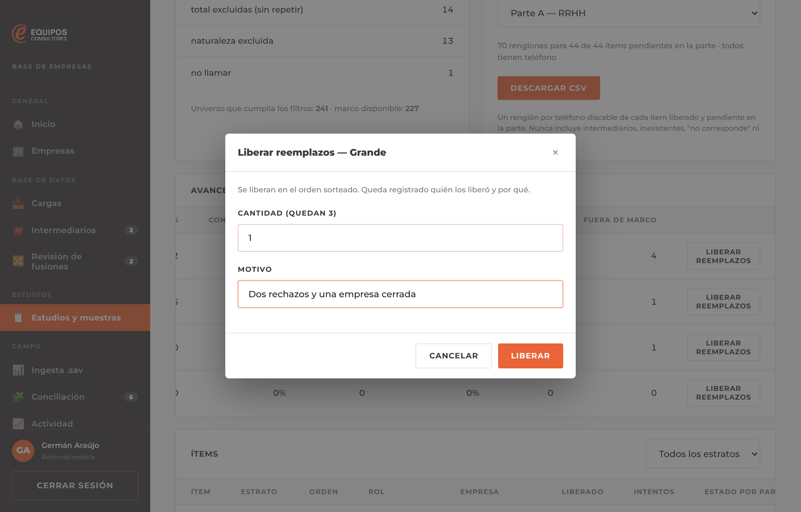

## Coordinador de campo

### Exportar el CSV para uContact

En la muestra, en **Exportar a uContact**, elegí la parte y tocá **Descargar CSV**. El resumen dice cuántos renglones salen, para cuántos ítems, y si algún ítem pendiente no tiene teléfono discable.

- Sale un renglón por cada teléfono discable de cada ítem liberado que esté pendiente o en curso en esa parte.
- Nunca salen intermediarios, números inexistentes o que no corresponden, ni nada en no llamar, aunque el pedido haya llegado después del sorteo.
- El link de Alchemer ya trae `EC_ID_ITEM`, `EC_RUT` y `EC_TEL_USADO`.
- La columna de contacto sugerido solo se completa si tu usuario tiene permiso para exportar contactos personales. Toda exportación queda auditada.
- **Orígenes a exportar:** todos (por defecto) o solo los elegidos; un teléfono con varios orígenes pasa si alguno está elegido. **Orden de los teléfonos:** por prioridad de origen y, dentro de cada origen, primero los verificados (por defecto). Las dos opciones quedan guardadas en la muestra y el resumen dice cuántos ítems quedan sin teléfono exportable por el filtro de origen.

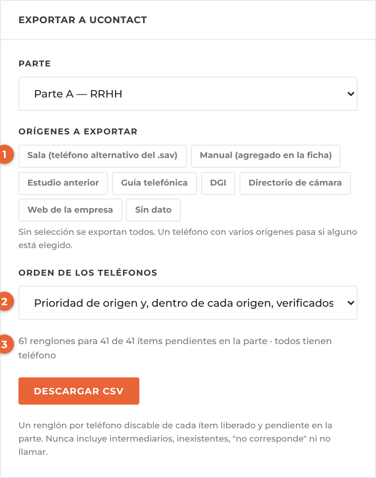

### Bloque estándar en Alchemer

Para que el .sav se asocie solo y actualice la base, cada cuestionario tiene que tener estas variables (el detalle de cómo armarlas está en `fase0/alchemer_bloque_estandar.md`):

| Variable | Qué es |
| --- | --- |
| `EC_ID_ITEM`, `EC_RUT` | URL variables ocultas que vienen en el link del CSV |
| `EC_TEL_USADO` | El teléfono con el que se hizo la encuesta (URL variable o pregunta) |
| `EC_CALIDAD_TEL` | 1 corresponde · 2 no es de la empresa · 3 estudio contable o jurídico · 4 la empresa cerró · 5 inexistente |
| `EC_TEL_ALT` | Número alternativo que dieron |
| `EC_RESP_NOMBRE`, `EC_RESP_CARGO`, `EC_RESP_AREA` | Quién contestó |
| `EC_RESULTADO` | 1 completa · 2 rechazo · 3 no corresponde · 4 agendada |

### Ingerir el .sav

Cuando cerrás una parte u ola, exportá el .sav de Alchemer y entrá a **Ingesta .sav**:

1. Elegí el estudio y la parte. Si es la segunda ola de un cuestionario que ya se usó en otro estudio, podés reusar el mapeo de esa otra parte.
2. Subí el .sav y tocá **Analizar**. El sistema lee el archivo y **propone** el mapeo: cuál es el `response_id`, cuál es el identificador (`EC_ID_ITEM` o RUT), qué variable corresponde a cada dato del sistema y, para las variables con códigos, qué valor del sistema corresponde a cada código.

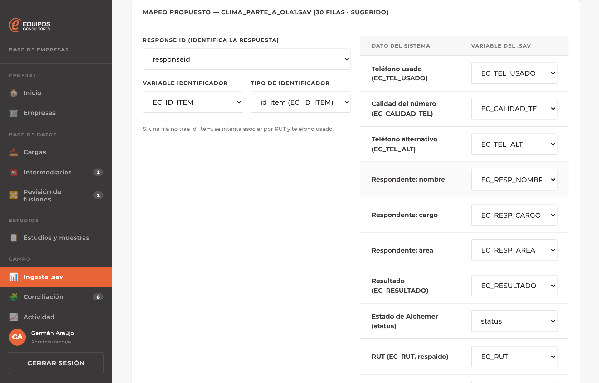

3. Revisá los **conteos**: filas asociadas a un ítem de la muestra, sin asociar (con motivo) y los valores sin mapear ("el 9 quedó sin mapear: 3 filas"). Si un código no tiene que hacer nada (por ejemplo, 9 = no sabe), mapealo a **ignorar**. Tocá **Recontar** después de cada cambio.

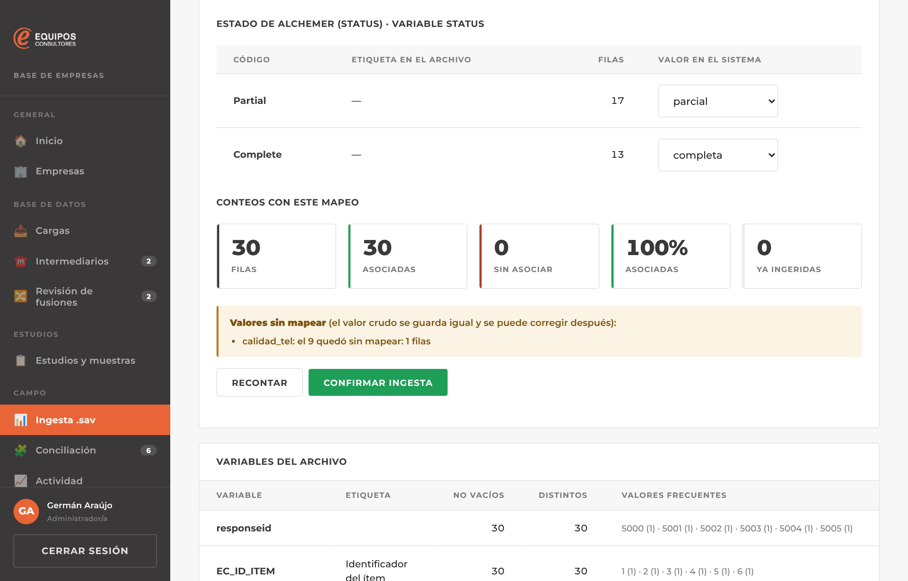

4. **Confirmar ingesta.** Recién ahí se aplica, en diferido. El mapeo queda como plantilla de la parte y se precarga en el próximo .sav.

Qué cambia en la base al confirmar:

| En el .sav | Cambio en la base |
| --- | --- |
| `EC_CALIDAD_TEL` = corresponde | El vínculo del teléfono usado pasa a **verificado** |
| = no es de la empresa / inexistente | El vínculo pasa a **no corresponde** / **inexistente**; deja de exportarse |
| = estudio contable o jurídico | El teléfono queda como **intermediario confirmado** |
| = la empresa cerró | La empresa pasa a **cerrada** (dato de la sala: una carga no lo pisa) |
| `EC_TEL_ALT` | Teléfono nuevo vinculado a la empresa, sin verificar, fuente "sala" |
| `EC_RESP_*` | Contacto nuevo o actualizado con su cargo y área |
| `EC_RESULTADO` | Estado del ítem en la parte (completa, rechazo, fuera de marco, en curso) |
| Completa, parcial o rechazo | Fecha de **último contacto efectivo** (de ahí se cuenta el enfriamiento) |

Cada cambio queda con su linaje: estudio, parte, ingesta, encuestador y fecha.

> **Subir el mismo .sav dos veces no duplica nada**: las respuestas se identifican por `response_id`. Podés subir el archivo acumulado de la parte cada vez que quieras.

### Corregir un mapeo

Si después de confirmar te das cuenta de que un código estaba mal mapeado, abrí la ingesta y tocá **Corregir mapeo**. Se reaplica sobre los valores crudos guardados, sin volver a subir el archivo.

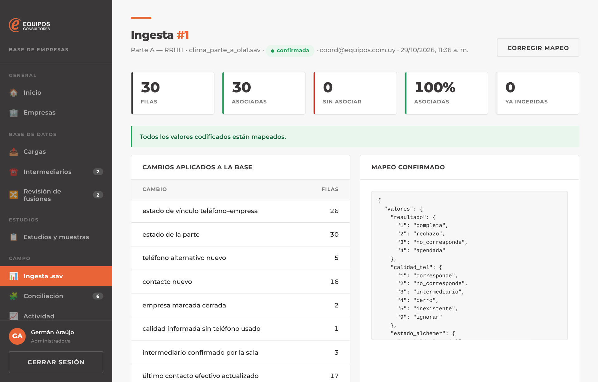

### Conciliación

Lo que no se pudo asociar solo espera en **Conciliación**:

- **Filas del .sav** sin ítem (por ejemplo, un `EC_ID_ITEM` mal escrito o un RUT que no está en la muestra). Podés ver los valores crudos y asociarla a un ítem; al hacerlo, sus resultados se aplican a la base.
- **Llamadas del CDR** cuyo número corresponde a más de un ítem de muestras activas (un número compartido). Elegís a qué ítem corresponde.

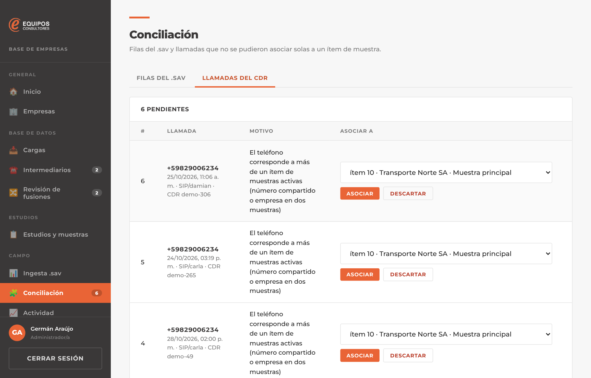

### Actividad

**Actividad** muestra, filtrando por estudio, muestra, encuestador y período: intentos, teléfonos marcados, empresas llamadas, contactos efectivos, completas y qué porcentaje de las llamadas quedó asociado a un ítem; intentos por franja horaria y por día; una tabla por encuestador (intentos, teléfonos, contactos efectivos, completas, intentos por completa); las disposiciones de llamada y las **corridas del job del CDR** (cuándo corrió, si fue programada o manual, el período leído, el estado y cuántos intentos nuevos cargó).

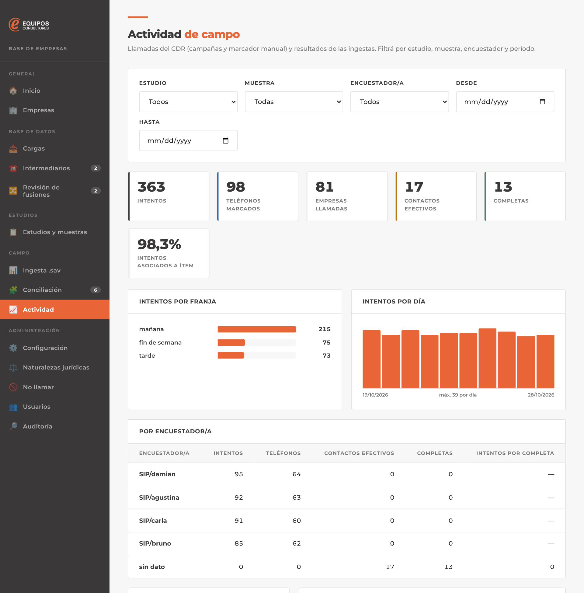

**Rendimiento por origen.** Por cada origen de teléfono: teléfonos discables, llamados, intentos, contactabilidad (teléfonos con al menos una llamada atendida sobre llamados; atendida = disposición ANSWERED o, si la disposición no lo dice, duración facturada mayor a 0), contactos efectivos, % que la sala marcó como no corresponde, inexistente o intermediario, e intentos por contacto efectivo. Un teléfono con varios orígenes cuenta en cada uno; la fila Total, una sola vez. Se descarga como CSV.

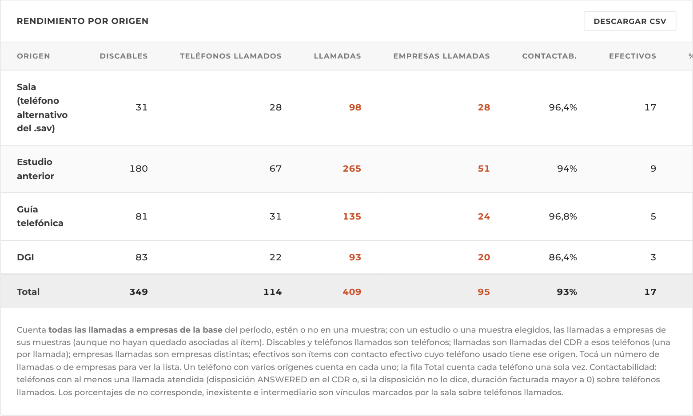

El CDR se procesa cada noche a las 4:00 (hora de Montevideo) e incluye las llamadas de campaña **y** las del marcador manual: se reconocen por el número marcado, no por la campaña. Las llamadas a internos y a números que no están en la base se cuentan pero no se guardan.

## Administrador

### Configuración

Todos los parámetros de negocio están en **Configuración** y se cambian sin pedir nada a un desarrollador. Cada vez que guardás se crea una versión nueva con tu nombre, la fecha y un comentario; las muestras guardan la versión con la que se sortearon.

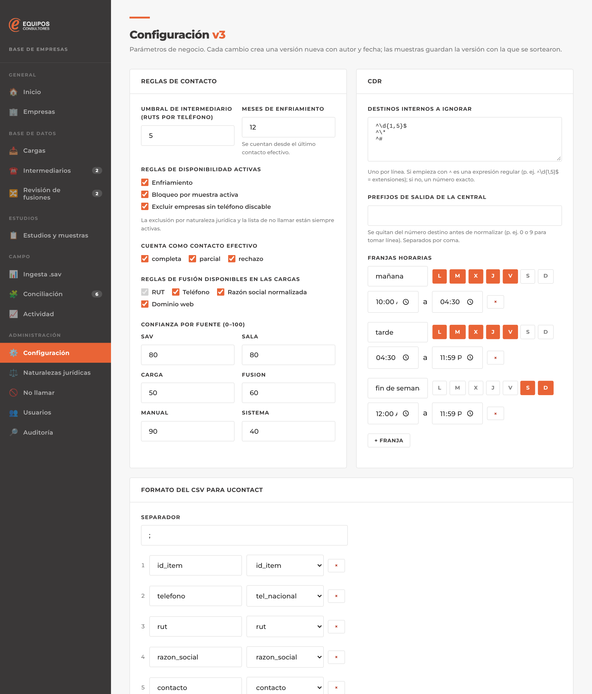

| Parámetro | Para qué sirve |
| --- | --- |
| Umbral de intermediario | Cuántos RUTs con el mismo teléfono lo vuelven sospechoso (5 por defecto) |
| Meses de enfriamiento | Cuánto tiempo después de un contacto efectivo una empresa no puede volver a sortearse |
| Reglas de disponibilidad | Activar o desactivar enfriamiento, bloqueo por muestra activa y exclusión de empresas sin teléfono discable. La naturaleza excluida y no llamar están siempre activas |
| Contacto efectivo | Qué resultados cuentan para el enfriamiento (completa, parcial, rechazo) |
| Reglas de fusión | Qué criterios se ofrecen en las cargas |
| Confianza por fuente | El peso de cada fuente en la regla de supervivencia |
| Destinos internos | Extensiones y números del CDR que se ignoran (uno por línea; los que empiezan con ^ son patrones) |
| Prefijos de salida | Dígitos que la central agrega para tomar línea y que hay que quitar |
| Franjas horarias | Nombre, días y horario de cada franja del tablero |
| Formato del CSV | Separador y columnas, para que coincida con la importación de uContact |

En el historial, tocá una versión para ver todos sus parámetros.

#### Conexión al CDR

La tarjeta **CDR — conexión a la base de uContact** tiene los datos que usa el job nocturno para leer las llamadas.

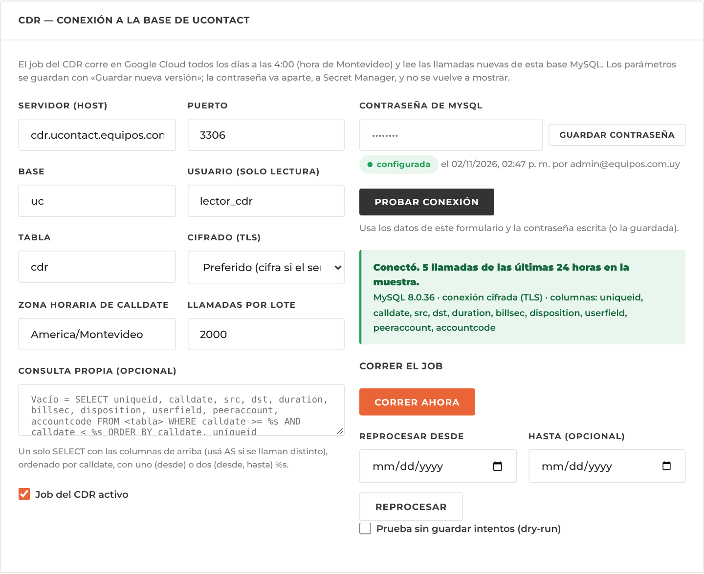

- **Servidor, puerto, base, usuario y tabla** de la base MySQL de uContact. El usuario conviene que sea de solo lectura.
- **Cifrado (TLS):** «Preferido» cifra si el servidor lo acepta; «Requerido» no deja conectar sin cifrado; «Desactivado» solo si el servidor no lo soporta.
- **Zona horaria de calldate** y **llamadas por lote** normalmente no se tocan.
- **Consulta propia (opcional):** solo si la tabla tiene otros nombres de columna. La ayuda debajo del campo dice qué tiene que devolver.
- **Job del CDR activo:** mientras no esté marcado, el job no lee nada (las corridas quedan como «omitida»).

Estos datos se guardan con **Guardar nueva versión**, como el resto de la configuración.

**La contraseña va aparte.** Escribila y tocá **Guardar contraseña**: se guarda en un lugar seguro (Secret Manager), fuera de la base y de la auditoría, y **nunca se vuelve a mostrar**. La tarjeta solo dice si está configurada, cuándo y quién la cargó. Para cambiarla, escribí la nueva y guardala.

**Probar conexión** usa los datos del formulario, aunque todavía no los hayas guardado, y la contraseña escrita (o la guardada). En pocos segundos dice si conectó, con qué versión de MySQL, si la conexión va cifrada y cuántas llamadas de las últimas 24 horas encontró. Si falla, dice por qué:

| Mensaje | Qué revisar |
| --- | --- |
| No se resuelve el host | El nombre del servidor |
| No responde el puerto | El puerto. Si está bien, el servidor probablemente acepta solo IPs autorizadas: avisale a quien hizo el despliegue (hace falta la IP fija) |
| Usuario o contraseña incorrectos | El usuario y la contraseña |
| La base no existe / La tabla del CDR no existe | Los nombres de base y tabla, o la consulta propia |
| El usuario no tiene permiso | Que al usuario de MySQL le den permiso de lectura |
| Error de cifrado (TLS) | Cambiar **Cifrado (TLS)** según lo que diga el mensaje |
| Faltan columnas en la consulta | La consulta propia: usá `AS` para renombrar columnas |

**Correr el job a mano.** **Correr ahora** lee las llamadas nuevas sin esperar a las 4:00. **Reprocesar desde** (con **Hasta** opcional) vuelve a leer un período, por ejemplo para cargar el histórico la primera vez o recuperar días en que el job falló. Reprocesar no duplica llamadas ni hace que el job nocturno retroceda. Con **Prueba sin guardar intentos (dry-run)** el job cuenta lo que haría sin escribir nada. La tarjeta sigue la corrida y muestra el resultado al terminar; no se puede lanzar otra mientras una está en curso.

### Atributos de empresa

En **Administración → Atributos** se definen los datos que traen las bases y que no son campos del sistema (cantidad de empleados, exporta, cámara…): nombre, clave (no se cambia después), tipo (texto, número, fecha o lista), sinónimos para el mapeo automático, si sirve como filtro y si sirve como estrato (solo listas). Desactivar un atributo lo saca del mapeo y de los filtros pero conserva sus valores; solo se borra uno sin valores y que no se use en una muestra activa. Los campos del sistema (RUT, razón social, naturaleza, CIIU, tamaño…) no se pueden borrar ni renombrar.

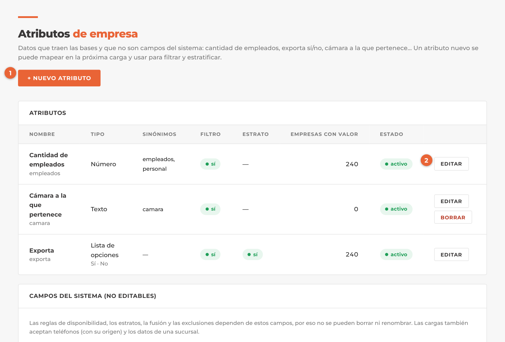

### Orígenes de teléfono

En **Administración → Orígenes de teléfono** está el catálogo de dónde sale cada número. El orden es la prioridad que usa el CSV. **Sala**, **Manual** y **Sin dato** son de sistema y no se borran; un origen con teléfonos se desactiva en lugar de borrarse.

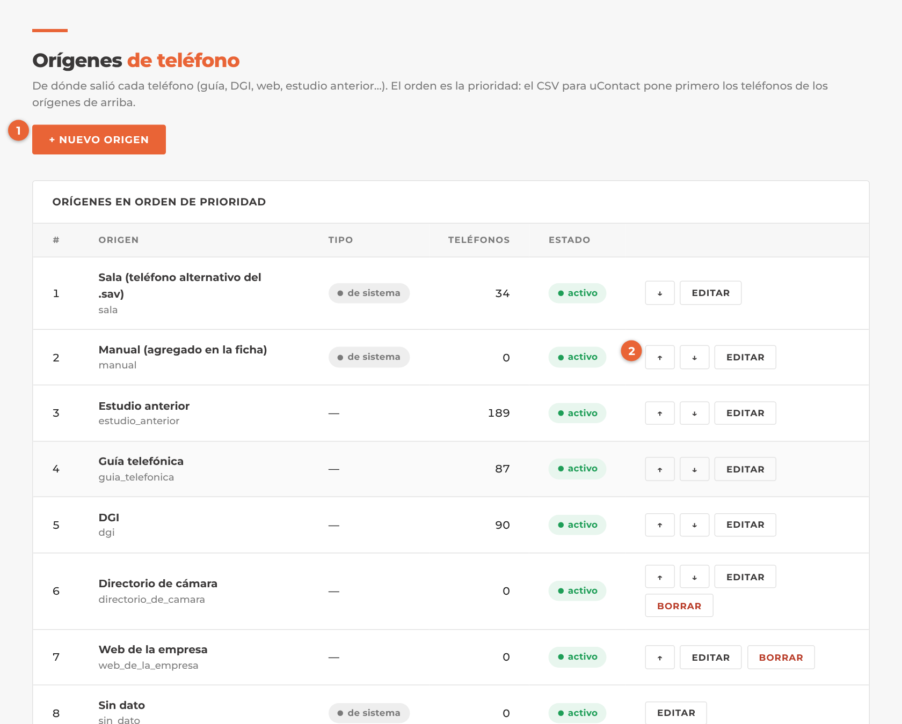

### Naturalezas jurídicas

El catálogo de naturalezas tiene la marca **excluida de contacto**. Las empresas de una naturaleza excluida se guardan y se siguen actualizando, pero nunca entran a un marco muestral ni a un CSV. Cambiar la marca crea una versión nueva de la configuración.

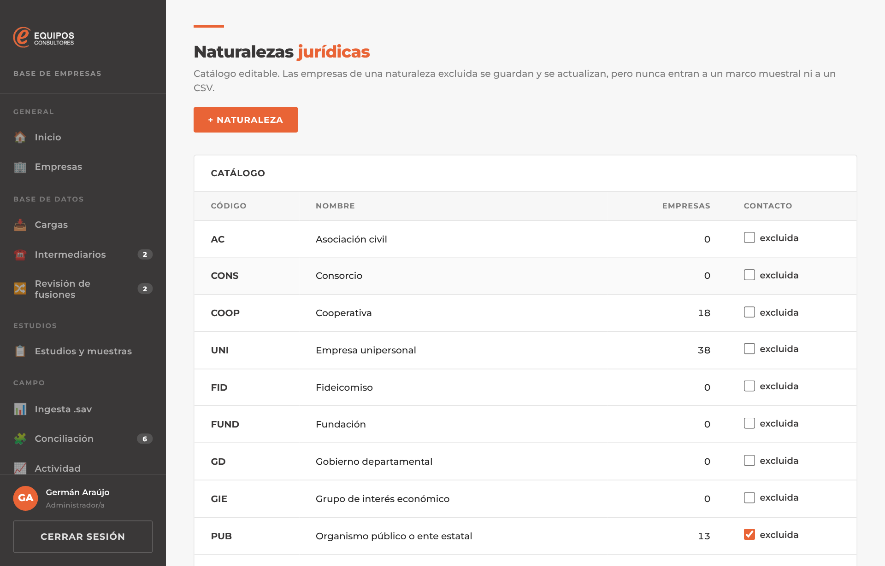

### No llamar

Registro de pedidos de no llamar por empresa (RUT), teléfono o contacto, con motivo, quién lo pidió y quién lo registró. Es el mecanismo para atender los derechos de supresión de la Ley 18.331. Un pedido se puede **levantar** (con motivo); el historial se conserva.

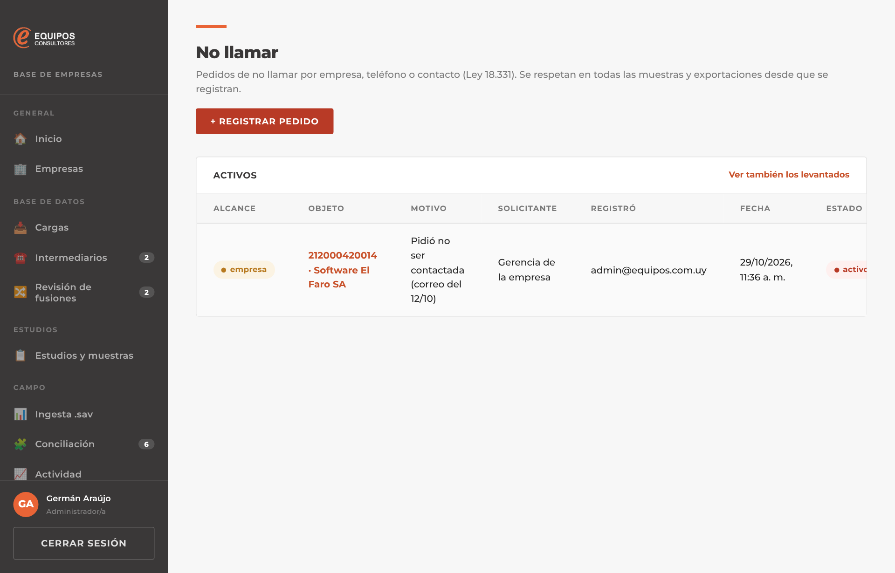

### Usuarios

En **Usuarios** se da de alta a las personas, se les cambia el rol y se las activa o desactiva. Todo se hace desde esta pantalla: no hace falta entrar a la consola de Firebase.

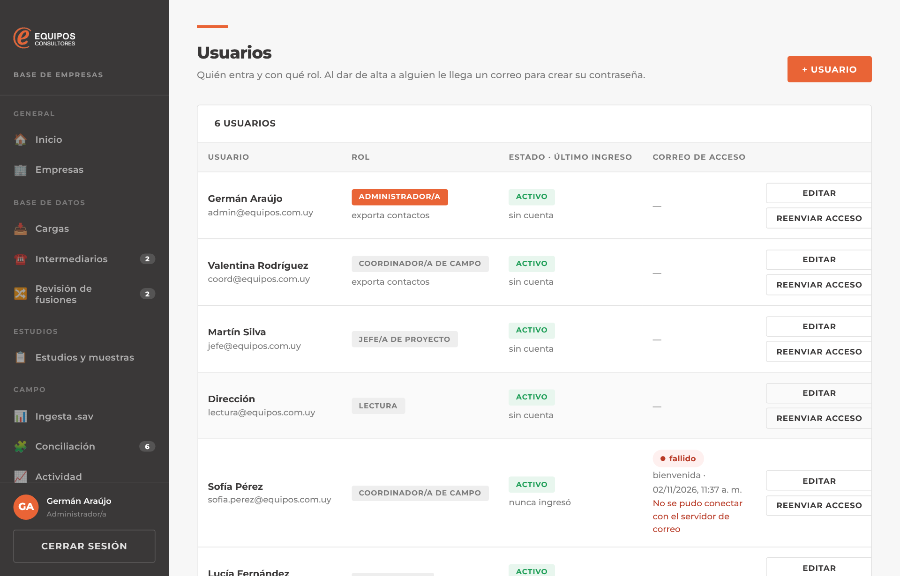

La tabla muestra, para cada persona:

- **Rol**, y si puede exportar contactos personales.
- **Estado** y **último ingreso**. "Nunca ingresó" es alguien que todavía no creó su contraseña; "sin cuenta", alguien registrado antes del alta con enlace, que necesita «Reenviar acceso».
- **Correo de acceso:** si el último correo salió (**enviado**) o no (**fallido**, con el motivo), qué correo fue y cuándo.

**Dar de alta.** Tocá **+ Usuario**, escribí email, nombre y rol, y marcá si puede exportar contactos personales. Tocá **Dar de alta**: la persona recibe un correo con el enlace para crear su contraseña (vence en una hora).

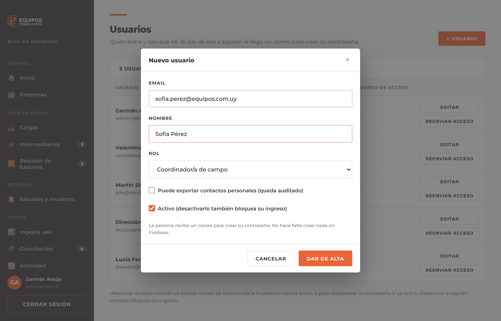

**Si el correo no salió**, la cuenta queda creada igual y aparece el enlace en una ventana que **se muestra una sola vez**. Tocá **Copiar enlace** y pasáselo a la persona por otro canal (WhatsApp, Teams). El enlace no se guarda en ningún lado: si se pierde, usá **Reenviar acceso**.

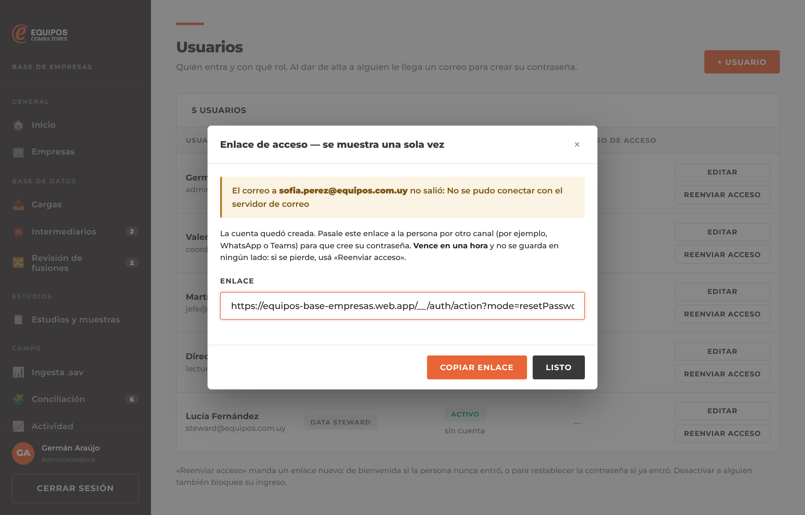

**Reenviar acceso.** Manda un enlace nuevo a quien lo perdió o lo dejó vencer: el de bienvenida si nunca entró, o uno para restablecer la contraseña si ya entró. Si la persona no tenía cuenta (por ejemplo, alguien registrado antes de este cambio), se la crea. Queda registrado quién lo pidió y cuándo.

**Editar.** Cambiar el nombre, el rol o el permiso de exportar contactos no manda ningún correo.

**Desactivar.** Desmarcá **Activo** al editar: la persona ya no puede entrar y ve "Tu acceso está desactivado". Para devolverle el acceso, volvé a marcarlo. No podés desactivarte ni quitarte el rol de administrador a vos mismo.

> **Si el email ya tenía cuenta** (por ejemplo, creada a mano antes), el alta no crea otra ni le cambia la contraseña: la registra con su rol y te avisa que uses **Reenviar acceso** si necesita entrar.

### Auditoría

Registro inalterable de cargas, fusiones, exclusiones, sorteos, exportaciones, ingestas, cambios de configuración y de usuarios. Se filtra por acción, objeto y actor; cada evento tiene su detalle. También se exporta todos los días a BigQuery para consultas largas.

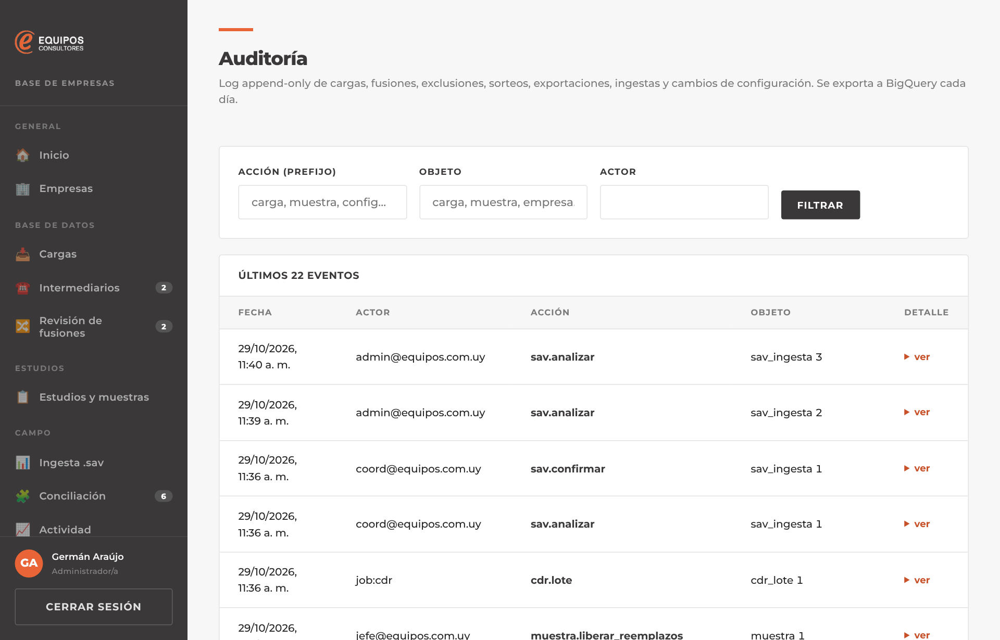

## Preguntas frecuentes

**No me llegó el correo para crear mi contraseña.** Buscalo en spam. Si no está, pedile a un administrador que use **Reenviar acceso**; si el correo vuelve a fallar, la pantalla le muestra el enlace para pasártelo por otro canal.

**El enlace del correo dice que venció o que ya se usó.** Los enlaces duran una hora y sirven una vez. En la pantalla de ingreso escribí tu email y tocá **¿Olvidaste tu contraseña?**.

**¿Por qué una empresa no salió en la muestra?** Abrí su ficha: el aviso de disponibilidad dice qué regla la bloquea y hasta cuándo. En la muestra, el cuadro de exclusiones dice cuántas empresas sacó cada regla.

**El CSV tiene menos renglones de los que esperaba.** Solo salen teléfonos discables de ítems liberados y pendientes o en curso en esa parte. El resumen arriba del botón dice cuántos ítems no tienen teléfono discable.

**Una llamada manual, ¿cuenta?** Sí. El CDR se analiza por número marcado, venga de una campaña o del marcador manual.

**En Inicio aparece un aviso del CDR.** El job de la noche falló o no corrió. Un administrador ve el motivo en **Actividad** (corridas del job) o en Configuración → **Probar conexión**, lo corrige y toca **Correr ahora**. No se pierden llamadas: la corrida siguiente sigue desde donde quedó.

**Subí el .sav y quedaron filas sin asociar.** Revisá el motivo en los conteos. Lo más común es que la encuesta no tenga la URL variable `EC_ID_ITEM`; en ese caso el sistema intenta por RUT y teléfono usado. Lo que no se resuelve va a Conciliación.

**Me equivoqué al cargar una base.** Si ninguna de sus empresas entró a una muestra, deshacé la carga desde su detalle. Si ya entraron, corregí los datos en la ficha o hacé una carga nueva con más confianza.

**¿Puedo volver a sortear una muestra?** Una muestra sorteada no se vuelve a sortear: se verifica. Si necesitás otra lista, cerrá la muestra y creá una nueva.

**Un número que confirmé como intermediario era legítimo.** En Intermediarios → Confirmados, tocá **Liberar**.

## Glosario

| Término | Significado |
| --- | --- |
| Ítem de muestra | Una empresa sorteada en una muestra, con su estrato, rol (titular o reemplazo) y orden |
| Parte | Una encuesta de Alchemer dentro de un estudio, con su respondente objetivo |
| Marco | Las empresas disponibles que cumplen los filtros al momento de sortear |
| Snapshot | Copia congelada del marco con la que se sorteó; permite reproducir la muestra |
| Semilla | Número que fija el sorteo: misma semilla y mismo marco dan la misma lista |
| Teléfono discable | Número válido, no intermediario, con vínculo sin verificar o verificado, y fuera de no llamar |
| Intermediario | Teléfono que no es de la empresa sino de un tercero (estudio contable o jurídico) compartido por muchos RUTs |
| Contacto efectivo | Encuesta completa, parcial o rechazo explícito de la empresa |
| Enfriamiento | Período después de un contacto efectivo en el que la empresa no se vuelve a sortear |
| Linaje | Registro de de dónde salió cada dato: fuente, lote, fecha, actor y confianza |
| Conciliación | Asociación manual de una respuesta o una llamada que el sistema no pudo asociar solo |
| CDR | Registro de llamadas de uContact |
