# Manual de usuario

La **Base de Empresas** es el registro maestro de empresas de Equipos, con el RUT como clave. De ahí salen las muestras de los estudios a empresas, se genera la lista para uContact y vuelven los resultados del campo (las llamadas del CDR y el .sav de Alchemer) para que la base aprenda en cada estudio: qué números no corresponden, cuáles son de estudios contables, quién atendió y cuándo se contactó a cada empresa.

Este manual sigue el circuito de un estudio y está organizado por rol. Las capturas usan datos ficticios de demostración.

## Roles

Cada persona entra con su email de Equipos y ve el menú de su rol. El sistema valida los permisos en el servidor: si una acción no está permitida para tu rol, el botón no aparece o el sistema avisa.

| Rol | Qué hace | Pantallas principales |
| --- | --- | --- |
| **Data steward** | Carga bases, resuelve intermediarios y coincidencias, corrige datos y fusiona empresas | Cargas, Intermediarios, Revisión de fusiones, Empresas |
| **Jefe/a de proyecto** | Crea estudios y partes, sortea muestras, libera reemplazos | Estudios y muestras, Actividad |
| **Coordinador/a de campo** | Exporta el CSV para uContact, ingiere el .sav, concilia y controla el campo | Estudios y muestras, Ingesta .sav, Conciliación, Actividad |
| **Administrador/a** | Configuración, naturalezas jurídicas, no llamar, usuarios y auditoría. Puede hacer todo lo de los demás roles | Administración |
| **Lectura** | Consulta, sin acciones. No ve los datos personales de los contactos | Inicio, Empresas, Estudios, Actividad |

## El circuito de un estudio

1. **Data steward:** mantiene la base al día (cargas, intermediarios, revisión).
2. **Jefe de proyecto:** crea el estudio con sus partes y sortea la muestra.
3. **Coordinador:** descarga el CSV de cada parte y lo carga en uContact.
4. **Campo:** los encuestadores llaman (campaña o marcador manual) y completan la encuesta de Alchemer, incluidas las preguntas del bloque estándar.
5. **Cada noche (automático):** el CDR de uContact llega al sistema y registra los intentos de llamada.
6. **Coordinador:** al cerrar una parte u ola, sube el .sav y confirma el mapeo. La base se actualiza sola: calidad de cada número, teléfonos alternativos, contactos y fecha del último contacto efectivo.
7. **Jefe de proyecto:** mira el avance por estrato y libera reemplazos si hace falta.

## Ingreso y pantalla de inicio

Entrá a la dirección de la aplicación con tu email y tu clave. Si es la primera vez o la olvidaste, escribí tu email y tocá **¿Olvidaste tu contraseña?**: te llega un correo para elegir una clave nueva.

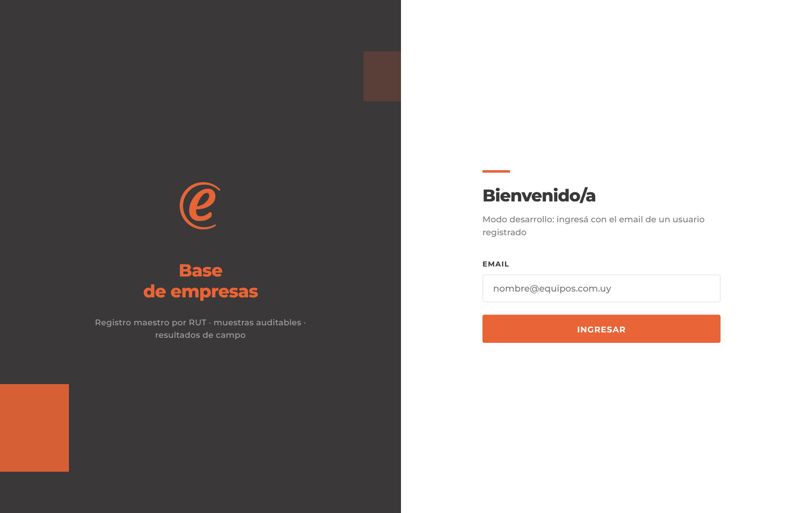

Si el sistema dice que tu email "no tiene acceso", pedile a un administrador que te agregue en **Usuarios** con tu rol.

La pantalla de **Inicio** resume el estado de la base (empresas activas, disponibles para muestra, con teléfono discable, muestras activas, intermediarios confirmados y llamadas de los últimos 7 días) y las **bandejas pendientes** de tu rol. Los números naranjas del menú indican cuántos pendientes hay en cada bandeja.

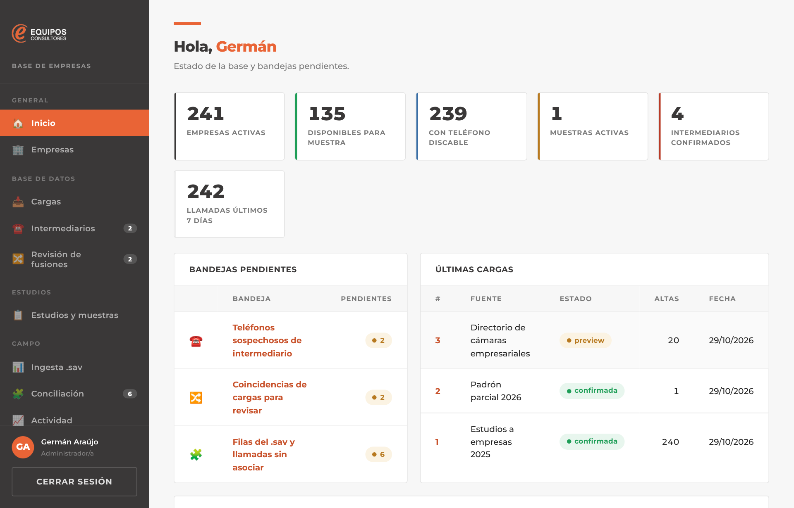

## Empresas

### Buscar

En **Empresas** buscás por RUT (con o sin puntos) o por razón social o nombre de fantasía, y filtrás por departamento, tamaño, naturaleza jurídica y disponibilidad. La columna **Disponibilidad** dice si la empresa puede salir en una muestra y, si no, qué regla la bloquea.

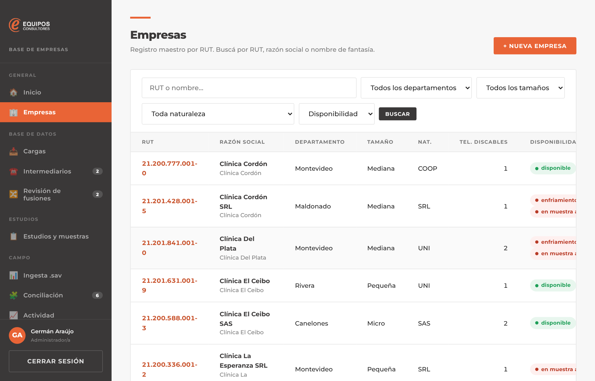

Las reglas que bloquean a una empresa son:

| Regla | Significa | Hasta cuándo |
| --- | --- | --- |
| Naturaleza excluida | Su naturaleza jurídica está marcada como excluida de contacto | Mientras siga excluida |
| No llamar | Hay un pedido de no llamar para la empresa | Hasta que un administrador lo levante |
| Enfriamiento | Tuvo un contacto efectivo hace menos de los meses configurados | La fecha se muestra en la ficha |
| En muestra activa | Está en una muestra activa (titular o reemplazo) | Hasta que se cierre la muestra |
| Sin teléfono discable | No tiene ningún número que se pueda llamar | Hasta que se agregue o libere un teléfono |
| Empresa cerrada | La sala o una fuente informó que cerró | Hasta que un dato más confiable diga otra cosa |

### La ficha de la empresa

Tocá el RUT para abrir la ficha. Arriba ves la razón social, el RUT, el estado y si está disponible; debajo, cuántos teléfonos discables y contactos tiene, en cuántas muestras estuvo y su último contacto efectivo.

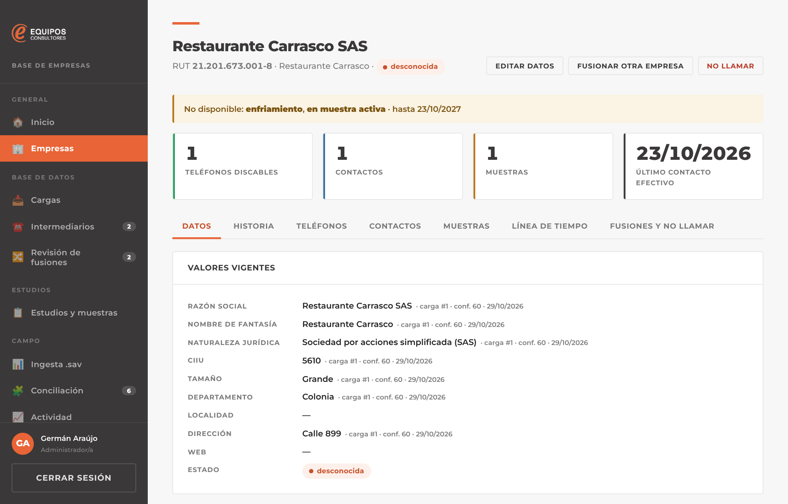

La pestaña **Datos** muestra el valor vigente de cada campo y de dónde salió: fuente (carga, sala, manual…), número de lote, confianza y fecha.

La pestaña **Historia** muestra todos los valores que llegó a tener cada campo. El vigente está resaltado en naranja; los tachados son de cargas o fusiones que se deshicieron. Así se resuelve "de dónde salió este dato".

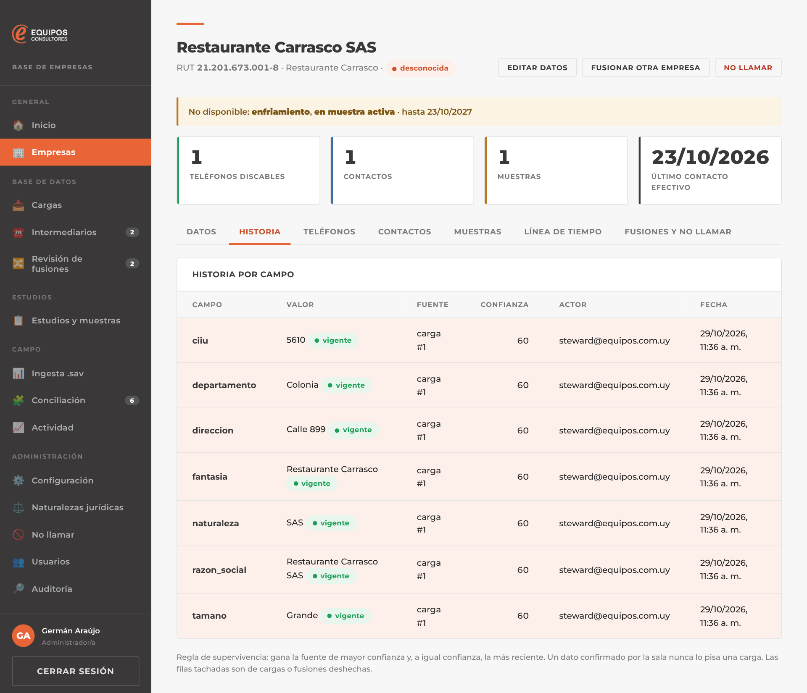

> **Cómo se elige el valor vigente.** Gana la fuente de mayor confianza y, a igual confianza, la más reciente. Un dato confirmado por la sala (por ejemplo, "la empresa cerró") nunca lo pisa una carga. Una corrección manual del data steward sí puede corregirlo.

La pestaña **Teléfonos** lista cada número con el estado de su vínculo con esta empresa (sin verificar, verificado, no corresponde, intermediario, inexistente), si es discable, alertas (intermediario, no llamar), cuántos RUTs comparten el número, cuántas veces se llamó y cuándo fue el último intento. El data steward puede cambiar el estado del vínculo o agregar un teléfono.

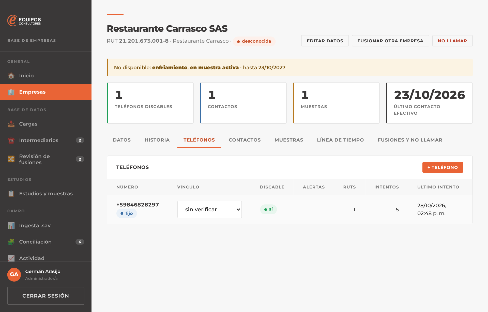

La pestaña **Línea de tiempo** junta todo lo que pasó con la empresa, del más reciente al más viejo: llamadas del CDR (con disposición, duración y encuestador), resultados de cada parte, cambios de datos, cambios de estado de teléfonos, muestras en las que salió y pedidos de no llamar.

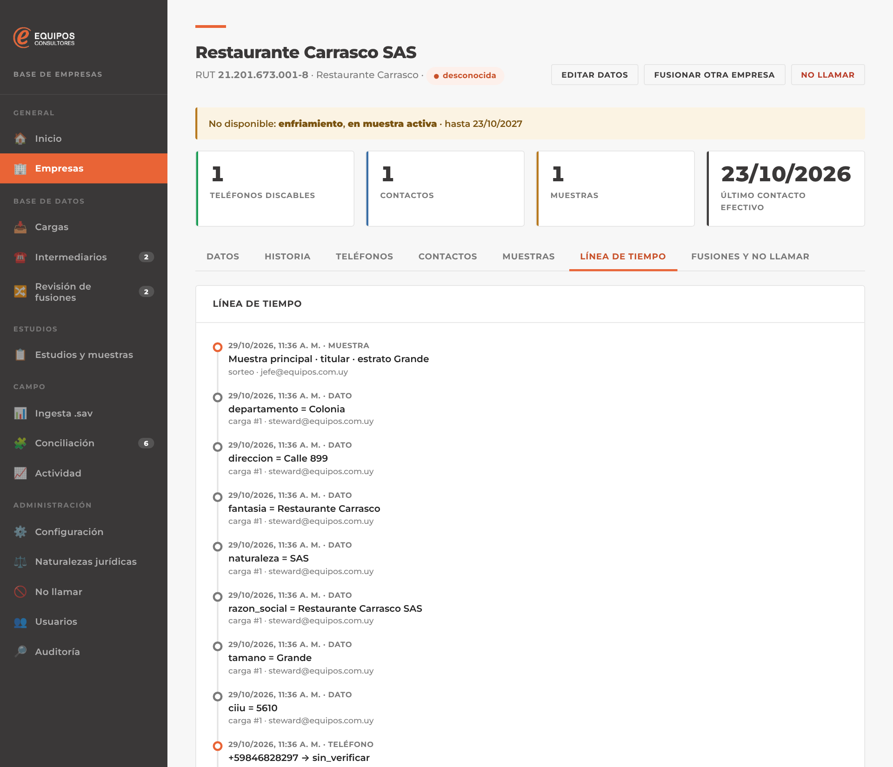

Las pestañas **Contactos**, **Muestras** y **Fusiones y no llamar** completan la ficha. Los contactos son datos personales (Ley 18.331): el rol Lectura los ve ocultos.

### Acciones del data steward en la ficha

- **Editar datos:** corrige campos con fuente "manual". Se registran solo los campos que cambiás; indicá el motivo.
- **Fusionar otra empresa:** cuando dos RUTs son la misma empresa, escribí el RUT de la que se absorbe. Sus teléfonos, contactos y sucursales pasan a esta; la absorbida queda guardada como "fusionada" y la fusión se puede **deshacer** desde la pestaña Fusiones.
- **No llamar** (también administrador): registra un pedido de no llamar con motivo y quién lo pidió. Se respeta en todas las muestras y CSV desde ese momento.

## Data steward

### Cargar una base

Las bases (estudios anteriores, padrones, directorios) entran por **Cargas → Nueva carga**. Se aceptan .xlsx, .csv y .sav de hasta 30 MB. Nada se escribe en la base hasta que confirmes.

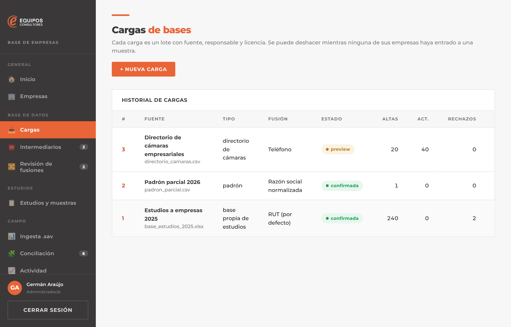

**Paso 1 — Archivo.** Arrastrá el archivo e indicá el **tipo de fuente** (por ejemplo, "padrón DGI" o "directorio de cámaras"). El mapeo de columnas se guarda como plantilla de ese tipo y se reusa la próxima vez.

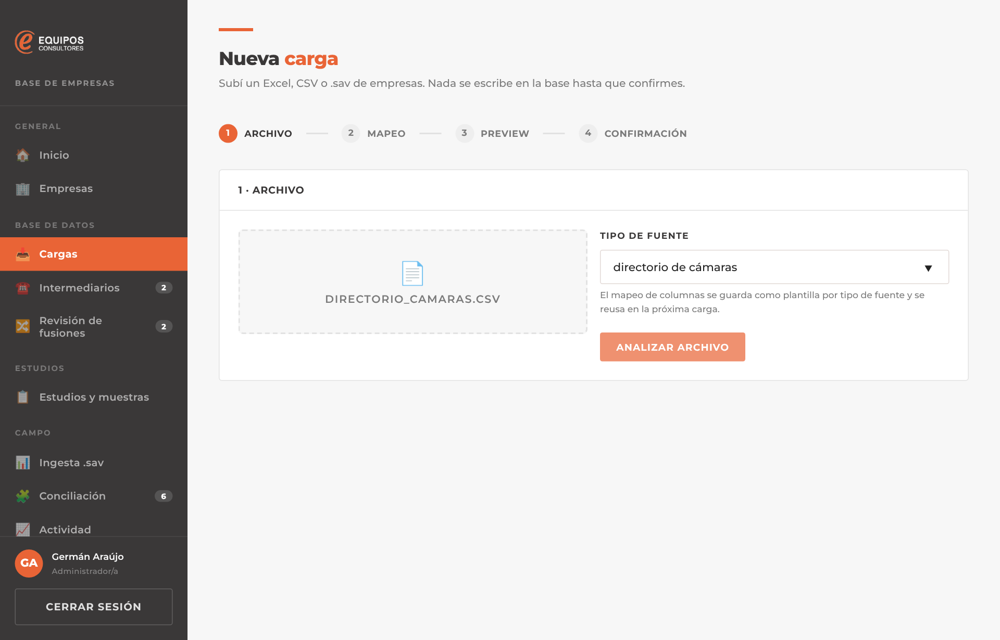

**Paso 2 — Mapeo.** El sistema propone qué columna del archivo va a cada campo de la base (por el nombre de la columna, o por la plantilla si ya existe). Revisalo: el RUT es obligatorio; las columnas de teléfono se marcan con los botones de la derecha (una celda puede traer varios números separados por / ; o ,). Completá además:

- **Nombre de la fuente** y **licencia de uso** (obligatoria: de dónde salió la base y para qué se puede usar).
- **Regla de fusión:** RUT por defecto. Con teléfono, razón social normalizada o dominio web, las filas cuyo RUT no existe pero que coinciden con una empresa por ese criterio no se dan de alta: van a **Revisión de fusiones**.
- **Confianza** de la fuente (0 a 100): decide qué dato gana cuando dos fuentes no coinciden.

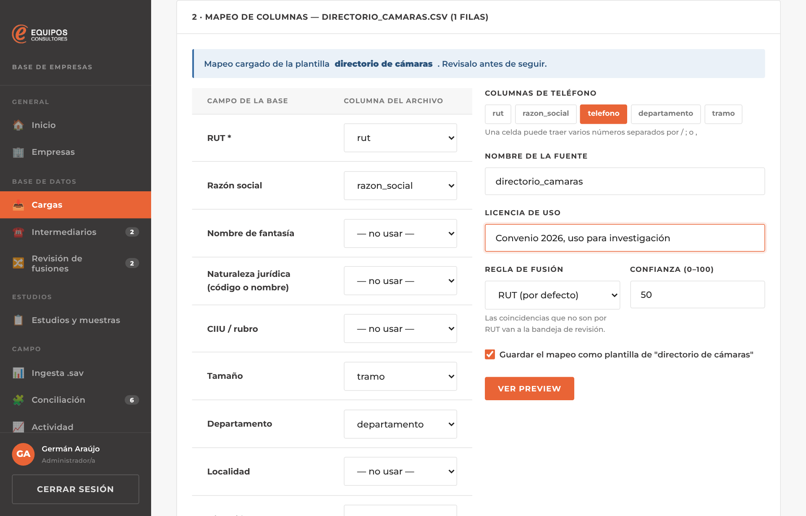

**Paso 3 — Preview.** Tocá **Ver preview**. El sistema procesa el archivo completo sin guardar nada y muestra los conteos reales: altas, actualizaciones, sin cambios, conflictos, rechazos, filas a revisión, nuevos teléfonos sospechosos de intermediario, teléfonos y contactos nuevos. Abajo están los rechazos por motivo (RUT inválido, sin RUT…), ejemplos de conflictos (el dato vigente, de qué fuente es y lo que llegó) y la lista de filas rechazadas.

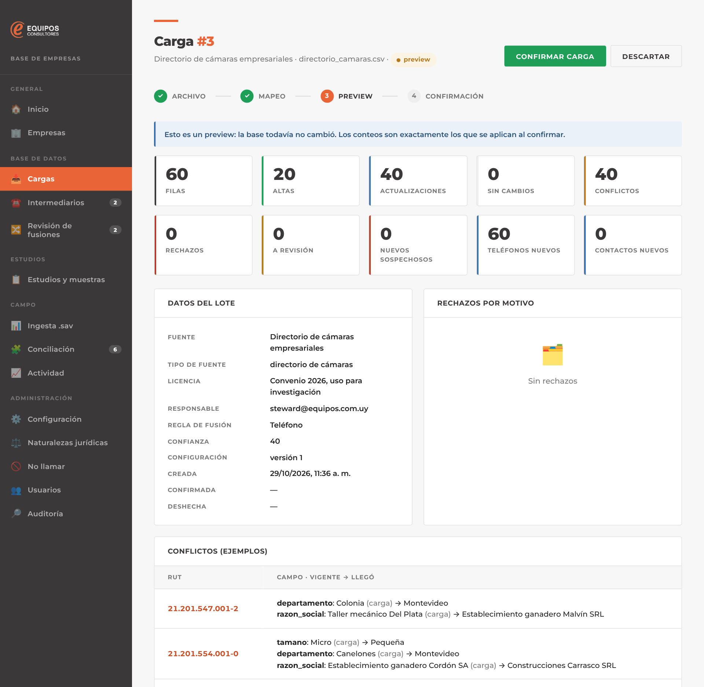

**Paso 4 — Confirmar o descartar.** **Confirmar carga** aplica exactamente lo que mostró el preview (en diferido, con una barra de avance). **Descartar** deja la base como estaba.

> **Deshacer una carga.** Desde el detalle de una carga confirmada, **Deshacer carga** anula todo lo que trajo, mientras ninguna de sus empresas haya entrado a una muestra. La historia no se borra: queda tachada.

Las filas con RUT inválido o sin RUT se rechazan siempre (en la fase 1 toda empresa entra con RUT válido). El motivo queda en el detalle de la carga.

### Intermediarios

Un teléfono vinculado a 5 RUTs o más (el umbral se configura) queda **sospechoso de intermediario**: normalmente es el número de un estudio contable o jurídico que figura en muchas empresas. Mientras esté sospechoso no sale en ningún CSV.

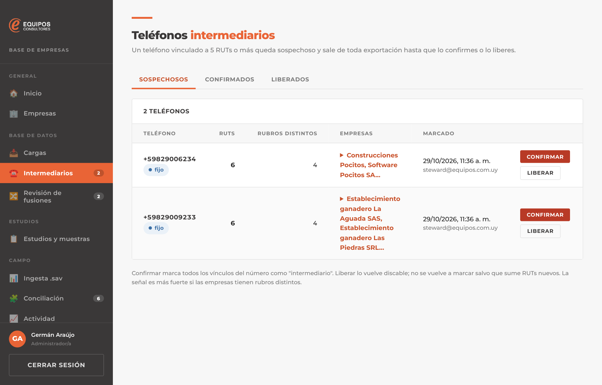

Para cada sospechoso ves cuántos RUTs lo comparten, de cuántos rubros distintos son (muchos rubros es una señal fuerte) y la lista de empresas. Entonces:

- **Confirmar:** marca todos sus vínculos como intermediario. No se vuelve a llamar.
- **Liberar:** si es un número legítimo (por ejemplo, la central de un grupo económico). Vuelve a ser discable y no se marca de nuevo salvo que aparezcan RUTs nuevos con ese número.

La sala también confirma intermediarios: cuando el encuestador responde "estudio contable o jurídico" en la pregunta de calidad del número.

### Revisión de fusiones

Cuando una carga usa una regla de fusión distinta del RUT, las filas que coinciden con una empresa existente (mismo teléfono, misma razón social o mismo dominio, pero otro RUT) esperan acá.

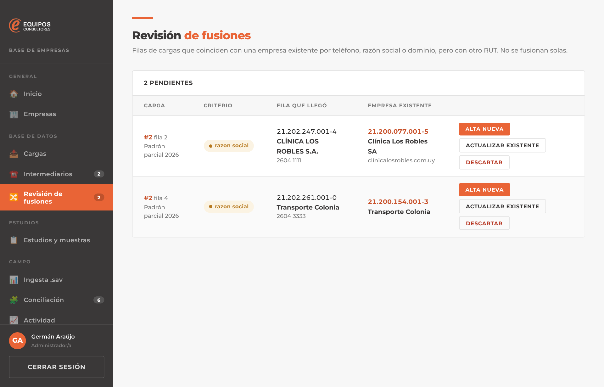

Comparás la fila que llegó con la empresa existente y elegís: **Alta nueva** (es otra empresa, se crea con su RUT), **Actualizar existente** (los datos se aplican a la empresa que ya estaba) o **Descartar**.

## Jefe de proyecto

### Estudios y partes

En **Estudios y muestras → Nuevo estudio** cargás nombre, cliente y fechas de campo, y la primera parte. Las fechas de campo importan: solo las llamadas dentro de ese período se asocian a los ítems de la muestra.

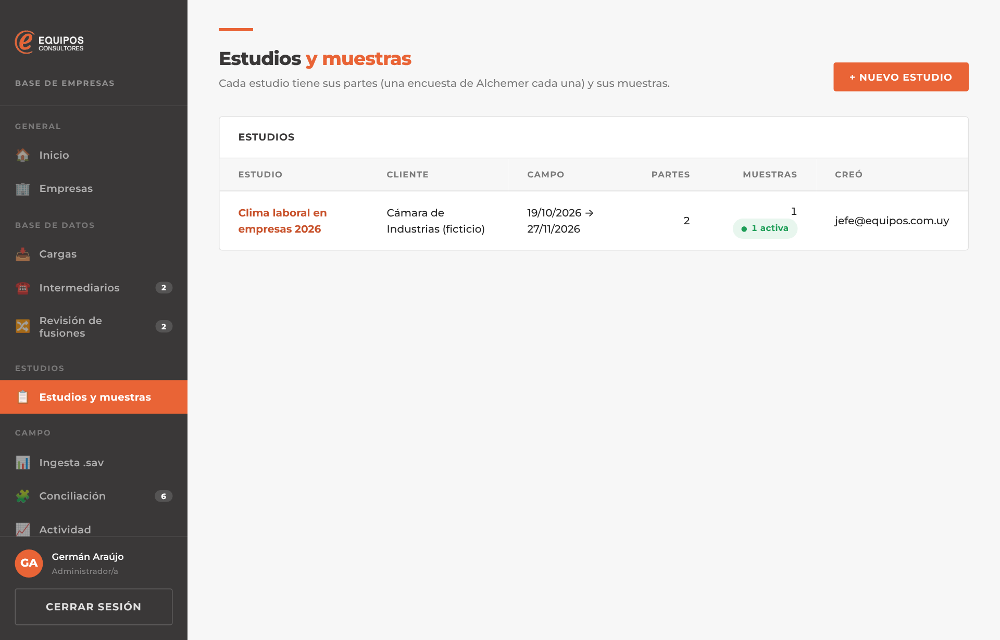

Cada **parte** es una encuesta de Alchemer con su survey ID, su link base y su respondente objetivo (área o cargo, por ejemplo "RRHH"). El respondente objetivo se usa para sugerir el contacto en el CSV. En el estudio ves sus partes (con cuántos ítems hay en cada estado) y sus muestras.

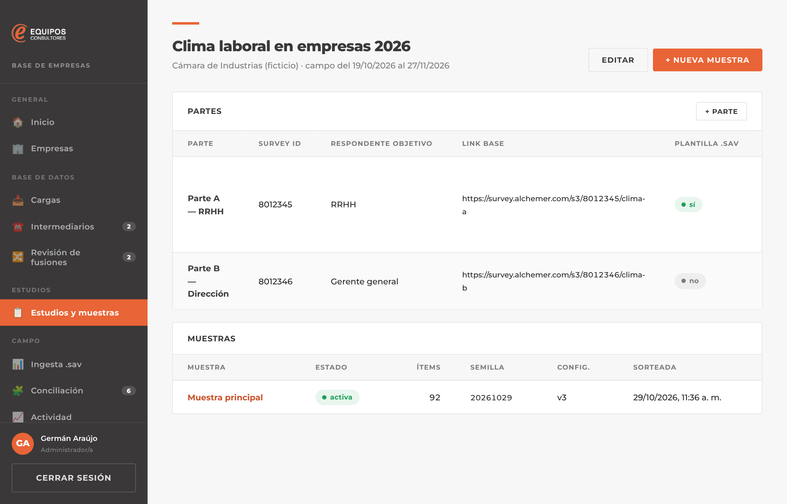

### Sortear una muestra

Desde el estudio, **Nueva muestra**:

1. **Filtros:** tamaño, departamento, naturaleza jurídica y prefijos de CIIU. Sin filtros entra toda la base disponible.
2. **Estratos:** elegí por qué estratificar (tamaño, departamento, naturaleza, CIIU a 1 o 2 dígitos) y tocá **Ver marco disponible**. El sistema muestra cuántas empresas cumplen los filtros, cuántas están disponibles y cuántas excluye cada regla.
3. **Tamaño por estrato:** titulares y reemplazos de cada estrato (con "Aplicar a todos" para cargarlos de una vez). Opcionalmente, una semilla.

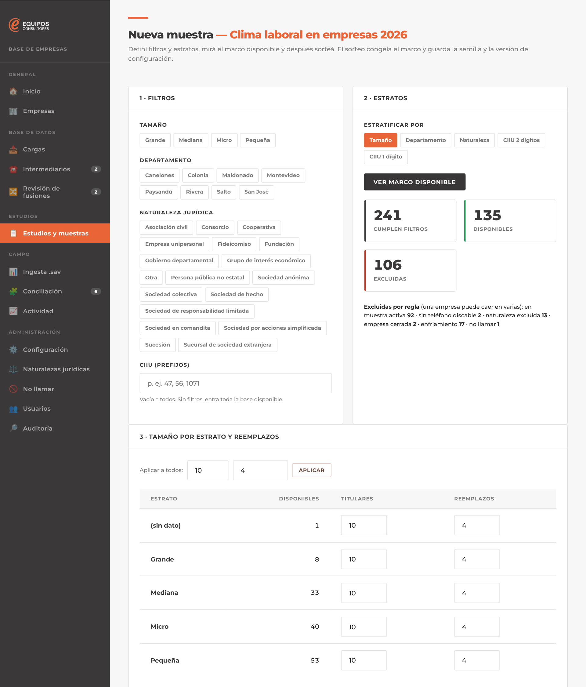

Al tocar **Crear y sortear** el sistema congela el marco (snapshot), aplica las reglas de la configuración vigente, sortea dentro de cada estrato y guarda la semilla y la versión de configuración. Los titulares quedan liberados; los reemplazos, en reserva y en orden.

> **Muestras auditables.** Con la misma semilla, el mismo snapshot y la misma configuración, el sorteo da exactamente la misma lista en el mismo orden. El botón **Verificar reproducibilidad** lo comprueba en cualquier momento.

### Seguir la muestra

La pantalla de la muestra muestra los totales, las exclusiones del sorteo, los avisos (por ejemplo, "el estrato Grande no alcanza: pidió 10 y hay 8 disponibles"), el **avance por estrato** (llamados, contactabilidad, completas, tasa de respuesta, rechazos, fuera de marco) y la lista de ítems con su estado en cada parte.

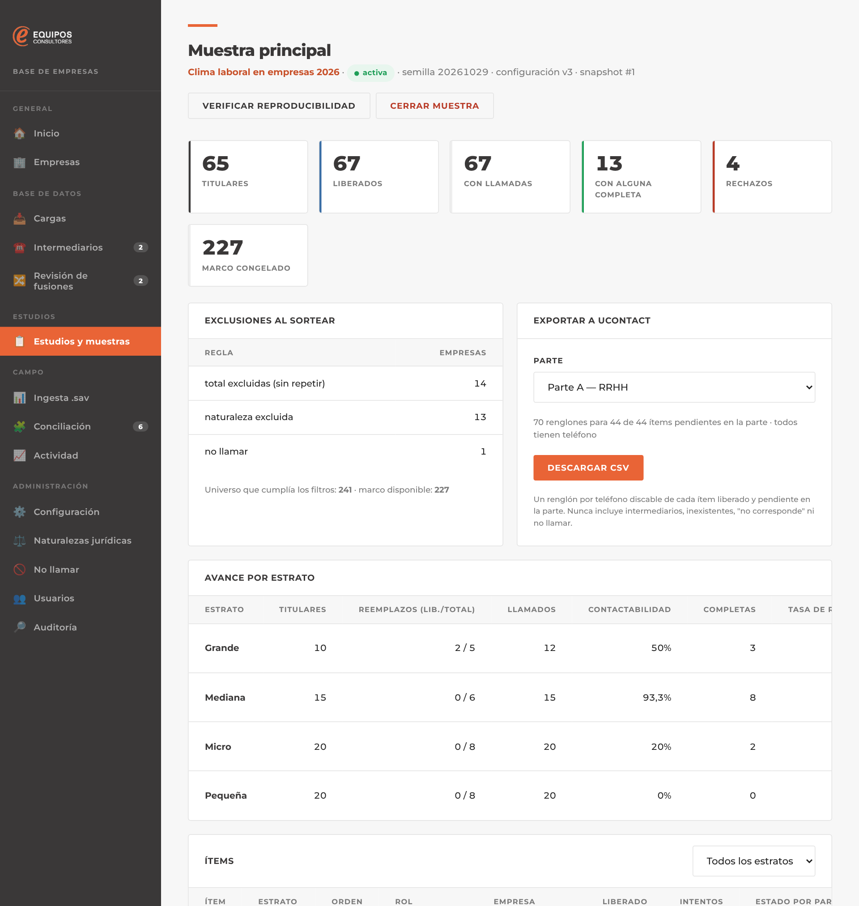

Mientras la muestra está activa, sus empresas no pueden salir en otra muestra. **Cerrar muestra** las libera y deja de permitir exportaciones.

### Liberar reemplazos

Cuando un estrato tiene bajas (rechazos, fuera de marco), tocá **Liberar reemplazos** en ese estrato, indicá cuántos y el motivo. Se liberan en el orden sorteado y queda registrado quién y por qué.

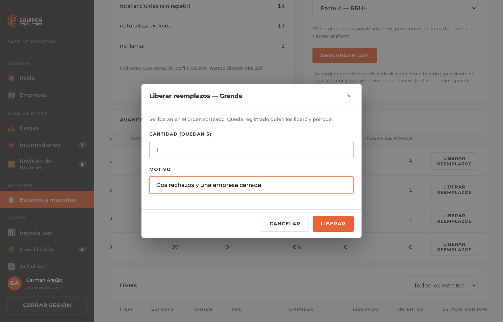

## Coordinador de campo

### Exportar el CSV para uContact

En la muestra, en **Exportar a uContact**, elegí la parte y tocá **Descargar CSV**. El resumen dice cuántos renglones salen, para cuántos ítems, y si algún ítem pendiente no tiene teléfono discable.

- Sale un renglón por cada teléfono discable de cada ítem liberado que esté pendiente o en curso en esa parte.
- Nunca salen intermediarios, números inexistentes o que no corresponden, ni nada en no llamar, aunque el pedido haya llegado después del sorteo.
- El link de Alchemer ya trae `EC_ID_ITEM`, `EC_RUT` y `EC_TEL_USADO`.
- La columna de contacto sugerido solo se completa si tu usuario tiene permiso para exportar contactos personales. Toda exportación queda auditada.

### Bloque estándar en Alchemer

Para que el .sav se asocie solo y actualice la base, cada cuestionario tiene que tener estas variables (el detalle de cómo armarlas está en `fase0/alchemer_bloque_estandar.md`):

| Variable | Qué es |
| --- | --- |
| `EC_ID_ITEM`, `EC_RUT` | URL variables ocultas que vienen en el link del CSV |
| `EC_TEL_USADO` | El teléfono con el que se hizo la encuesta (URL variable o pregunta) |
| `EC_CALIDAD_TEL` | 1 corresponde · 2 no es de la empresa · 3 estudio contable o jurídico · 4 la empresa cerró · 5 inexistente |
| `EC_TEL_ALT` | Número alternativo que dieron |
| `EC_RESP_NOMBRE`, `EC_RESP_CARGO`, `EC_RESP_AREA` | Quién contestó |
| `EC_RESULTADO` | 1 completa · 2 rechazo · 3 no corresponde · 4 agendada |

### Ingerir el .sav

Cuando cerrás una parte u ola, exportá el .sav de Alchemer y entrá a **Ingesta .sav**:

1. Elegí el estudio y la parte. Si es la segunda ola de un cuestionario que ya se usó en otro estudio, podés reusar el mapeo de esa otra parte.
2. Subí el .sav y tocá **Analizar**. El sistema lee el archivo y **propone** el mapeo: cuál es el `response_id`, cuál es el identificador (`EC_ID_ITEM` o RUT), qué variable corresponde a cada dato del sistema y, para las variables con códigos, qué valor del sistema corresponde a cada código.

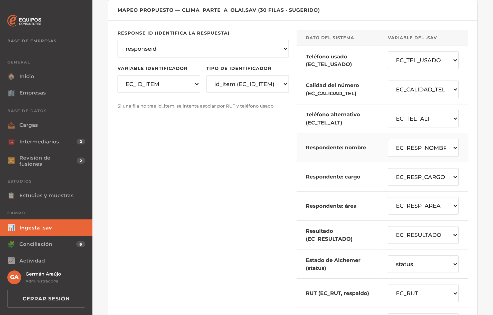

3. Revisá los **conteos**: filas asociadas a un ítem de la muestra, sin asociar (con motivo) y los valores sin mapear ("el 9 quedó sin mapear: 3 filas"). Si un código no tiene que hacer nada (por ejemplo, 9 = no sabe), mapealo a **ignorar**. Tocá **Recontar** después de cada cambio.

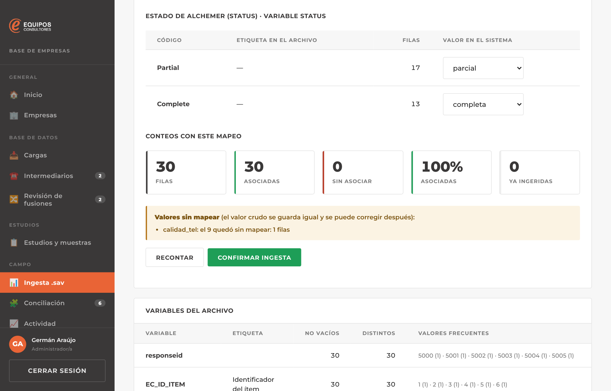

4. **Confirmar ingesta.** Recién ahí se aplica, en diferido. El mapeo queda como plantilla de la parte y se precarga en el próximo .sav.

Qué cambia en la base al confirmar:

| En el .sav | Cambio en la base |
| --- | --- |
| `EC_CALIDAD_TEL` = corresponde | El vínculo del teléfono usado pasa a **verificado** |
| = no es de la empresa / inexistente | El vínculo pasa a **no corresponde** / **inexistente**; deja de exportarse |
| = estudio contable o jurídico | El teléfono queda como **intermediario confirmado** |
| = la empresa cerró | La empresa pasa a **cerrada** (dato de la sala: una carga no lo pisa) |
| `EC_TEL_ALT` | Teléfono nuevo vinculado a la empresa, sin verificar, fuente "sala" |
| `EC_RESP_*` | Contacto nuevo o actualizado con su cargo y área |
| `EC_RESULTADO` | Estado del ítem en la parte (completa, rechazo, fuera de marco, en curso) |
| Completa, parcial o rechazo | Fecha de **último contacto efectivo** (de ahí se cuenta el enfriamiento) |

Cada cambio queda con su linaje: estudio, parte, ingesta, encuestador y fecha.

> **Subir el mismo .sav dos veces no duplica nada**: las respuestas se identifican por `response_id`. Podés subir el archivo acumulado de la parte cada vez que quieras.

### Corregir un mapeo

Si después de confirmar te das cuenta de que un código estaba mal mapeado, abrí la ingesta y tocá **Corregir mapeo**. Se reaplica sobre los valores crudos guardados, sin volver a subir el archivo.

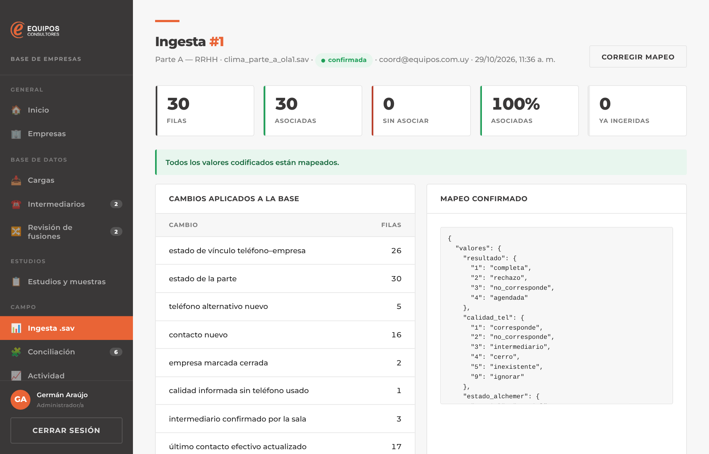

### Conciliación

Lo que no se pudo asociar solo espera en **Conciliación**:

- **Filas del .sav** sin ítem (por ejemplo, un `EC_ID_ITEM` mal escrito o un RUT que no está en la muestra). Podés ver los valores crudos y asociarla a un ítem; al hacerlo, sus resultados se aplican a la base.
- **Llamadas del CDR** cuyo número corresponde a más de un ítem de muestras activas (un número compartido). Elegís a qué ítem corresponde.

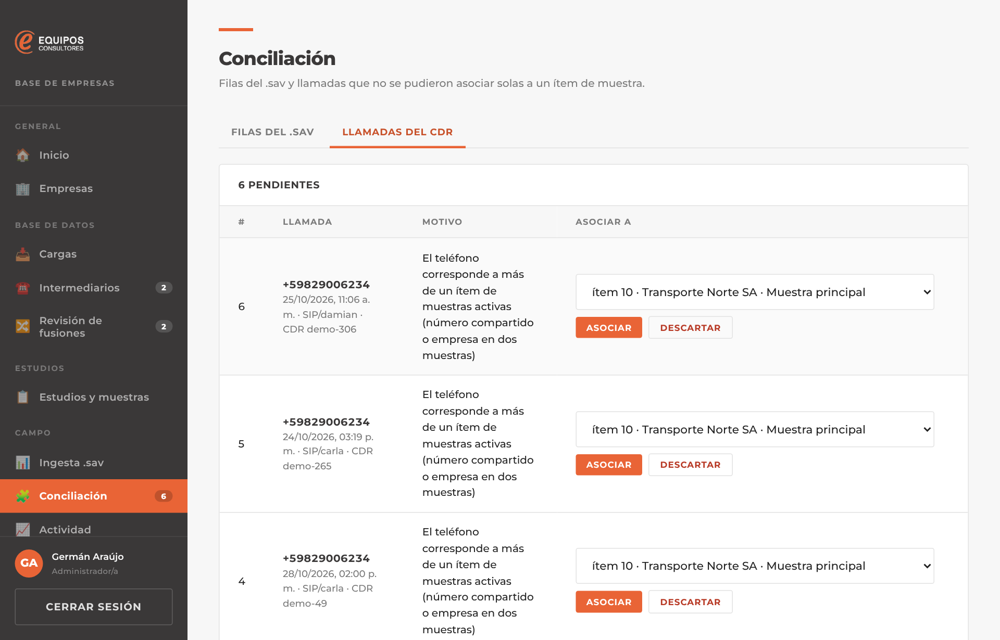

### Actividad

**Actividad** muestra, filtrando por estudio, muestra, encuestador y período: intentos, teléfonos marcados, empresas llamadas, contactos efectivos, completas y qué porcentaje de las llamadas quedó asociado a un ítem; intentos por franja horaria y por día; una tabla por encuestador (intentos, teléfonos, contactos efectivos, completas, intentos por completa); las disposiciones de llamada y los lotes del CDR recibidos.

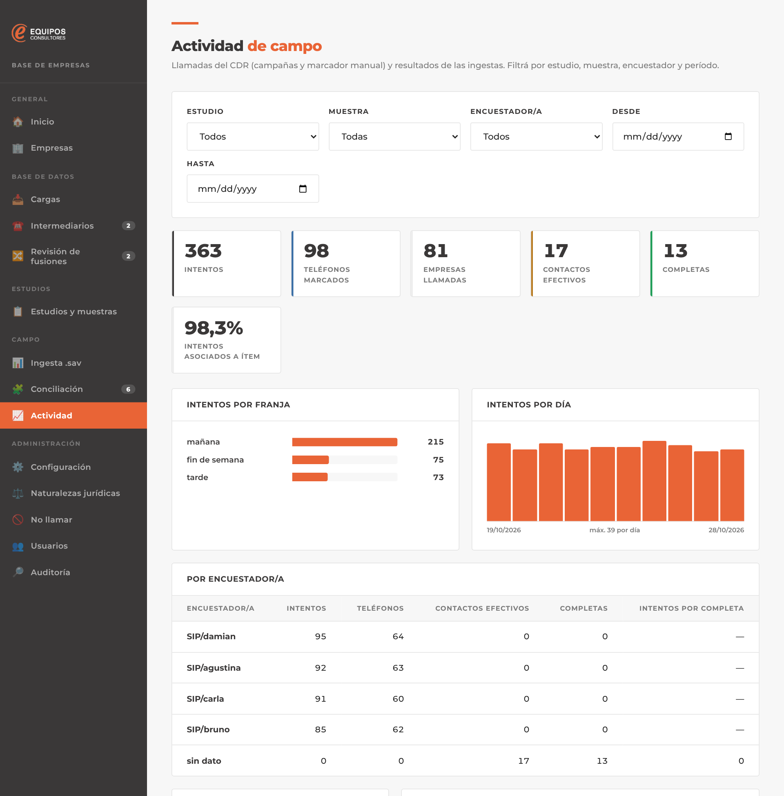

El CDR se procesa cada noche a las 4:00 e incluye las llamadas de campaña **y** las del marcador manual: se reconocen por el número marcado, no por la campaña. Las llamadas a internos y a números que no están en la base se cuentan pero no se guardan.

## Administrador

### Configuración

Todos los parámetros de negocio están en **Configuración** y se cambian sin pedir nada a un desarrollador. Cada vez que guardás se crea una versión nueva con tu nombre, la fecha y un comentario; las muestras guardan la versión con la que se sortearon.

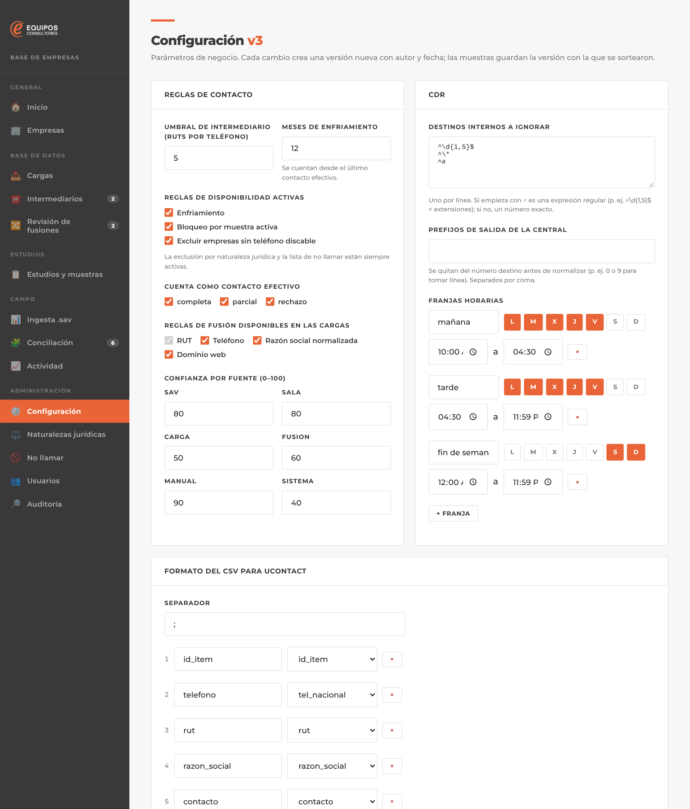

| Parámetro | Para qué sirve |
| --- | --- |
| Umbral de intermediario | Cuántos RUTs con el mismo teléfono lo vuelven sospechoso (5 por defecto) |
| Meses de enfriamiento | Cuánto tiempo después de un contacto efectivo una empresa no puede volver a sortearse |
| Reglas de disponibilidad | Activar o desactivar enfriamiento, bloqueo por muestra activa y exclusión de empresas sin teléfono discable. La naturaleza excluida y no llamar están siempre activas |
| Contacto efectivo | Qué resultados cuentan para el enfriamiento (completa, parcial, rechazo) |
| Reglas de fusión | Qué criterios se ofrecen en las cargas |
| Confianza por fuente | El peso de cada fuente en la regla de supervivencia |
| Destinos internos | Extensiones y números del CDR que se ignoran (uno por línea; los que empiezan con ^ son patrones) |
| Prefijos de salida | Dígitos que la central agrega para tomar línea y que hay que quitar |
| Franjas horarias | Nombre, días y horario de cada franja del tablero |
| Formato del CSV | Separador y columnas, para que coincida con la importación de uContact |

En el historial, tocá una versión para ver todos sus parámetros.

### Naturalezas jurídicas

El catálogo de naturalezas tiene la marca **excluida de contacto**. Las empresas de una naturaleza excluida se guardan y se siguen actualizando, pero nunca entran a un marco muestral ni a un CSV. Cambiar la marca crea una versión nueva de la configuración.

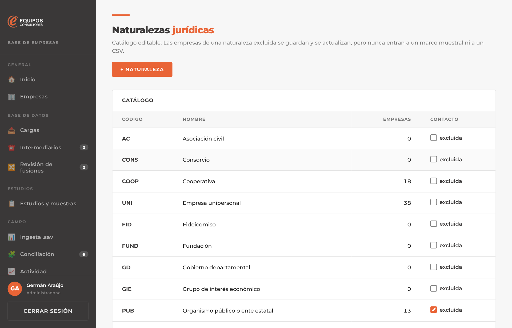

### No llamar

Registro de pedidos de no llamar por empresa (RUT), teléfono o contacto, con motivo, quién lo pidió y quién lo registró. Es el mecanismo para atender los derechos de supresión de la Ley 18.331. Un pedido se puede **levantar** (con motivo); el historial se conserva.

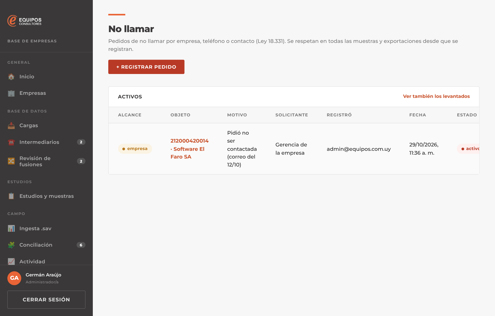

### Usuarios

Alta y edición de usuarios: email, nombre, rol, permiso para exportar contactos personales y si está activo. La persona tiene que existir también en Firebase Authentication con el mismo email (ver la guía de despliegue). No podés quitarte a vos mismo el rol de administrador.

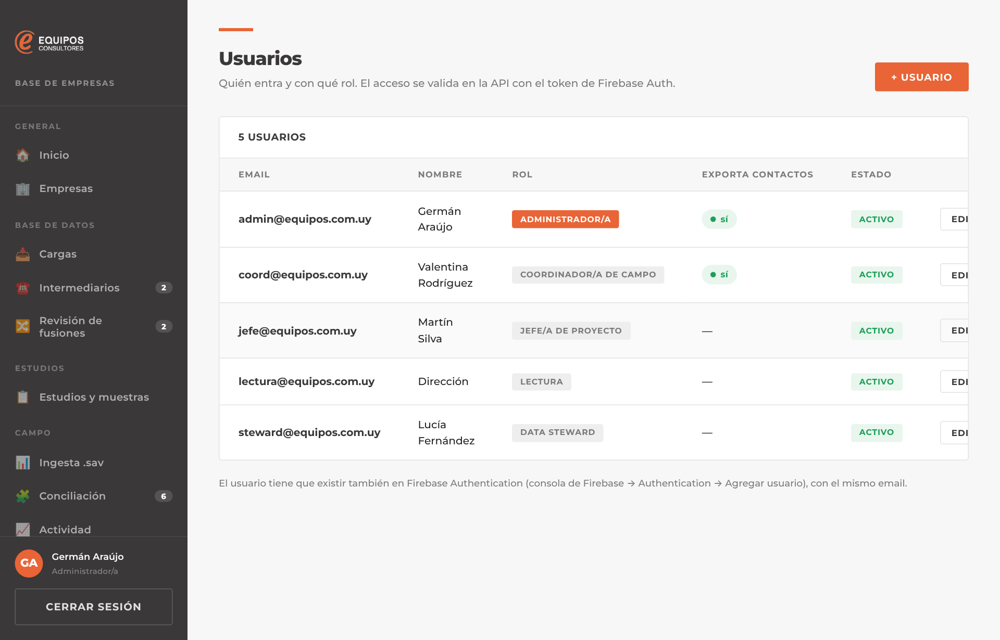

### Auditoría

Registro inalterable de cargas, fusiones, exclusiones, sorteos, exportaciones, ingestas, cambios de configuración y de usuarios. Se filtra por acción, objeto y actor; cada evento tiene su detalle. También se exporta todos los días a BigQuery para consultas largas.

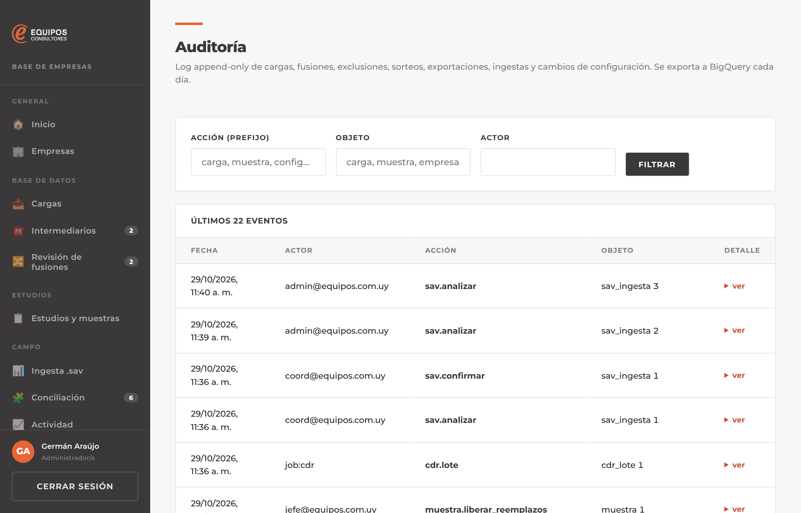

## Preguntas frecuentes

**¿Por qué una empresa no salió en la muestra?** Abrí su ficha: el aviso de disponibilidad dice qué regla la bloquea y hasta cuándo. En la muestra, el cuadro de exclusiones dice cuántas empresas sacó cada regla.

**El CSV tiene menos renglones de los que esperaba.** Solo salen teléfonos discables de ítems liberados y pendientes o en curso en esa parte. El resumen arriba del botón dice cuántos ítems no tienen teléfono discable.

**Una llamada manual, ¿cuenta?** Sí. El CDR se analiza por número marcado, venga de una campaña o del marcador manual.

**Subí el .sav y quedaron filas sin asociar.** Revisá el motivo en los conteos. Lo más común es que la encuesta no tenga la URL variable `EC_ID_ITEM`; en ese caso el sistema intenta por RUT y teléfono usado. Lo que no se resuelve va a Conciliación.

**Me equivoqué al cargar una base.** Si ninguna de sus empresas entró a una muestra, deshacé la carga desde su detalle. Si ya entraron, corregí los datos en la ficha o hacé una carga nueva con más confianza.

**¿Puedo volver a sortear una muestra?** Una muestra sorteada no se vuelve a sortear: se verifica. Si necesitás otra lista, cerrá la muestra y creá una nueva.

**Un número que confirmé como intermediario era legítimo.** En Intermediarios → Confirmados, tocá **Liberar**.

## Glosario

| Término | Significado |
| --- | --- |
| Ítem de muestra | Una empresa sorteada en una muestra, con su estrato, rol (titular o reemplazo) y orden |
| Parte | Una encuesta de Alchemer dentro de un estudio, con su respondente objetivo |
| Marco | Las empresas disponibles que cumplen los filtros al momento de sortear |
| Snapshot | Copia congelada del marco con la que se sorteó; permite reproducir la muestra |
| Semilla | Número que fija el sorteo: misma semilla y mismo marco dan la misma lista |
| Teléfono discable | Número válido, no intermediario, con vínculo sin verificar o verificado, y fuera de no llamar |
| Intermediario | Teléfono que no es de la empresa sino de un tercero (estudio contable o jurídico) compartido por muchos RUTs |
| Contacto efectivo | Encuesta completa, parcial o rechazo explícito de la empresa |
| Enfriamiento | Período después de un contacto efectivo en el que la empresa no se vuelve a sortear |
| Linaje | Registro de de dónde salió cada dato: fuente, lote, fecha, actor y confianza |
| Conciliación | Asociación manual de una respuesta o una llamada que el sistema no pudo asociar solo |
| CDR | Registro de llamadas de uContact |
